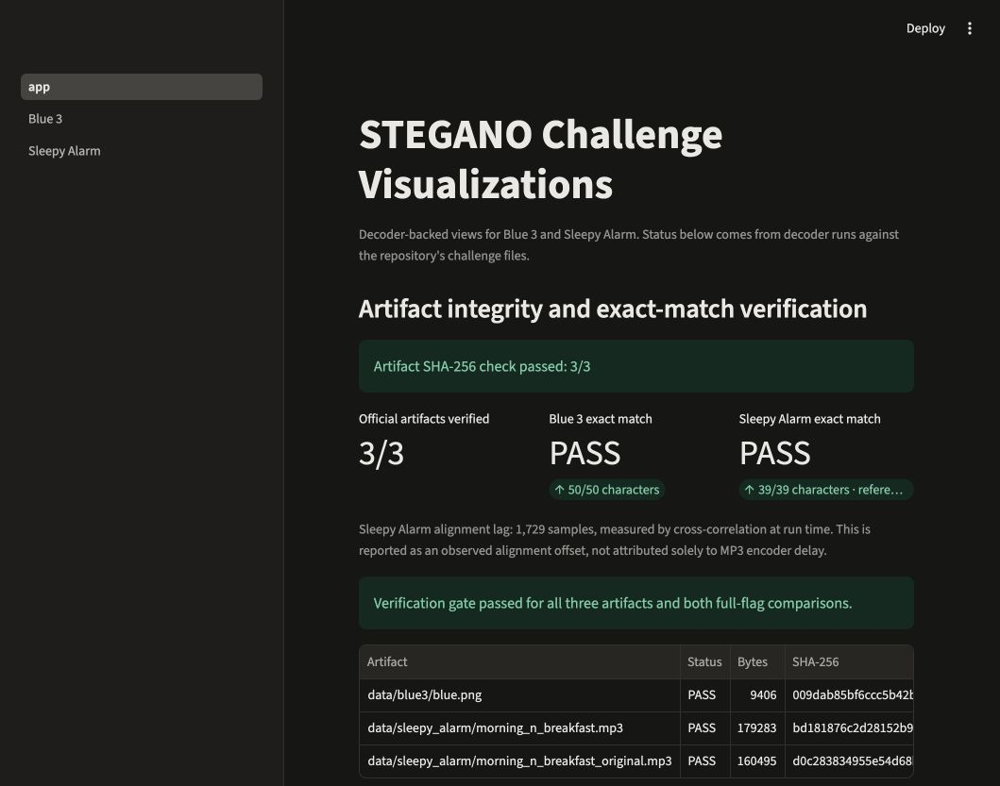
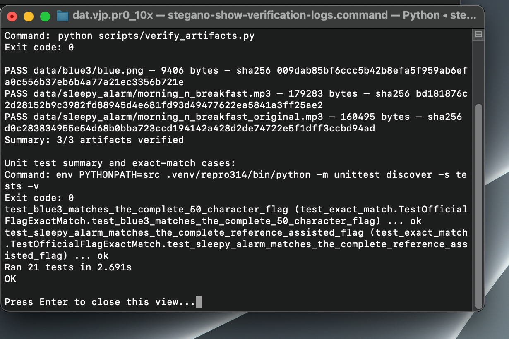
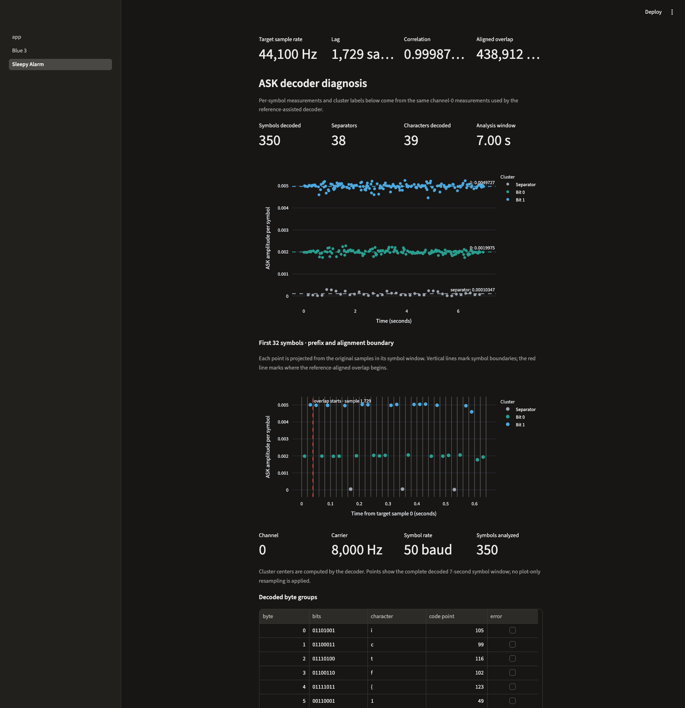
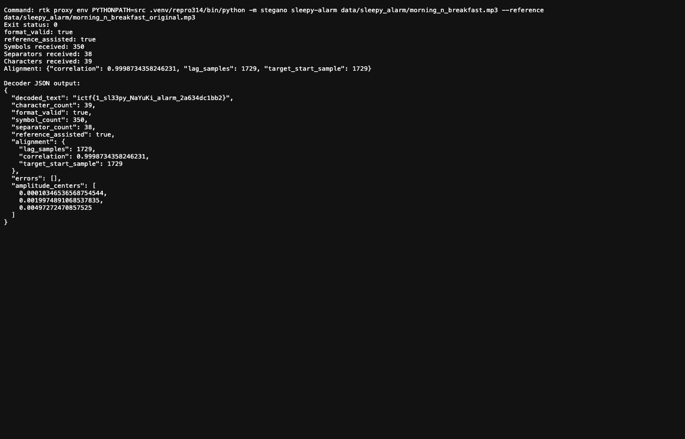

# Appendix A — Detailed experiment and evidence record

This appendix expands the dated entries in [`LOGBOOK.md`](../LOGBOOK.md) and maps them to the methods and results in [`REPORT.md`](REPORT.md). It is intended to make each recorded action, command, observation, and evidence item easier to trace.

The appendix expands each logbook entry with its technical hypothesis, commands, results, evidence, and estimated work duration. “No error recorded” means no error appears in that entry, not that no error occurred. Where an exact historical command was not recorded, the replay instructions in [`README.md`](../README.md) are identified separately.

## A.1 Cross-reference index

| Logbook entry | Appendix detail | Report section |
|---|---|---|
| [Entry 00](../LOGBOOK.md#entry-00) — environment | [A.2](#app-a2-environment-setup) | [§3 Environment](REPORT.md#report-environment) |
| [Entry 01](../LOGBOOK.md#entry-01) — Blue 3 | [A.3](#app-a3-blue-3-extraction) | [§4.1](REPORT.md#report-method-image), [§6.1](REPORT.md#report-blue3) |
| [Entry 02](../LOGBOOK.md#entry-02) — reference-assisted audio | [A.4](#app-a4-sleepy-alarm-reference-assisted) | [§4.2](REPORT.md#report-method-audio), [§6.2](REPORT.md#report-audio-assisted) |
| [Entry 03](../LOGBOOK.md#entry-03) — reference-free audio | [A.5](#app-a5-sleepy-alarm-reference-free) | [§6.3](REPORT.md#report-audio-free), [§8](REPORT.md#report-limitations) |
| [Entry 04](../LOGBOOK.md#entry-04) — initial tests | [A.6](#app-a6-initial-automated-tests) | [§6.4](REPORT.md#report-tests) |
| [Entry 05](../LOGBOOK.md#entry-05) — input hashes | [A.7](#app-a7-input-artifact-integrity) | [§6.5](REPORT.md#report-integrity) |
| [Entry 06](../LOGBOOK.md#entry-06) — first visualizer | [A.8](#app-a8-first-visualizer-verification) | [§5 Workflow](REPORT.md#report-workflow) |
| [Entry 07](../LOGBOOK.md#entry-07) — alignment regression | [A.9](#app-a9-audio-alignment-regression) | [§6.4](REPORT.md#report-tests) |
| [Entry 08](../LOGBOOK.md#entry-08) — correlation diagnostics | [A.10](#app-a10-correlation-diagnostics) | [§4.2](REPORT.md#report-method-audio) |
| [Entry 09](../LOGBOOK.md#entry-09) — visual evidence | [A.11](#app-a11-alignment-visual-evidence) | [§5 Workflow](REPORT.md#report-workflow) |
| [Entry 10](../LOGBOOK.md#entry-10) — ASK and Blue 3 diagnostics | [A.12](#app-a12-ask-and-blue-3-diagnostics) | [§4.1](REPORT.md#report-method-image), [§4.2](REPORT.md#report-method-audio) |
| [Entry 11](../LOGBOOK.md#entry-11) — artifact integrity and exact match | [A.14](#app-a14-artifact-integrity-and-exact-match) | [§3 Analysis](REPORT.md) |
| [Entry 12](../LOGBOOK.md#entry-12) — ASK prefix preservation and reproduction | [A.15](#app-a15-ask-prefix-preservation-and-reproduction) | [§2.2 Method](REPORT.md#report-method-audio), [§3 Analysis](REPORT.md) |

<a id="app-a2-environment-setup"></a>
## A.2 Environment setup

**Source:** [Logbook Entry 00](../LOGBOOK.md#entry-00) · [Report §3](REPORT.md#report-environment)

**Technical hypothesis:** the declared project dependencies install and import successfully in the recorded Python environment.

| Item | Recorded detail |
|---|---|
| Date | 16 November 2026; setup re-run on 18 November at 15:06:20–15:07:36 (+07) |
| Platform | macOS, MacBook Air |
| Python / environment | Python 3.14.10; isolated `.venv/repro314` used for the 18 November rerun |
| Setup actions | Separate virtual environment created; pip upgrade attempt failed on DNS and remained at 26.2.2; dependencies installed from `requirements.txt`; `pip freeze` generated |
| Packages listed | NumPy 2.5.5, Pillow 13.0.0, SciPy 1.18.1, SoundFile 0.14.0, cffi 2.1.1, pycparser 3.12, typing-extensions 4.16.0 |
| Import observation | NumPy, Pillow, SciPy, and SoundFile imports reported successful |
| Error / correction | No error or corrective action recorded |
| Saved evidence | [`environment-freeze.txt`](../../evidence/results/logs/environment-freeze.txt) |

The logbook does not preserve a complete terminal transcript for the original installation. The exact setup commands for replay are in [README — Environment setup](../README.md#environment-setup); they should not be mistaken for a verbatim transcript of the original session. The dependency freeze records package versions.

**Environment re-setup — 18 November 2026:** the pre-existing `.venv` used Python 3.9.6, below the README's Python 3.10 minimum. A separate `.venv/repro314` was created with Python 3.14.10. Commands were `rtk python3.14 -m venv .venv/repro314`, `rtk proxy .venv/repro314/bin/python -m pip install --upgrade pip`, `rtk proxy .venv/repro314/bin/python -m pip install -r requirements.txt`, and `rtk proxy .venv/repro314/bin/python -m pip check`. The pip upgrade attempt hit a DNS failure resolving `pypi.org`, leaving pip at 26.2.2; requirements installed successfully and `pip check` found no broken requirements. Pip disabled its unwritable user cache. The setup interval is 15:06:20–15:07:36 (+07), with venv creation immediately before the start marker. Logs: [setup-time.txt](../results/reproduction-2026-11-18/setup-time.txt), [setup-end.txt](../results/reproduction-2026-11-18/setup-end.txt), [pip-upgrade.log](../results/reproduction-2026-11-18/pip-upgrade.log), [pip-install.log](../results/reproduction-2026-11-18/pip-install.log), [environment-check.log](../results/reproduction-2026-11-18/environment-check.log), [environment-freeze.txt](../results/reproduction-2026-11-18/environment-freeze.txt), and [pip-check.log](../results/reproduction-2026-11-18/pip-check.log).

**Terminal screenshot — 18 November 2026, 16:12:56 (+07):** Python 3.14.10, the requirements installation check, and the clean `pip check` result are shown in [the setup/configuration capture](../evidence/terminal/2026-11-18-setup-terminal.png).

<a id="app-a3-blue-3-extraction"></a>
## A.3 Blue 3 extraction

**Source:** [Logbook Entry 01](../LOGBOOK.md#entry-01) · [Report §4.1](REPORT.md#report-method-image) · [Report §6.1](REPORT.md#report-blue3)

**Technical hypothesis:** diagonal RGB differences from the image yield a candidate accepted by the challenge flag-format check.

| Item | Recorded detail |
|---|---|
| Date | 16 November 2026; rerun on 18 November at 15:08:05–15:08:53 (+07) |
| Input | `data/blue3/blue.png` |
| Command reported | `PYTHONPATH=src python -m stegano blue3 data/blue3/blue.png` |
| Output | `byuctf{more_blue_steganography_da_ba_dee_nkiY9CyP}` |
| Validation | `format_valid: true`; 50 characters; exit code 0 |
| Error / correction | No error or correction recorded |
| Saved output | [`decoder-output.txt`](../../evidence/results/blue3/decoder-output.txt) |

The saved output shows candidate attempts for lengths 2 through 50; the accepted 50-character candidate closes with `}`. This is evidence for this supplied image and implementation, not a general image steganalysis result.

**Re-executed — 18 November 2026, 15:08:05–15:08:53 (+07):** `rtk proxy env PYTHONPATH=src .venv/repro314/bin/python -m stegano blue3 data/blue3/blue.png` returned the same valid 50-character flag; exit code 0. Output: [blue3.log](../results/reproduction-2026-11-18/blue3.log).

**Terminal screenshot — 18 November 2026, 16:13:32 (+07):** a later run shows the command and accepted candidate: [Blue 3 capture](../evidence/terminal/2026-11-18-blue3-terminal.png).

<a id="app-a4-sleepy-alarm-reference-assisted"></a>
## A.4 Sleepy Alarm — reference-assisted extraction

**Source:** [Logbook Entry 02](../LOGBOOK.md#entry-02) · [Report §4.2](REPORT.md#report-method-audio) · [Report §6.2](REPORT.md#report-audio-assisted)

**Technical hypothesis:** aligning and subtracting the original recording reveals a valid payload in the target.

| Item | Recorded detail |
|---|---|
| Date | 16 November 2026; rerun on 18 November at 15:08:05–15:08:53 (+07) |
| Target | `data/sleepy_alarm/morning_n_breakfast.mp3` |
| Reference | `data/sleepy_alarm/morning_n_breakfast_original.mp3` |
| Command reported | `PYTHONPATH=src python -m stegano sleepy-alarm data/sleepy_alarm/morning_n_breakfast.mp3 --reference data/sleepy_alarm/morning_n_breakfast_original.mp3` |
| Output | `ictf{1_sl33py_NaYuKi_alarm_2a634dc1bb2}` |
| Decoder metrics | 350 symbols; 38 separators; lag/start 1,729 samples; normalized correlation 0.9998734358246231; no byte errors |
| Amplitude centers | 0.00010346536568754544; 0.0019974891068537835; 0.00497272470857525 |
| Validation | `format_valid: true`; exit code 0 |
| Error / correction | No error or correction recorded |
| Saved output | [`reference-assisted-output.json`](../../evidence/results/sleepy_alarm/reference-assisted-output.json) |

The reference input is part of the method. Therefore this result supports reference-assisted extraction only; it does not establish blind recovery.

**Re-executed — 18 November 2026, 15:08:05–15:08:53 (+07):** `rtk proxy env PYTHONPATH=src .venv/repro314/bin/python -m stegano sleepy-alarm data/sleepy_alarm/morning_n_breakfast.mp3 --reference data/sleepy_alarm/morning_n_breakfast_original.mp3` returned the same valid flag, 350 symbols, 38 separators, and exit code 0. Output: [sleepy-alarm-reference-assisted.log](../results/reproduction-2026-11-18/sleepy-alarm-reference-assisted.log).

**Terminal screenshot — 18 November 2026, 16:14:39 (+07):** a subsequent run shows the flag, valid format, symbol count, separator count, and no errors: [reference-assisted capture](../evidence/terminal/2026-11-18-audio-assisted-terminal.png).

<a id="app-a5-sleepy-alarm-reference-free"></a>
## A.5 Sleepy Alarm — reference-free extraction

**Source:** [Logbook Entry 03](../LOGBOOK.md#entry-03) · [Report §6.3](REPORT.md#report-audio-free) · [Report §8](REPORT.md#report-limitations)

**Technical hypothesis:** the decoder can recover a valid payload from the target even when the original/reference recording is omitted.

| Item | Recorded detail |
|---|---|
| Date | 16 November 2026; rerun on 18 November at 15:08:05–15:08:53 (+07) |
| Target | `data/sleepy_alarm/morning_n_breakfast.mp3`; no reference supplied |
| Command reported | `PYTHONPATH=src python -m stegano sleepy-alarm data/sleepy_alarm/morning_n_breakfast.mp3` |
| Output fragment | `ictsl33p_Nauk_arm_224dcb2}` |
| Decoder metrics | 350 symbols; 49 separators; 20 malformed byte groups; no alignment performed |
| Validation | `format_valid: false`; exit code 2 |
| Error / correction | The invalid output is the recorded outcome. No subsequent fix for blind extraction is recorded. |
| Saved output | [`reference-free-output.json`](../../evidence/results/sleepy_alarm/reference-free-output.json) |

This negative result is retained separately from Entry 02. It shows that this implementation did not recover a valid flag in reference-free mode in the recorded run.

**Re-executed — 18 November 2026, 15:08:05–15:08:53 (+07):** `rtk proxy env PYTHONPATH=src .venv/repro314/bin/python -m stegano sleepy-alarm data/sleepy_alarm/morning_n_breakfast.mp3` again returned an invalid fragment, 20 malformed byte groups, and exit code 2. Output: [sleepy-alarm-reference-free.log](../results/reproduction-2026-11-18/sleepy-alarm-reference-free.log).

**Terminal screenshot — 18 November 2026, 16:15:19 (+07):** a new target-only run displays `format_valid: false`: [reference-free capture](../evidence/terminal/2026-11-18-audio-reference-free-terminal.png). The detailed earlier run log records 20 malformed groups and exit code 2.

<a id="app-a6-initial-automated-tests"></a>
## A.6 Initial automated tests

**Source:** [Logbook Entry 04](../LOGBOOK.md#entry-04) · [Report §6.4](REPORT.md#report-tests)

**Technical hypothesis:** the Blue 3 and reference-assisted Sleepy Alarm integration paths pass on the supplied artifacts.

| Item | Recorded detail |
|---|---|
| Date | 16 November 2026; rerun on 18 November at 15:08:05–15:08:53 (+07) |
| Command reported | `PYTHONPATH=src python -m unittest discover -s tests -v` |
| Outcome | 2 tests passed: Blue 3 and reference-assisted Sleepy Alarm |
| Runtime / exit | 0.294 seconds; exit code 0 |
| Error / correction | No failing test or correction recorded |
| Saved output | [`unittest.log`](../../evidence/results/logs/unittest.log) |

This is the initial two-test run. The later development and visualization test runs are separate records in [A.8–A.12](#app-a8-first-visualizer-verification); their test counts should not be substituted for this result.

**Re-executed — 18 November 2026, 15:08:05–15:08:53 (+07):** `rtk proxy env PYTHONPATH=src .venv/repro314/bin/python -m unittest discover -s tests -v` passed 19 tests in 7.864 seconds; exit code 0. AppTest printed a missing-`ScriptRunContext` warning in bare mode; the page test passed. Full output: [unittest.log](../results/reproduction-2026-11-18/unittest.log); statuses: [exit-status.txt](../results/reproduction-2026-11-18/exit-status.txt).

**Terminal screenshot — 18 November 2026, 16:15:58 (+07):** a subsequent run passed all 19 tests in 2.285 seconds: [unittest capture](../evidence/terminal/2026-11-18-unittest-terminal.png).

The combined setup, decoder, and test interval was 15:06:20–15:08:53 (+07), or 2 minutes 33 seconds between the saved markers.

<a id="app-a7-input-artifact-integrity"></a>
## A.7 Input artifact integrity

**Source:** [Logbook Entry 05](../LOGBOOK.md#entry-05) · [Report §6.5](REPORT.md#report-integrity)

The following SHA-256 values were supplied for the inputs used by the recorded experiments:

| Input artifact | SHA-256 |
|---|---|
| `data/blue3/blue.png` | `009dab85bf6ccc5b42b8efa5f959ab6efa0c556b37eb6b4a77a21ec3356b721e` |
| `data/sleepy_alarm/morning_n_breakfast.mp3` | `bd181876c2d28152b9c3982fd88945d4e681fd93d49477622ea5841a3ff25ae2` |
| `data/sleepy_alarm/morning_n_breakfast_original.mp3` | `d0c283834955e54d68b0bba723ccd194142a428d2de74722e5f1dff3ccbd94ad` |

**Technical hypothesis:** matching these SHA-256 values identifies reuse of the same challenge input bytes. No hash-generation command transcript or error recovery is included in Entry 05.

**Recheck — 18 November 2026:** local SHA-256 values matched all three entries above. Output: [input-sha256.txt](../results/reproduction-2026-11-18/input-sha256.txt).

<a id="app-a8-first-visualizer-verification"></a>
## A.8 First visualizer verification

**Source:** [Logbook Entry 06](../LOGBOOK.md#entry-06) · [Report §5](REPORT.md#report-workflow)

**Estimated effort:** 5 hours for the 16 November session covering Entries 00–06. The screenshots are dated 21:40:24–21:41:45, followed by related commits at 23:07:59, 23:16:09, and 23:22:18 (+07).

**Technical hypothesis:** the UI can display decoder-backed challenge results and signal/image views while using the challenge files.

| Item | Recorded detail |
|---|---|
| Date | 16 November 2026; screenshots dated 21:40:24–21:41:45 (+07) |
| Work recorded | Streamlit overview, Blue 3 and Sleepy Alarm pages, shared data/decoder helpers, Plotly charts |
| Verification | 9 unit tests passed; Streamlit AppTest loaded all 3 pages without exceptions; app health endpoint returned `ok` |
| Challenge observations | Blue 3 and reference-assisted audio returned format-valid results; reference-free audio remained invalid with 20 byte errors |
| Error / correction | No test or application error recorded for this verification |
| Screenshots | Five dated visualization images are indexed below; they document UI states, not environment installation or terminal commands |


*Figure A.1. Overview showing the challenge pages and recorded result states.*


*Figure A.2. Blue 3 image extraction view.*


*Figure A.3. RGB channel histogram used in the image diagnostics.*


*Figure A.4. Audio inputs, sample rates, and waveform views.*


*Figure A.5. Decoder result panel contrasting reference-assisted and reference-free outputs.*

**Visualization recheck — 18 November 2026, 15:46:46–15:47:40 (+07):**

```text
rtk proxy env PYTHONPATH=src .venv/repro314/bin/streamlit run visualization/app.py --server.headless true --server.port 8765
```

The first launch could not bind localhost (`PermissionError: [Errno 1] Operation not permitted`). After retrying with local-server access, Streamlit started and the `/_stcore/health` endpoint returned `ok`; the server was stopped after this check. Logs: [initial launch error](../results/reproduction-2026-11-18/streamlit.log), [successful launch](../results/reproduction-2026-11-18/streamlit-retry.log), [health response](../results/reproduction-2026-11-18/streamlit-health.log), and [timestamps](../results/reproduction-2026-11-18/visualizer-time.txt).

**Terminal screenshot — 18 November 2026, 16:18:28–16:18:49 (+07):** Streamlit was launched on `127.0.0.1`, the health request returned `ok`, and the process was stopped afterward. The image shows the localhost-only URL and startup output: [visualizer launch](../evidence/terminal/2026-11-18-streamlit-terminal.png).

<a id="app-a9-audio-alignment-regression"></a>
## A.9 Audio alignment regression

**Source:** [Logbook Entry 07](../LOGBOOK.md#entry-07) · [Report §6.4](REPORT.md#report-tests)

**Estimated effort:** 2–3 hours. The alignment-helper commit is timestamped 08:22:57 (+07) and records 134 insertions across five files.

**Technical hypothesis:** the alignment helper handles reference and target signals with different sample rates, a time offset, and different lengths. The logbook records synthetic regression cases for these conditions.

| Item | Recorded detail |
|---|---|
| Date | 17 November 2026; related commit at 08:22:57 (+07) |
| Work recorded | Added an audio alignment helper that resamples the reference to the target rate, estimates offset by cross-correlation, and returns the shared overlap |
| Command reported | `python -m unittest discover -s tests -v` |
| Outcome | 5 tests passed, including 3 synthetic alignment tests and existing image/audio integration tests |
| Runtime / exit | 0.311 seconds; exit code 0 |
| Error / correction | No failing test or correction recorded |

This run validates the reported synthetic alignment cases. It is distinct from the challenge-output test count in Entry 04.

<a id="app-a10-correlation-diagnostics"></a>
## A.10 Correlation diagnostics

**Source:** [Logbook Entry 08](../LOGBOOK.md#entry-08) · [Report §4.2](REPORT.md#report-method-audio)

**Estimated effort:** 2.5 hours for Entries 08–09 together. Related commits are timestamped 21:55:17–22:24:50; the alignment screenshot is dated 22:18:35 (+07).

**Technical hypothesis:** the displayed normalized correlation profile identifies the same lag selected by the full-resolution alignment routine.

| Item | Recorded detail |
|---|---|
| Date | 17 November 2026; related commits at 21:55:17–22:24:50 (+07) |
| Work recorded | Refactored shared resampling/correlation and added `alignment_diagnostics`; Sleepy Alarm view displays pre/post-resampling waveforms, correlation profile with selected lag, aligned overlap and residual |
| Command reported | `python -m unittest discover -s tests -v` |
| Outcome | 17 tests passed; AppTest loaded the overview and both challenge pages without exceptions |
| Additional observation | Synthetic signals with differing rates, delay, and lengths reportedly showed the correlation-profile peak matching the selected lag |
| Error / correction | No failing test or correction recorded |

Plot downsampling is recorded as display-only; alignment diagnostics use full-resolution signals.

<a id="app-a11-alignment-visual-evidence"></a>
## A.11 Alignment visual evidence

**Source:** [Logbook Entry 09](../LOGBOOK.md#entry-09) · [Report §5](REPORT.md#report-workflow)

**Session duration:** included in the 2.5-hour estimate in A.10.

The screenshot dated 22:18:35 (+07) records both files at 44,100 Hz, with 441,840 target frames and 438,912 reference frames. It shows a selected lag of 1,729 samples, correlation of 0.999873436, and an overlap of 438,912 samples. Entry 09 identifies this as a screenshot observation, not a separate test run; no command, test count, error, or correction was recorded for this entry.


*Figure A.6. Resampled reference, correlation profile, selected lag, aligned overlap, and residual as captured in the visualizer.*

<a id="app-a12-ask-and-blue-3-diagnostics"></a>
## A.12 ASK and Blue 3 diagnostics

**Source:** [Logbook Entry 10](../LOGBOOK.md#entry-10) · [Report §4.1](REPORT.md#report-method-image) · [Report §4.2](REPORT.md#report-method-audio)

**Estimated effort:** 3 hours. The four screenshots are dated 06:31:35–06:47:19; the related commit is timestamped 06:49:47 (+07) and records changes across 14 files.

**Technical hypothesis:** visual diagnostics expose the intermediate measurements used by the decoders, and the selected Blue 3 candidate can be reconstructed from its diagonal blocks.

| Item | Recorded detail |
|---|---|
| Date | 18 November 2026; screenshots dated 06:31:35–06:47:19 and commit at 06:49:47 (+07) |
| Audio diagnostics | Channel-0 ASK level/label per symbol, three cluster centers, decoded byte groups |
| Image diagnostics | Inferred RGB baseline and selected diagonal blocks, pixel bounds, per-channel deltas, summed character codes, decoded characters |
| Command reported | `rtk env PYTHONPATH=src .venv/bin/python -m unittest discover -s tests -v` |
| Test outcome | 19 tests passed, including AppTest for the overview and both challenge pages |
| Additional check | `rtk git diff --check` completed without errors |
| Run observation | Reference-assisted result reported 350 symbols, 38 separators, and no NUL characters in decoded byte groups; Blue 3 diagnostics reconstructed the selected valid candidate |
| Error / correction | No failure or corrective action recorded |

The four screenshots below document intermediate and final visualization states. They do not show the shell command or environment installation.


*Figure A.7. Blue 3 image with the selected diagonal blocks highlighted.*


*Figure A.8. Candidate, RGB baseline, and per-block character/code table.*


*Figure A.9. ASK measurements, symbol clusters, and decoder parameters.*


*Figure A.10. Decoded byte groups, bits, characters, code points, and error indicators.*

<a id="app-a13-assignment-evidence-coverage-and-remaining-gaps"></a>
## A.13 Assignment evidence coverage and remaining gaps

The assignment asks for a concise logbook with work time, technical hypothesis, commands, errors and fixes, and screenshots spanning setup/configuration, execution, intermediate results, and final results. The current records support the following coverage:

| Requirement | Evidence currently recorded | Coverage / remaining gap |
|---|---|---|
| Work time | Estimated durations are recorded in Entries 06–10 alongside screenshot and commit timestamps; setup/replay intervals are in Entries 00–05; Entry 12 records 2.966- and 2.826-second unittest runs | Historical durations are estimates; the 18 November setup and replay use saved time markers. Documentation and screenshot preparation on 19 November was not timed. |
| Technical hypothesis | A technical hypothesis is stated in each experimental subsection A.2–A.12 and A.14–A.15 | Each hypothesis is paired with its observed outcome. |
| Commands | Original challenge commands and replay commands are recorded in A.2–A.6 and Entries 00–04; Entry 12 records the 19 November decoder and test commands | Earlier setup and some visualization commands were not preserved verbatim; the current replay commands and outputs are stored with the corresponding entries. |
| Errors and fixes | Reference-free decoder failure and pip DNS issue/recovery are recorded in A.2–A.5 | The dependency installation succeeded in the isolated Python 3.14 environment; see A.2. |
| Installation/configuration screenshots | Terminal setup capture linked in A.2 | Shows Python version, requirements installation check, and clean `pip check` for the 18 November environment rerun. |
| Execution screenshots | Terminal captures linked in A.2–A.6 and A.8; the browser-rendered run log in A.15 | The 18 November terminal captures show commands and rerun output. The 19 November image shows the saved log file, not a terminal; no new terminal capture was added. |
| Intermediate/final results | 16 November visualization screenshots, 18 November terminal captures, 19 November Streamlit screenshot, and saved JSON/log/manifest files | The new dashboard image shows the first 32 symbols, 350/38/39 counts, symbol boundaries, and alignment start; current raw outputs are linked in A.15. |

The 18 November terminal captures document real reruns and are linked beside their matching logbook and appendix entries. They do not represent screenshots taken during the original 16 November session. The existing 16 November visualization screenshots remain evidence of the UI states captured then. Entry 12 adds a 19 November browser capture of the running Streamlit page and a separate screenshot of the saved run log.

<a id="app-a14-artifact-integrity-and-exact-match"></a>
## A.14 Artifact integrity and exact-match verification

**Source:** [Logbook Entry 11](../LOGBOOK.md#entry-11) · [Report §3](REPORT.md)

**Technical hypothesis:** the pinned manifest identifies the exact challenge artifact bytes, and the regression tests reject any decoded flag that differs by even one character.

| Item | Recorded detail |
|---|---|
| Date/time | 18 November 2026; timestamp sample 20:08:39 (+07) |
| Integrity command | `rtk proxy python scripts/verify_artifacts.py` |
| Integrity result | Exit code 0; all 3/3 artifacts passed size and SHA-256 checks |
| Test command | `rtk proxy env PYTHONPATH=src .venv/repro314/bin/python -m unittest discover -s tests -v` |
| Test result | 21 tests passed; exit code 0; 2.691 seconds |
| Exact-match cases | Blue 3: 50/50 characters; Sleepy Alarm reference-assisted: 39/39 characters |
| Audio observations | 350 symbols; 38 separators; no byte errors; observed cross-correlation lag 1,729 samples |
| Warnings | Three Streamlit missing-`ScriptRunContext` warnings in bare mode; AppTest passed |
| Error / correction | No command or test failure; no correction required |
| Saved command output | [artifact verification](../results/reproduction-2026-11-18/artifact-verification-2026-11-18.log) · [unittest](../results/reproduction-2026-11-18/unittest-exact-match-2026-11-18.log) |
| Screenshots | [dashboard evidence](../evidence/visualization/2026-11-18-verification-dashboard.png) · [Terminal log excerpt](../evidence/terminal/2026-11-18-verification-log-terminal.png) |

The lag is the alignment offset observed from cross-correlation at run time; the evidence does not attribute the full value solely to MP3 encoder delay.



*Figure A.11. Dashboard view of the three artifact checks and the Blue 3 and reference-assisted Sleepy Alarm exact-match results.*



*Figure A.12. Terminal capture of the artifact-check output, exact-match test results, exit status, and 21-test summary. Full test output is preserved in the linked log file.*

<a id="app-a15-ask-prefix-preservation-and-reproduction"></a>
## A.15 ASK prefix preservation and reference-assisted reproduction

**Source:** [Logbook Entry 12](../LOGBOOK.md#entry-12) · [Report §2.2 and §3](REPORT.md)

**Technical hypothesis:** coherent per-symbol projection on original samples, with phase indexed from the start of the target, preserves early symbols even when the reference-aligned overlap starts inside a symbol.

| Item | Recorded detail |
|---|---|
| Date | 19 November 2026 |
| Decoder change | Retained target prefix before aligned overlap; subtracted the aligned target/reference overlap; projected I/Q per original symbol window with global sample indices; added decoded complete-byte character count |
| Synthetic regression | Overlap starts 1.5 symbol periods into the target; first 16 labels and first ASK level match the generated signal; full flag preserved |
| Test command | `rtk proxy env PYTHONPATH=src .venv/repro314/bin/python -m unittest discover -s tests -v` |
| Test result | Two runs passed all 22 tests; exit code 0; 2.966 and 2.826 seconds |
| Test warning | Review rerun emitted three Streamlit `missing ScriptRunContext` warnings in bare mode; the AppTest page test passed |
| Reproduction command | `rtk proxy env PYTHONPATH=src .venv/repro314/bin/python -m stegano sleepy-alarm data/sleepy_alarm/morning_n_breakfast.mp3 --reference data/sleepy_alarm/morning_n_breakfast_original.mp3` |
| Decoder result | `format_valid: true`; `reference_assisted: true`; 350 symbols; 38 separators; 39 characters; no byte errors |
| Alignment | Lag and target start: 1,729 samples; normalized correlation: 0.9998734358246231 |
| Configuration | 8,000 Hz carrier; 50 baud; 7-second decoding window |
| Initial issue / correction | System Python lacked Streamlit for the test suite; reran successfully with `.venv/repro314/bin/python` |
| Output and log | [JSON output](../results/reproduction-2026-11-19/sleepy-alarm-reference-assisted-output.json) · [run log](../results/reproduction-2026-11-19/sleepy-alarm-reference-assisted.log) |
| Manifest | [reference-assisted run manifest](../results/reproduction-2026-11-19/sleepy-alarm-reference-assisted-manifest.json), including input hashes and output/log SHA-256 values |
| Screenshots | [Streamlit ASK diagnostics](../evidence/visualization/2026-11-19-sleepy-alarm-streamlit.png) · [rendered run log](../evidence/visualization/2026-11-19-sleepy-alarm-run-log.png) |

The separate run manifest supplements the input-integrity manifest; it does not replace or modify `results/artifact_manifest.json`.



*Figure A.13. The 350/38/39 decoder metrics, ASK measurements, first 32 symbol windows, and the overlap start at sample 1,729.*



*Figure A.14. The saved reference-assisted `.log` rendered in a browser, showing the run command, counts, alignment, and JSON result. This is a log view rather than a terminal capture.*
