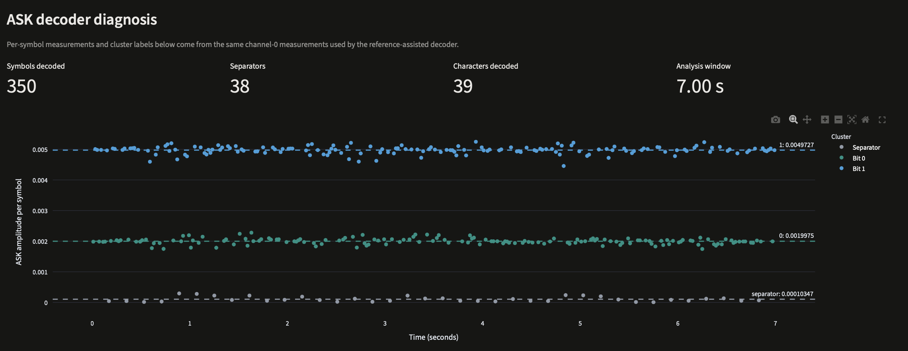
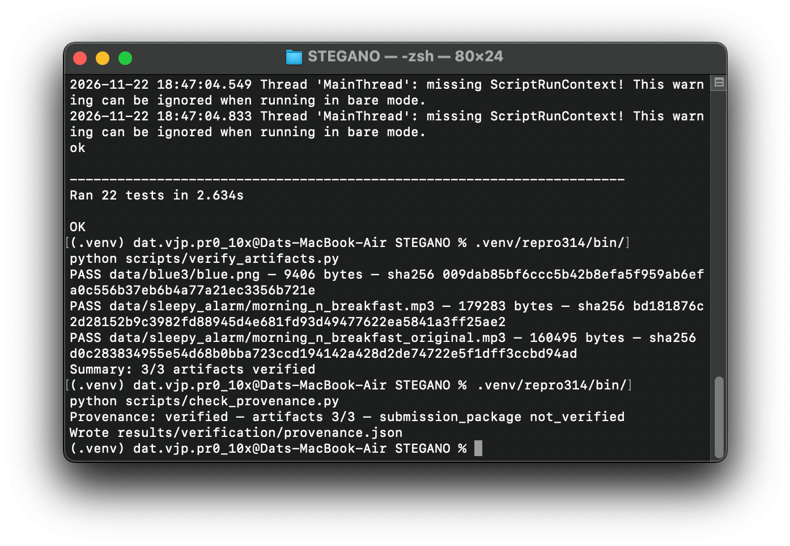

# STEGANO — CTF Jeopardy Practical Project Report

**Course:** UET.CN3124 — Information Security (VNU University of Engineering and Technology)  
**Topic:** Steganography (Blue 3 — Image; Sleepy Alarm — Audio)  
**Student:** Nguyễn Khả Đạt — **Student ID:** 24021404 — **Class:** INT3307E_3  
**Instructor:** Nguyễn Đại Thọ

---

## Abstract

This project investigates and implements independent decoding pipelines for two Jeopardy-style CTF challenges under the Steganography track across two distinct media modalities: **Blue 3** (PNG image, BYU-CSA) and **Sleepy Alarm** (MP3 audio, ImaginaryCTF 2024). Over the integrity-verified artifacts (3/3 matching byte sizes and SHA-256 digests in `results/artifact_manifest.json`), the image decoder recovers the exact Blue 3 flag (`byuctf{more_blue_steganography_da_ba_dee_nkiY9CyP}`, 50 characters) via RGB differences over diagonal blocks, while the audio decoder recovers the exact Sleepy Alarm flag (`ictf{1_sl33py_NaYuKi_alarm_2a634dc1bb2}`, 39 characters, 350 symbols, 38 separators, 0 byte errors) in *reference-assisted* mode with a cross-correlation alignment lag of 1,729 samples (normalized correlation 0.9999). By contrast, *reference-free* mode fails (26 characters, 49 separators, 20 malformed byte groups, exit code 2) and is preserved as an explicit experimental limitation.

Beyond core extraction, the project contributes a reproducible post-hoc signal discovery script (`scripts/inspect_discovery_signals.py`), a 9-variant image robustness matrix (Blue 3: 1/9 PASS) and a 23-trial one-sided audio robustness matrix (Sleepy Alarm: 7/23 PASS), a 6-variant asymmetric audio experiment (2/6 PASS), a fixed-threshold heuristic steganalysis benchmark (image: TP=5, TN=12, FP=0, FN=0; audio: TP=0, TN=8, FP=0, FN=5 — missing all 5 positive samples), a multi-page Streamlit diagnostic dashboard, and an automated quality-gate/provenance verification workflow with 22/22 `unittest` cases passing. The report also analyzes the underlying mechanisms from an offensive and defensive perspective, explicitly documenting success conditions, inference boundaries, and directions for future improvement.

---

## 1. Introduction and Objectives

In **UET.CN3124 — Information Security**, Jeopardy-style Capture The Flag (CTF) practical work—where participants solve categorized technical tasks to recover a verified flag string [3]—develops forensic evidence extraction skills (CLO4) and security risk/defense evaluation (CLO5) aligned with the course learning outcomes. The **Steganography** topic was selected because it poses a dual analytical problem: concealing payloads inside seemingly benign multimedia carriers without perceptible distortion, while requiring signal/image processing paired with security reasoning.

The project pairs one image challenge (**Blue 3**) with one audio challenge (**Sleepy Alarm**) to avoid relying on a single data modality or a single textbook technique such as plain least-significant-bit (LSB) embedding:

- **Blue 3** embeds data in the spatial domain of a PNG image using cumulative RGB differences relative to the background color along main-diagonal blocks.
- **Sleepy Alarm** embeds data in the time–frequency domain of an MP3 file using Amplitude-Shift Keying (ASK) modulation (8,000 Hz carrier, 50 baud, three amplitude levels), requiring time alignment and reference subtraction.

**Rationale for Python (NumPy, SciPy, Pillow, soundfile) and Comparison of Alternatives:** Existing tools such as Aperi'Solve [4] (primarily targeting LSB bit-plane visualization and string extraction) or Audacity/Sonic Visualiser (manual waveform and spectrogram inspection) are useful for initial visual triage, but they neither model Blue 3's variable $n \times n$ diagonal RGB-delta grid nor automate sample-accurate cross-correlation alignment, pre-overlap prefix preservation, and globally phased per-symbol I/Q projection across 350 ASK symbols. Implementing the pipeline in Python with NumPy [7], SciPy [8], Pillow [9], and soundfile [10] guarantees reproducibility, automated regression testing, and quantitative robustness evaluation.

| Evaluated Option | Artifact Availability | Automated Reproducibility | Technical Depth | Alignment with UET.CN3124 |
|---|---|---|---|---|
| **Blue 3 + Sleepy Alarm & custom Python pipeline (Selected)** | All 3 official artifacts pinned and SHA-256 verified [1], [2] | High: CLI, 22 `unittest`, benchmark & quality gate | Combines spatial RGB-delta and ASK I/Q signal processing | Covers digital evidence extraction (CLO4) and covert-channel/DLP defense (CLO5) |
| Single basic image LSB challenge | Widely available | Moderate (often lacks negative controls) | Low; inspects only least-significant bits | Reflects only one classical hiding scheme |
| GUI/web tools only (Aperi'Solve, Audacity) | Depends on external UI | Low; manual clicks resist regression testing | Limited for batch I/Q projection and robustness sweeps | Difficult to standardize defensive verification |
| ASK audio challenge without original reference | Lacks clean cover recording | Cannot verify reference subtraction | Risks unquantified guesses on residual noise | Misses reference-assisted vs. reference-free contrast |

**Scope and Work Allocation Framework:** Within the course's ~30-hour individual project framework, effort is structured across core phases: challenge investigation and decoder implementation; unit and regression test authoring; asymmetric robustness, extended robustness, and steganalysis benchmarking; Streamlit diagnostic visualization; automated quality-gate/provenance engineering; and technical documentation (individual per-task hour counts are intentionally not assigned, as logbook durations are self-reported estimates).

---

## 2. Background and Theoretical Foundations

**Steganography vs. Cryptography:** Cryptography transforms plaintext into unreadable ciphertext to protect confidentiality, yet the existence of an encrypted message remains obvious to an observer. By contrast, steganography conceals the *existence* of the message inside an innocuous cover medium such as an image or audio recording [11]; in practice, the two techniques frequently complement one another.

**Spatial-Domain Image Embedding (RGB Delta):** Rather than modifying only the least-significant bits (LSBs) of individual pixels [11], this spatial-domain variant encodes each character via the cumulative color deviation $\Delta = \sum_{(x,y)\in B_i} (I(x,y) - B_0)$ over a block $B_i$ relative to the dominant background color $B_0$. When $B_0$ accounts for the overwhelming majority of pixels, small per-pixel perturbations remain visually inconspicuous while still summing to exact character codepoints across each block.

**Audio ASK Modulation and the Role of a Reference Signal:** Amplitude-Shift Keying (ASK) encodes symbols by varying the amplitude of a sinusoidal carrier $s(t) = A_k \cos(2\pi f_c t + \phi)$. When the embedded carrier has very small amplitude (approximately $10^{-4}$–$5\times 10^{-3}$, consistent with the largest measured cluster center $\approx 0.005$) and is superposed onto broadband music of much higher energy, the background music masks the carrier within every symbol window. Given the original recording (*reference*), accurate time alignment and subtraction (`target - reference`) cancels most of the cover music, exposing the discrete ASK amplitude levels.

**Effect of MP3 Compression on Signal Subtraction:** MP3 (MPEG-1/2 Layer-3) is a lossy perceptual audio codec combining filter banks, frame-based Modified Discrete Cosine Transform (MDCT), and psychoacoustic masking [12]. Encoding and decoding commonly introduce frame-level encoder delay, high-frequency attenuation or rounding (including around 8 kHz), and quantization differences across re-encodings. Consequently, signals cannot be subtracted directly from sample 0; the offset lag must first be estimated via cross-correlation, and residual quantization noise persists even after subtraction.

---

## 3. Environment and Tools

<a id="report-environment"></a>
<a id="report-artifacts"></a>

**Execution Environment and Parameter Provenance:** The codebase requires **Python $\ge 3.10$**. Recorded reproduction and quality-gate runs use **Python 3.14.10** (CPython) on macOS arm64 (`results/final/provenance.json`). Exact dependency versions from the verified environment are pinned in `requirements-lock.txt` (`pip freeze`) alongside compatible ranges in `requirements.txt`: NumPy `2.5.5`, Pillow `13.0.0`, SciPy `1.18.1`, SoundFile `0.14.0`, Plotly `6.9.0`, and Streamlit `1.67.0`.

The [November 19 run manifest](../results/reproduction-2026-11-19/sleepy-alarm-reference-assisted-manifest.json) records fixed Sleepy Alarm decoder parameters of an 8,000 Hz carrier, 50 baud symbol rate, and 7.0-second analysis window. Historical records confirm the parameters used in the experiments but do not preserve the pre-solve exploration steps prior to knowing the expected flag; accordingly, this report treats these values as fixed decoder settings rather than claiming blind parameter selection, and treats exact-match string comparison as post-decode validation. For transparent oral-defense verification, Section 4 supplements this with a reproducible **post-hoc** signal inspection via `scripts/inspect_discovery_signals.py`. The author confirms no public writeups were consulted for either challenge.

**Input Artifact Integrity:** The three official inputs under `data/` are verified for byte size and SHA-256 digest via `python scripts/verify_artifacts.py` against [artifact_manifest.json](../results/artifact_manifest.json):

| Artifact | Size (bytes) | SHA-256 | Official Source |
|---|---:|---|---|
| `data/blue3/blue.png` | 9,406 | `009dab85bf6ccc5b42b8efa5f959ab6efa0c556b37eb6b4a77a21ec3356b721e` | BYU-CSA [1] |
| `data/sleepy_alarm/morning_n_breakfast.mp3` | 179,283 | `bd181876c2d28152b9c3982fd88945d4e681fd93d49477622ea5841a3ff25ae2` | ImaginaryCTF 2024 [2] |
| `data/sleepy_alarm/morning_n_breakfast_original.mp3` | 160,495 | `d0c283834955e54d68b0bba723ccd194142a428d2de74722e5f1dff3ccbd94ad` | ImaginaryCTF 2024 [2] |

---

## 4. Step-by-Step Methodology

<a id="report-methods"></a>

All implementation steps, hypotheses, intermediate outputs, and error resolutions are recorded chronologically in [LOGBOOK.md](../LOGBOOK.md) and detailed in [APPENDIX.md](APPENDIX.md). The *signal discovery checks* below are **reproducible post-hoc inspections** executed via `python scripts/inspect_discovery_signals.py` (`results/final/discovery-signals.json`, `results/final/discovery-signals.log`), not contemporaneous pre-solve logs. All commands below are plain Python invocations from the repository root.

### 4.1. Challenge 1 — Blue 3 (PNG Image)

1. **Structural Discovery Check (post-hoc on raw image):** Inspecting the RGB distribution of `data/blue3/blue.png` ($512 \times 512$ px = 262,144 pixels) reveals only 49 distinct RGB colors, with a single modal background `(64, 77, 205)` covering 258,916 pixels (98.77%). Masking all non-background pixels (`pixels != base`) shows that all **3,228 altered pixels** (1.23%) lie within $|x - y| \le 9\text{ px}$ along the main diagonal (`results/final/discovery-signals.json`), visually confirmed in Figure 1. This spatial localization motivates partitioning the image into an $n \times n$ grid and summing RGB deltas across the $n$ diagonal blocks.
2. **Hypothesis and Execution Command:** Summing RGB differences from the background color across $n$ diagonal blocks yields a valid challenge flag:
   ```bash
   PYTHONPATH=src python -m stegano blue3 data/blue3/blue.png
   ```
3. **Intermediate and Final Output:** In `src/stegano/image.py`, the decoder sweeps $n$ from $2$ to $\min(w, h)$. The saved log `results/recheck/blue3.log` records 49 candidate attempts (`length=2..50`); grids $n=2..49$ produce garbled text or omit the closing brace (e.g., $n=49$ yields `byuctf{more_blue_steganography_da_ba_dee_nkiY9CyP`), whereas $n=50$ matches `byuctf{more_blue_steganography_da_ba_dee_nkiY9CyP}` (`format_valid: true`, exit code 0).
4. **Errors and Fixes:** Early environment checks ([Logbook Entry 00](../LOGBOOK.md#entry-00), [Entry 12](../LOGBOOK.md#entry-12)) found that the legacy `.venv` used Python 3.9.6 (< 3.10) and system Python lacked `streamlit`; a dedicated Python 3.14.10 virtual environment was created and verified with `pip check`.
5. **Evidence:** See [Logbook Entry 01](../LOGBOOK.md#entry-01), [Appendix A.3](APPENDIX.md#app-a3-blue-3-extraction), and Figure 1.


*Figure 1. Streamlit Blue 3 diagnostic view showing the RGB channel histogram concentrated at `(64, 77, 205)` and the 50 decoded blocks along the main diagonal (`evidence/visualization/2026-11-22-blue3-rgb-histogram-diagonal-trace.png`).*

### 4.2. Challenge 2 — Sleepy Alarm (MP3 Audio)

1. **Spectral and Symbol-Timing Check (post-hoc on audio pair):** Before subtraction, the 7.0-second `periodogram` of `morning_n_breakfast.mp3` peaks at 1,598.71 Hz (background music), while the 7.9–8.1 kHz band accounts for only **0.03%** (`0.000257`, `results/final/discovery-signals.json`) of total energy; note that the **0.02%** (`0.000204`) figure in `results/steganalysis/benchmark.json` (Section 6.2) is measured across the **full 10.02-second file**, whereas **0.03%** is measured over the **first 7.0-second payload window**. After cross-correlation alignment (`lag_samples = 1729`) and subtraction (`target - reference`), the residual spectrum peaks sharply at **8,000.00 Hz**, with the 7.9–8.1 kHz band rising to **52.40%** (`0.524009`) of residual energy (Figure 2). Plotting the residual under the fixed decoder parameter of **50 baud** (**20 ms/symbol**, 350 symbols in 7.0 s), both the 32-symbol zoom (`evidence/visualization/2026-11-22-sleepy-first-32-symbols-byte-groups.png`) and Figure 3 confirm amplitude transitions align consistently with 20 ms boundaries (this is a fixed decoder configuration verified for consistency, not an independently derived measurement).
2. **Hypothesis and Execution Commands:** Subtracting the aligned original recording exposes three ASK amplitude levels (separator, bit `0`, bit `1`), while running without `--reference` serves as a negative control:
   ```bash
   # Reference-assisted mode
   PYTHONPATH=src python -m stegano sleepy-alarm \
     data/sleepy_alarm/morning_n_breakfast.mp3 \
     --reference data/sleepy_alarm/morning_n_breakfast_original.mp3

   # Reference-free mode (negative control)
   PYTHONPATH=src python -m stegano sleepy-alarm \
     data/sleepy_alarm/morning_n_breakfast.mp3
   ```
3. **Intermediate and Final Output:** In *reference-assisted* mode (`results/reproduction-2026-11-19/sleepy-alarm-reference-assisted-output.json`), alignment yields `lag_samples = 1729`, `target_start_sample = 1729`, and correlation `0.9998734358246231` ($\approx 0.9999$). Clustering the 350 I/Q projections produces three centers `[0.0001035, 0.0019975, 0.0049727]` (Figure 3), 38 separators, 0 malformed byte groups, and the exact 39-character flag `ictf{1_sl33py_NaYuKi_alarm_2a634dc1bb2}` (exit code 0). In *reference-free* mode (`results/recheck/sleepy-alarm-reference-free.log`), 350 symbols are still measured but clustering breaks down (49 separators, 20 malformed byte groups), producing only the broken fragment `ictsl33p_Nauk_arm_224dcb2}` (26 characters, `format_valid: false`, exit code 2).
4. **Bugs Found and Fixes ([Logbook Entry 12](../LOGBOOK.md#entry-12)):** Prior to November 19, the decoder operated only on the aligned overlap `x - y`, discarding the target prefix before `target_start_sample` whenever alignment began inside an early symbol. The fix in `src/stegano/audio.py` prepends `prefix = target[:alignment['target_start_sample']]` and projects each symbol using global sample indices for carrier phase; a synthetic regression test in `tests/test_audio.py` placing the overlap 1.5 symbol periods into the target verifies the first 16 labels and full flag. Additionally, running Streamlit `AppTest` in bare mode emits three non-fatal `missing ScriptRunContext` warnings (tests still pass), and a misleading green status banner on the Overview page was corrected in [Logbook Entry 16](../LOGBOOK.md#entry-16).
5. **Evidence:** See [Logbook Entry 02](../LOGBOOK.md#entry-02), [Entry 03](../LOGBOOK.md#entry-03), [Entry 12](../LOGBOOK.md#entry-12), [Appendix A.4](APPENDIX.md#app-a4-sleepy-alarm-reference-assisted)–[A.5](APPENDIX.md#app-a5-sleepy-alarm-reference-free), [A.15](APPENDIX.md#app-a15-ask-prefix-preservation-and-output-regression), Figure 2, and Figure 3.


*Figure 2. Comparison of 0–16 kHz `periodogram` power spectra over the first 7.0 s before and after reference alignment subtraction (`report/figures/sleepy-residual-spectrum.svg`, generated by `scripts/inspect_discovery_signals.py`): the 8,000 Hz carrier rises from 0.03% to 52.40% of residual energy.*



*Figure 3. Amplitude distribution across 350 ASK symbols after reference subtraction, showing three well-separated clusters for separator, bit `0`, and bit `1` (`evidence/visualization/2026-11-22-sleepy-ask-symbol-clusters.png`).*

---

## 5. Results

<a id="report-results"></a>

The table below summarizes all quantitative findings traced directly to saved JSON and log records in the repository:

| Verification Item | Recorded Outcome | Data Source |
|---|---|---|
| Artifact integrity | **3/3 PASS** (byte size + SHA-256 verified) | `results/artifact_manifest.json` |
| Signal discovery check (post-hoc) | Blue 3: 3,228 px within $\lvert x-y \rvert \le 9$; Audio residual: 8,000 Hz peak (52.40%) | `results/final/discovery-signals.json` |
| Blue 3 extraction | **Exact match**, 50 chars: `byuctf{more_blue_steganography_da_ba_dee_nkiY9CyP}` | `results/recheck/blue3.log` |
| Sleepy Alarm (reference-assisted) | **Exact match**, 39 chars: `ictf{1_sl33py_NaYuKi_alarm_2a634dc1bb2}`; 350 symbols, 38 separators, lag 1,729, corr 0.9999, 0 byte errors | `results/reproduction-2026-11-19/sleepy-alarm-reference-assisted-output.json` |
| Sleepy Alarm (reference-free) | **FAIL** — 26 chars, 49 separators, 20 malformed byte groups, `format_valid: false`, exit code 2 | `results/steganalysis/benchmark.json` |
| Sleepy Alarm asymmetric robustness | Baseline **PASS**; one-sided transforms **2/6 PASS** (2 resample PASS, 4 gain FAIL) | `results/asymmetric/asymmetric_robustness.json` |
| Blue 3 extended robustness | **1/9 PASS** (only Gaussian blur r=0.3 achieves exact match) | `results/robustness/blue3_extended_robustness.json` |
| Sleepy Alarm extended robustness | **7/23 PASS** (baseline + gain ×0.75, AWGN SNR 30 dB, resample on each side) | `results/robustness/sleepy_alarm_robustness_matrix.json` |
| Baseline detector — Image | **TP=5, TN=12, FP=0, FN=0** (Precision/Recall/F1 = 1.00 across 17 samples) | `results/steganalysis/benchmark.json` |
| Baseline detector — Audio | **TP=0, TN=8, FP=0, FN=5** (Recall = 0.00 across 13 samples — misses all 5 positives) | `results/steganalysis/benchmark.json` |
| Automated tests & final quality gate | **22/22 unittest PASS** (exit code 0); provenance (97 files) & archive (169 members) `verified` | `results/final/quality-gate.json` |

For quality assurance and provenance, the final run in `results/final/quality-gate.json` and `results/final/provenance.json` verifies 3/3 official artifacts, 22/22 `unittest` cases, 97 hashed source/documentation files, and all 169 archive members in `submission_package_current.zip` as `verified`; historical snapshots and the provenance workflow are detailed in the Appendix.

---

## 6. Technical, Offensive, and Defensive Analysis

### 6.1. Technical Mechanisms, Success Conditions, and Limits

**Blue 3 (`src/stegano/image.py`):** `blue.png` measures $512 \times 512$ px with only 49 distinct RGB colors, where the modal background accounts for **98.77%** of all pixels (`modal_rgb_fraction = 0.987686`) and mean channel standard deviation is **0.094** (`results/steganalysis/benchmark.json`). The decoder identifies the modal RGB color `base`, iterates grid counts $n \in [2, \min(w,h)]$, and extracts $n$ diagonal blocks of size $\lfloor w/n \rfloor \times \lfloor h/n \rfloor$ (`pixels[i*ch:(i+1)*ch, i*cw:(i+1)*cw]`). For each block $i$, it sums the RGB channel differences relative to `base` ($\text{value} = \sum (\text{block} - \text{base})$ across height, width, and 3 channels) and maps `chr(value)`.

- *Success Conditions & Limits:* Decoding assumes no global brightness/contrast scaling (which perturbs `block - base` across every pixel in a $10 \times 10 = 100$-pixel block), no edge cropping (which shifts diagonal alignment), and no additive noise pushing codepoints out of range. Crucially, selecting $n = 50$ relies on known challenge-format validation (`candidate.startswith('byuctf{')`, trailing `}`, and alphanumeric/`_{}` characters); this is **format-guided selection**, not blind extraction of arbitrary payloads. The table below lists the first seven blocks extracted by `diagnose_blue3`:

| Block | Coordinates `(x0:x1, y0:y1)` | `rgb_delta` `(ΔR, ΔG, ΔB)` | Sum / Codepoint | Character |
|---:|---|---|---:|---|
| 0 | `(0:10, 0:10)` | `(30, 37, 31)` | 98 | `b` |
| 1 | `(10:20, 10:20)` | `(33, 50, 38)` | 121 | `y` |
| 2 | `(20:30, 20:30)` | `(39, 46, 32)` | 117 | `u` |
| 3 | `(30:40, 30:40)` | `(36, 30, 33)` | 99 | `c` |
| 4 | `(40:50, 40:50)` | `(41, 33, 42)` | 116 | `t` |
| 5 | `(50:60, 50:60)` | `(32, 35, 35)` | 102 | `f` |
| 6 | `(60:70, 60:70)` | `(49, 40, 34)` | 123 | `{` |

**Sleepy Alarm (`src/stegano/audio.py`):** Both MP3 files are 44,100 Hz stereo audio (~10.02 s). The decoder fixes $f_c = 8{,}000\text{ Hz}$, $50\text{ baud}$ ($\approx 882\text{ samples/symbol}$), and a $7\text{-second}$ window ($350\text{ symbols}$). In reference-assisted mode, `_align` downsamples by `round(sr/4000) = 11` for coarse FFT cross-correlation and refines within $\pm 11$ samples at full rate (`lag_samples = 1729`, `correlation = 0.999873`). Prepending `target[:1729]` before `x - y` preserves sample-0 symbol timing and carrier phase. `_project_symbol` then computes unfiltered per-symbol I/Q projection (avoiding whole-signal band-pass smearing across symbol edges):
$$I_i = \frac{2}{N_i}\sum_{k} (z_k - \bar{z})\cos\!\left(\frac{2\pi f_c k}{f_s}\right),\quad Q_i = \frac{2}{N_i}\sum_{k} (z_k - \bar{z})\sin\!\left(\frac{2\pi f_c k}{f_s}\right),\quad A_i = \sqrt{I_i^2 + Q_i^2}$$
Three amplitude levels $A_i$ are clustered via 1D k-means initialized at the 5th, 50th, and 95th percentiles into separator (`' '`), bit `'0'`, and bit `'1'`, and each 8-bit group is decoded as ASCII.

- *Success Conditions & Limits:* Decoding requires a matching reference recording (comparable background amplitude, uncropped, and unfiltered in 7.5–8.5 kHz) and exact $(f_c, \text{baud}, \text{duration})$ settings. Output acceptance (`format_valid`) enforces 39 error-free 8-bit groups matching `ictf{...}`, which validates against the challenge format rather than performing universal blind demodulation. The first five byte groups from `diagnose_sleepy_alarm` illustrate how `ictf{` is assembled:

| Byte Index | 8-Bit Sequence (after ASK clustering) | ASCII Code | Character |
|---:|---|---:|---|
| 0 | `01101001` | 105 | `i` |
| 1 | `01100011` | 99 | `c` |
| 2 | `01110100` | 116 | `t` |
| 3 | `01100110` | 102 | `f` |
| 4 | `01111011` | 123 | `{` |

### 6.2. Offensive and Defensive Perspective

- **Exploited Mechanism & Real-World Risk:** Adversaries exploit spare capacity in everyday media files (PNG images or MP3 audio clips) to establish **covert data exfiltration channels** or command-and-control (C2) signaling that bypass conventional signature-based DLP/firewall inspection. Because Blue 3 perturbations are localized and Sleepy Alarm operates at 8 kHz with amplitude $\le 0.005$, the files remain visually and audibly normal to end users.
- **Detection Indicators:**
  1. *Blue 3-style images:* Extreme histogram dominance (>90% identical RGB pixels), near-zero channel standard deviation, and discrete localized color shifts aligned along a geometric diagonal.
  2. *Sleepy Alarm-style audio:* Narrowband energy modulation around 8 kHz switching at fixed symbol intervals (20 ms for 50 baud), or high-frequency residual discrepancies when compared against a known clean original.
- **Defensive Mitigations and Experimental Limits:**
  - *Content Disarm and Reconstruction (CDR):* Apply non-trivial transformations at network egress gateways (e.g., brightness/contrast normalization, cropping, additive noise, or lossy re-encoding). Crucially, our experimental evidence (Section 7) shows **light sanitization is insufficient as a defense**: *Gaussian blur radius 0.3* (Blue 3) and *44.1→48→44.1 kHz resampling round-trip* on either side (Sleepy Alarm) still **PASS** full flag recovery. Furthermore, although 8/9 image transforms cause Blue 3 to **FAIL** exact-match criteria, `brightness ×0.9` still preserves **47/50 character positions** (`edit_distance = 3`, `results/robustness/blue3_extended_robustness.json`), breaking automated format validity without fully erasing leaked content.
  - *Band Filtering & Gain Perturbation (Audio):* Within our tested matrix, a 7.5–8.5 kHz band-pass filter, AWGN at $\le 20\text{ dB}$ SNR, and one-sided gain mismatches ($\times 0.25/\times 0.5/\times 1.25/\times 1.5/\times 1.75$) all cause decoder failure (FAIL). Lower-bitrate MP3 re-compression or low-pass filtering is likewise a sound theoretical mitigation, though not directly benchmarked in this project.
  - *Statistical Media Monitoring:* Deploy statistical anomaly checks (spatial entropy, color dominance, narrowband spectral peaks) on outbound media at DLP/proxy gateways.
- **Honest Link to Project Detector Benchmark:** The fixed heuristics in `src/steganalysis.py` require both modality-specific thresholds to trigger (`results/steganalysis/benchmark.json`):
  - *Image:* Achieves **TP=5, TN=12, FP=0, FN=0** (F1 = 1.00) because `blue.png` and its four brightness variants exhibit `modal_rgb_fraction = 0.9877 >= 0.90` and `mean_channel_std ≈ 0.094 <= 8.0`. However, this heuristic would miss payloads embedded in complex natural photographs and was evaluated only against 12 synthetic benign controls.
  - *Audio:* Scores **TP=0, TN=8, FP=0, FN=5** (Recall = 0.00 — missing all 5 positive samples). `benchmark.json` explains why: the 50-baud RMS variation check triggers (`symbol_block_rms_cv ≈ 0.987 >= 0.15`), but the global 8 kHz energy ratio fails (`carrier_band_energy_ratio ≈ 0.000204 < 0.02`, ~0.02% of full-file energy—lower than the synthetic controls at `~0.009`). Because the broadband music overwhelms the weak carrier globally, fixed whole-file energy thresholds are unsuitable as a standalone detection gate.
  - *Detector Improvements:* Replace global energy ratios with a narrowband peak-to-local-floor ratio, compute short-window (20 ms) spectral/cepstral residuals, and calibrate ML classifiers on diverse real-world media corpora.

**Side-by-Side Comparison under UET.CN3124 Security Concepts:**

| Dimension | Blue 3 (PNG Image) | Sleepy Alarm (MP3 Audio) |
|---|---|---|
| **Embedding Domain** | Spatial domain: cumulative RGB delta across $n$ diagonal blocks | Time–frequency domain: 8 kHz ASK modulation at 50 baud |
| **Challenge Payload Size** | 50 chars in a $512 \times 512$ image *(challenge payload size, not maximum capacity)* | 39 bytes in a 7 s window *(challenge payload size, not maximum capacity)* |
| **Observed Robustness** | 1/9 image variants PASS (`Gaussian blur r=0.3`); `brightness ×0.9` keeps 47/50 positions *(not directly comparable to audio due to different transform types and matrix size)* | 7/23 one-sided trials PASS (baseline + gain ×0.75, AWGN 30 dB, resample on each side) *(not directly comparable to image ratio)* |
| **Detection Indicators (IDS/DLP)** | Extreme modal color dominance (98.77%), low `mean_channel_std` (0.094) | Narrowband 8 kHz peak (0.02% full file / 0.03% 7 s window pre-subtraction; 52.40% post-subtraction) |
| **Defensive Mitigations (CDR/Monitoring)** | Strong brightness/contrast scaling, cropping, noise (light blur 0.3 insufficient) | 7.5–8.5 kHz filtering, gain mismatch, strong noise (light resampling insufficient) |
| **Course Alignment (UET.CN3124)** | Image covert exfiltration channel; multimedia content inspection at DLP egress | Time–frequency covert channel evading signature filters; covert-channel detection on IDS/DLP |

---

## 7. Custom Extensions and Contributions

<a id="report-asymmetric-robustness"></a>
<a id="report-benchmark"></a>
<a id="report-extended-robustness"></a>
<a id="report-visualization"></a>

Beyond baseline challenge solving, the following custom evaluation and verification tools were developed:

1. **Asymmetric Audio Robustness Experiment (`scripts/run_audio_asymmetric.py`):** Independently transforms either `target` or `reference` using gain ($\times 0.5$, $\times 1.5$) and resampling round-trip ($44.1 \to 48 \to 44.1\text{ kHz}$). In `results/asymmetric/asymmetric_robustness.json`, the baseline PASSES separately, while one-sided variants achieve **2/6 PASS**:

   | Modified File | Gain ×0.5 | Gain ×1.5 | Resample 44.1→48→44.1 kHz |
   |---|---|---|---|
   | **Target** | **FAIL** (28 chars, 14 byte errors) | **FAIL** (34 chars, 4 byte errors) | **PASS** (39 chars, 0 byte errors) |
   | **Reference** | **FAIL** (36 chars, 5 byte errors) | **FAIL** (33 chars, 4 byte errors) | **PASS** (39 chars, 0 byte errors) |

2. **Extended Robustness Matrices (`scripts/run_extended_robustness.py`):** Evaluated under strict PASS criteria (`format_valid`, exact ground-truth match, 0 byte errors), stored under `results/robustness/` and plotted in Figure 4:
   - *Blue 3 (`blue3_extended_robustness.json`):* **1/9 PASS** — only *Gaussian blur radius 0.3* preserves all 50 characters; the remaining eight variants (brightness $\times 0.9/\times 1.1$, contrast $\times 0.9/\times 1.1$, 16 px crop, and Gaussian noise $\sigma = 0.5/1.0/2.0$) FAIL (though brightness $\times 0.9$ matches 47/50 positions).
   - *Sleepy Alarm (`sleepy_alarm_robustness_matrix.json`):* **7/23 PASS**, comprising the baseline plus six one-sided transforms (gain $\times 0.75$, AWGN SNR 30 dB, and resampling round-trip on both `target` and `reference`); the other 16 trials (gain $\times 0.25/\times 0.5/\times 1.25/\times 1.5/\times 1.75$, AWGN SNR 20/10 dB, and 7.5–8.5 kHz band-pass on each side) FAIL.


*Figure 4. PASS/FAIL breakdown across 9 Blue 3 image variants and 23 Sleepy Alarm audio trials (`report/figures/robustness-heatmaps.svg`, source `results/recheck/robustness/`).*

3. **Steganalysis Benchmark & Open-Source Scope Comparison (`scripts/run_steganalysis_benchmark.py`):** Confusion matrices across 17 image and 13 audio samples are shown in Figure 5 (`results/steganalysis/benchmark.json`). Scope-only comparisons (without executing external tools) are documented against [Aperi'Solve](https://github.com/Zeecka/AperiSolve) [4] (image/bit-plane triage), [The-A-Files](https://github.com/pawel-kaczmarek/The-A-Files) [5] (audio steganography robustness framework), and [WavSteg](https://github.com/ragibson/Steganography) [6] (WAV LSB).
4. **Streamlit Diagnostic Dashboard & Automated Quality Gate:** Built a 3-page Streamlit application (`visualization/app.py`) for integrity/diagnostic inspection and automated test/archive verification via `scripts/verify_reproducibility.py`.


*Figure 5. Confusion matrices for the fixed-threshold baseline detectors: 17 image samples (F1 = 1.00) and 13 audio samples (FN = 5/5, Recall = 0.00) (`report/figures/benchmark-confusion-matrices.svg`).*

---

## 8. Evaluation, Limitations, and Lessons Learned

<a id="report-reflection"></a>
<a id="report-limitations"></a>

**Challenges Encountered:** (1) Initial environment mismatch between Python 3.9.6 in `.venv` and the $\ge 3.10$ / 3.14.10 requirement; (2) silent truncation of the target prefix prior to overlap in early ASK decoding; and (3) complete failure (5/5 false negatives) of the whole-file 8 kHz energy-ratio audio detector due to broadband music masking.

**Critical Scope Limitations:**

- Exact-match tests verify recovery on three fixed artifacts with known flag formats (`byuctf{...}` and `ictf{...}`); they do not prove blind payload discovery or generalization to unseen challenges.
- Sleepy Alarm's exact-match extraction depends on having the clean reference recording; *reference-free* extraction fails and is retained as a negative result.
- The detector benchmark (17 image, 13 audio samples) uses deterministic synthetic benign controls and does not represent real-world media distributions. Likewise, the 1/9 and 7/23 robustness rates characterize only one artifact per challenge under the specific transforms tested.
- Work-duration figures in Logbook Entries 06–10 are self-reported estimates rather than timed measurements; SHA-256 verification confirms byte identity against the pinned manifest rather than publisher identity.
- Because `requirements.txt` specifies version ranges, `requirements-lock.txt` was added to pin the exact verified Python 3.14.10 environment.

**Intellectual Growth and Alignment with Academic Literature:**

- *Iterative Refinement of Assumptions:* Initially, the Sleepy Alarm decoder only subtracted and demodulated the aligned overlap `x - y`; inspecting edge cases revealed that an overlap starting mid-symbol drops leading samples and shifts carrier phase, leading to the `prefix = target[:target_start_sample]` fix and a synthetic 1.5-symbol overlap regression test (`tests/test_audio.py`). Likewise, while exact-match initially looked like general decoding success, auditing the source code clarified that both decoders rely on known challenge-format checks (`byuctf{...}`, `ictf{...}`, 39 chars) rather than blind recovery—prompting honest scoping and preservation of negative results (*reference-free* FAIL, audio detector FN=5/5).
- *Comparison with [11] and [12]:* Empirical behavior aligns with [11] (Petitcolas et al.) on the classical trade-off between imperceptibility, payload size, and fragility to perturbations (Blue 3 maintains 98.77% uniform background pixels yet loses exact-match under mild pixel transforms). For audio, [12] (Brandenburg) explains in principle why lossy MP3/MDCT compression introduces frame delay and spectral quantization noise—justifying cross-correlation alignment and residual noise after subtraction (while the observed `lag_samples = 1729` remains an empirical alignment offset rather than being attributed solely to MP3 encoder delay).

**Lessons Learned and Concrete Next Steps:** Maintaining sample-0 phase/time anchoring and writing synthetic boundary regression tests catches subtle signal bugs masked by happy-path data, while global-energy heuristics fail when weak narrowband carriers are buried under broadband cover audio. Concrete next steps include: (i) running actual **MP3 re-compression** experiments at 128/96/64 kbps (`ffmpeg`/`lame` on temporary copies) to test the unverified audio CDR hypothesis noted in Section 6.2; (ii) upgrading `src/steganalysis.py` from global energy ratios to narrowband peak-to-local-floor ratios; and (iii) exploring reference-free ASK demodulation using local envelope estimation and blind carrier synchronization (Costas loop / PLL).

---

## 9. Conclusion

This project fulfills its objectives of independently decoding, verifying, and analyzing two Steganography CTF challenges (Blue 3 and Sleepy Alarm) under strict reproducibility standards. Both official flags are recovered exactly, all 3/3 official artifacts and 22/22 `unittest` cases pass the automated quality gate, and all negative outcomes (*reference-free* FAIL, audio detector FN=5/5, and 1/9 and 7/23 robustness limits) are preserved transparently to frame realistic defensive boundaries in information security.

---

## References

[1] BYU-CSA, "blue-3 (Forensics/Steganography CTF Challenge)," *old-ctf-challenges*, GitHub. [Online]. Available: https://github.com/BYU-CSA/old-ctf-challenges/tree/master/forensics-steganography/blue-3

[2] ImaginaryCTF, "Sleepy Alarm (Forensics CTF Challenge)," *ImaginaryCTF-2024-Challenges*, GitHub, 2024. [Online]. Available: https://github.com/ImaginaryCTF/ImaginaryCTF-2024-Challenges/tree/main/Forensics/Sleepy%20Alarm

[3] CTFtime, "All about CTF (Capture The Flag)," *CTFtime.org*. [Online]. Available: https://ctftime.org/ctf-wtf/

[4] Zeecka, "Aperi'Solve — Online platform which performs layer analysis on image," GitHub. [Online]. Available: https://github.com/Zeecka/AperiSolve

[5] P. Kaczmarek, "The-A-Files — Audio steganography evaluation framework," GitHub. [Online]. Available: https://github.com/pawel-kaczmarek/The-A-Files

[6] R. Gibson, "Steganography (WavSteg) — LSB steganography for WAV files," GitHub. [Online]. Available: https://github.com/ragibson/Steganography

[7] NumPy Developers, "NumPy Documentation," *numpy.org*. [Online]. Available: https://numpy.org/doc/stable/

[8] SciPy Developers, "SciPy Documentation," *scipy.org*. [Online]. Available: https://docs.scipy.org/doc/scipy/

[9] A. Clark et al., "Pillow (PIL Fork) Documentation," *Read the Docs*. [Online]. Available: https://pillow.readthedocs.io/en/stable/

[10] B. Bechtold, "python-soundfile Documentation," *Read the Docs*. [Online]. Available: https://python-soundfile.readthedocs.io/en/latest/

[11] F. A. P. Petitcolas, R. J. Anderson, and M. G. Kuhn, "Information hiding—a survey," *Proceedings of the IEEE*, vol. 87, no. 7, pp. 1062–1078, Jul. 1999, doi: 10.1109/5.771065.

[12] K. Brandenburg, "MP3 and AAC Explained," *Proc. AES 17th Int. Conf.: High-Quality Audio Coding*, Florence, Italy, Sep. 1999. [Online]. Available: https://www.iis.fraunhofer.de/content/dam/iis/de/doc/ame/conference/AES-17-Conference_mp3-and-AAC-explained_AES17.pdf

---

## Appendix

<a id="report-quality-gate-provenance"></a>

> *Commands prefixed with `rtk proxy` in the appendices are historical execution records; omit this prefix when re-running locally.*

### A. Quality Gate and Provenance Summary

The automated verification runner (`scripts/verify_reproducibility.py`) sequentially executes `scripts/verify_artifacts.py`, `unittest discover -s tests -v`, and `scripts/check_provenance.py`. For `submission_package_current.zip`, provenance checks CRC integrity (`testzip()`), required files, complete member set, and byte-for-byte parity with the working checkout (exempting self-referential quality-gate outputs from byte comparison to prevent hash recursion, while still verifying their presence and CRC).

| Check | Snapshot 22/11 (`results/verification/`) | Recheck (`results/recheck/`) | Final Run (`results/final/`) |
|---|---|---|---|
| Unittest | **22/22 PASS** (exit 0) | **22/22 PASS** (exit 0) | **22/22 PASS** (exit 0) |
| Artifact integrity | **3/3 verified** | **3/3 verified** | **3/3 verified** |
| Provenance | `verified` (30 hashed files) | `verified` (95 hashed files) | `verified` (97 hashed files) |
| `submission_package` | `not_verified` | `verified` (159 members) | `verified` (169 members) |


*Figure A.1. Quality-gate summary rendered from `results/recheck/quality-gate.json` and `results/recheck/provenance.json` (`report/figures/quality-gate-summary.svg`). The final run in `results/final/` preserves the PASS state with 97 inventoried files and 169 archive members.*


*Figure A.2. End-to-end provenance and archive verification flow converging at the quality gate (`report/figures/provenance-flow.svg`).*

### B. Detailed Record Cross-References

- Full chronological experiment log (Entries 00–16): [LOGBOOK.md](../LOGBOOK.md)
- Detailed per-run appendix records (A.1–A.19): [APPENDIX.md](APPENDIX.md)
- Reproduce post-hoc signal discovery metrics and residual spectrum SVG (`results/final/discovery-signals.json`, `figures/sleepy-residual-spectrum.svg`):
  ```bash
  python scripts/inspect_discovery_signals.py
  ```
- Re-render the four static report SVG figures from `results/recheck/`:
  ```bash
  python scripts/render_report_figures.py
  ```
- Re-run the quality gate into a new directory (e.g., `results/final/`):
  ```bash
  python scripts/create_submission_zip.py
  python scripts/verify_reproducibility.py \
    --output results/final/quality-gate.json \
    --provenance-output results/final/provenance.json \
    --log-output results/final/reproducibility.log
  ```

### C. Terminal Execution Evidence

The six unaltered terminal screenshots below from `evidence/terminal/` document environment verification, decoding of both challenges (including the reference-free negative control), automated unit tests, and artifact/provenance checks:


*Figure C.1. Python 3.14.10 environment verification, dependency check against `requirements.txt`, and clean `pip check` (`evidence/terminal/2026-11-18-setup-terminal.png`).*


*Figure C.2. Blue 3 decoder terminal output recovering the 50-character flag `byuctf{more_blue_steganography_da_ba_dee_nkiY9CyP}` (`evidence/terminal/2026-11-18-blue3-terminal.png`).*


*Figure C.3. Sleepy Alarm reference-assisted decoder output: `format_valid: true`, 350 symbols, 38 separators, 1,729-sample lag, 0 byte errors (`evidence/terminal/2026-11-18-audio-assisted-terminal.png`).*


*Figure C.4. Negative control in reference-free mode (`reference_free`): `status: FAIL`, `format_valid: false`, 26 characters, 49 separators, and 20 malformed byte groups (`evidence/terminal/2026-11-20-reference-free-audio-failure-terminal.png`).*


*Figure C.5. Full 22-test `unittest` run passing (`Ran 22 tests in 2.634s — OK`) with non-fatal Streamlit bare-mode `AppTest` warnings (`evidence/terminal/2026-11-22-unittest-22-tests-passed-terminal.png`).*



*Figure C.6. SHA-256 verification of all 3/3 official artifacts and `scripts/check_provenance.py` execution (`evidence/terminal/2026-11-22-artifact-and-provenance-terminal.png`).*
