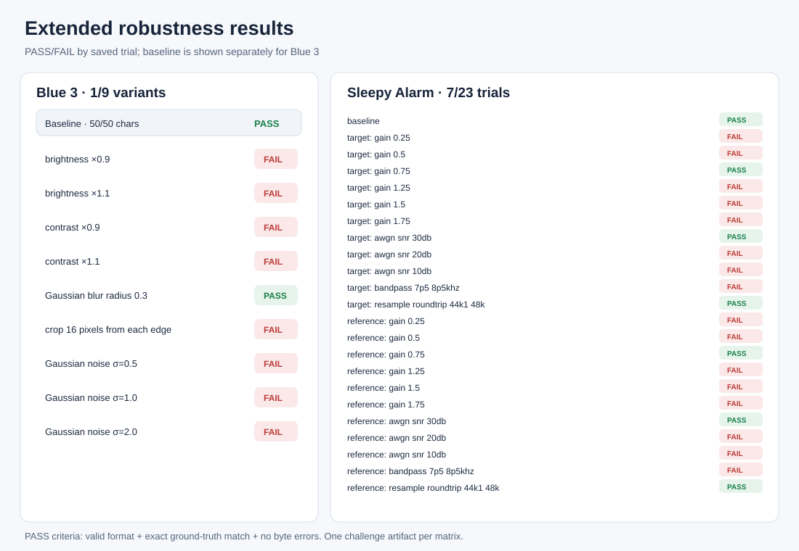

# STEGANO — Báo cáo đồ án thực hành CTF Jeopardy

**Học phần:** UET.CN3124 — An toàn và an ninh mạng<br>
**Chủ đề:** Steganography<br>
**Challenges:** Blue 3 (ảnh) và Sleepy Alarm (âm thanh)

**Sinh viên:** Nguyễn Khả Đạt<br>
**MSSV:** 24021404<br>
**Lớp:** INT3307E_3<br>
**Giảng viên:** Nguyễn Đại Thọ

## 1. Lập kế hoạch và biện minh

Đồ án khảo sát hai challenge cùng chủ đề nhưng dùng hai cách nhúng khác nhau: Blue 3 mã hóa ký tự qua sai khác RGB theo vùng chéo; Sleepy Alarm nhúng bit bằng ASK trong âm thanh. Mục tiêu là giải mã từ artifact chính thức, kiểm tra nguyên vẹn dữ liệu và xác nhận kết quả bằng toàn bộ flag.

## 2. Triển khai và tài liệu hóa

<a id="report-artifacts"></a>
### 2.1. Artifact và nguồn

Ba artifact trong `data/` được xác định bằng kích thước và SHA-256 trong [manifest](../results/artifact_manifest.json), cùng URL nguồn challenge chính thức cho từng file. Lệnh `python scripts/verify_artifacts.py` kiểm tra kích thước và checksum.

| Artifact | Bytes | SHA-256 |
|---|---:|---|
| `data/blue3/blue.png` | 9,406 | `009dab85bf6ccc5b42b8efa5f959ab6efa0c556b37eb6b4a77a21ec3356b721e` |
| `data/sleepy_alarm/morning_n_breakfast.mp3` | 179,283 | `bd181876c2d28152b9c3982fd88945d4e681fd93d49477622ea5841a3ff25ae2` |
| `data/sleepy_alarm/morning_n_breakfast_original.mp3` | 160,495 | `d0c283834955e54d68b0bba723ccd194142a428d2de74722e5f1dff3ccbd94ad` |

<a id="report-methods"></a>
### 2.2. Phương pháp và kiểm thử

- **Blue 3:** decoder tìm baseline RGB rồi cộng sai khác theo từng vùng chéo để khôi phục ký tự.
- **Sleepy Alarm:** decoder căn chỉnh target và reference bằng cross-correlation, trừ hai tín hiệu trong vùng overlap rồi phân loại các mức ASK. Prefix target trước overlap được giữ nguyên để giải mã từ mẫu 0. Phép chiếu I/Q được tính riêng trên mẫu gốc của từng symbol, với pha sóng mang theo chỉ số mẫu toàn cục. Lag được đo lại khi chạy, không giả định trước một độ trễ MP3 cố định.
- **Baseline steganalysis:** detector ảnh dùng tỷ lệ màu RGB phổ biến và độ lệch chuẩn kênh; detector audio dùng năng lượng dải quanh 8 kHz và độ biến thiên RMS theo khối 50 baud. Các ngưỡng được cố định, không huấn luyện hoặc hiệu chỉnh trên tập giữ lại.
- **Benchmark:** positive samples gồm artifact chính thức và các bản biến đổi xác định; benign controls là ảnh/audio tổng hợp có seed cố định. Tập này đo baseline heuristic, không đại diện cho phân phối media thực tế.
- **Robustness bất đối xứng:** chạy `rtk proxy env PYTHONPATH=src .venv/repro314/bin/python scripts/run_audio_asymmetric.py`; mỗi biến thể chỉ đổi target hoặc reference, còn baseline được báo cáo riêng. Kết quả được ghi thành JSON, CSV và log.
- **Robustness mở rộng:** chạy `python scripts/run_extended_robustness.py`; script ghi ma trận ảnh Blue 3 và 23 lượt audio Sleepy Alarm. PASS yêu cầu format hợp lệ, exact match và không có lỗi byte.
- **Đối chiếu công cụ mã nguồn mở:** so sánh phạm vi/cách tiếp cận với Aperi'Solve, The-A-Files và WavSteg; các công cụ này không được cài hoặc chạy trong benchmark.
- Chạy toàn bộ kiểm thử trong môi trường ảo đã cài dependencies: `PYTHONPATH=src python -m unittest discover -s tests -v`.
- Mở dashboard chẩn đoán và trạng thái kiểm chứng: `streamlit run visualization/app.py`.

<a id="report-environment"></a>
**Minh bạch về phiên bản, tham số và phương pháp.** Phiên bản Python cao nhất được ghi trong lịch sử chạy của project là 3.14.10; đây là phiên bản dùng cho các lần tái chạy được lưu trong hồ sơ dự án. Các mục lịch sử giữ nguyên phiên bản được ghi cho từng lần chạy. [Manifest của lần chạy ngày 19/11](../results/reproduction-2026-11-19/sleepy-alarm-reference-assisted-manifest.json) ghi cấu hình ASK 8.000 Hz, 50 baud và cửa sổ 7 giây. Hồ sơ xác nhận cấu hình đã dùng nhưng không ghi lại cách suy ra các giá trị này trước khi đối chiếu với flag đã biết; vì vậy báo cáo xem đây là cấu hình decoder cố định, không tuyên bố đã chọn mù hoặc đăng ký trước. Exact-match là bước kiểm tra sau giải mã trên artifact cụ thể. Tác giả xác nhận không tham khảo writeup công khai cho hai challenge.

<a id="report-results"></a>
## 3. Phân tích kết quả

| Kiểm tra | Kết quả |
|---|---|
| Tính toàn vẹn artifact | **3/3 pass** — kích thước và SHA-256 khớp manifest |
| Blue 3 | **Exact match**, 50 ký tự: `byuctf{more_blue_steganography_da_ba_dee_nkiY9CyP}` |
| Sleepy Alarm, reference-assisted | **Exact match**, 39 ký tự: `ictf{1_sl33py_NaYuKi_alarm_2a634dc1bb2}`; 350 symbol, 38 separator, `reference_assisted: true`, không lỗi byte |
| Sleepy Alarm, baseline robustness | **PASS**; baseline được tính riêng, không nằm trong mẫu số sáu biến thể |
| Sleepy Alarm, biến đổi một phía | **2/6 PASS**; cả hai phép resample round-trip PASS, bốn phép đổi gain FAIL |
| Image baseline detector | **TP=5, TN=12, FP=0, FN=0**; precision/recall/F1 đều 1.00 trên 17 mẫu |
| Audio baseline detector | **TP=0, TN=8, FP=0, FN=5**; recall 0.00 trên 13 mẫu — baseline bỏ sót cả năm positive samples |
| Blue 3 robustness mở rộng | **1/9 PASS**; chỉ Gaussian blur radius 0.3 khôi phục exact match |
| Sleepy Alarm robustness mở rộng | **7/23 PASS**; gồm baseline và sáu phép biến đổi một phía |
| Toàn bộ unittest | **22 tests pass**, exit code 0 |

<a id="report-asymmetric-robustness"></a>
### Robustness bất đối xứng của Sleepy Alarm

Baseline reference-assisted PASS với 350 symbols, 38 separators, 39 characters và không có byte error. PASS yêu cầu `format_valid`, toàn bộ flag khớp ground truth và không có byte error. Mỗi phép biến đổi dưới đây chỉ áp dụng lên một file; file còn lại giữ nguyên.

| File được thay đổi | Gain ×0.5 | Gain ×1.5 | Resample 44.1→48→44.1 kHz |
|---|---|---|---|
| Target | **FAIL** — 28 ký tự, 14 byte errors | **FAIL** — 34 ký tự, 4 byte errors | **PASS** — 39 ký tự, 0 byte errors |
| Reference | **FAIL** — 36 ký tự, 5 byte errors | **FAIL** — 33 ký tự, 4 byte errors | **PASS** — 39 ký tự, 0 byte errors |

Hai phép resample một phía giữ được exact match; các phép đổi gain một phía không đạt tiêu chí. Đây là giới hạn quan sát được trên cặp audio Sleepy Alarm đã ghim và đúng sáu cấu hình được thử, không phải kết luận tổng quát cho audio hoặc mức gain khác. JSON, CSV và log nằm trong [results/asymmetric](../results/asymmetric/); ảnh dashboard và terminal được ghi tại [Appendix A.16](APPENDIX.md#app-a16-asymmetric-audio-robustness).

Hai test trong `tests/test_exact_match.py` dùng so sánh toàn chuỗi; flag chỉ đúng tiền tố sẽ thất bại. Regression tổng hợp mới đặt điểm overlap bên trong symbol thứ hai và xác nhận 16 nhãn đầu, mức ASK đầu tiên, cùng toàn bộ flag vẫn đúng.

Các số test là kết quả của những snapshot và phạm vi khác nhau, không phải số tích lũy. Entry 06 ghi 9 kiểm tra tập trung vào visualizer. Entry 07 ghi 5 test trong snapshot alignment: hai test tích hợp ảnh/audio đã có và ba test alignment tổng hợp. Lịch sử Git cho thấy test visualizer được thêm riêng sau snapshot năm test; do đó mức 9 rồi 5 phản ánh hai bộ kiểm tra khác phạm vi/thời điểm, không phải bằng chứng test bị xóa. Từ Entry 08 trở đi, số lượng tăng theo các test được thêm; các lần chạy có log lần lượt ghi 17, 19, 21 và 22 test. Không còn transcript hoặc snapshot đầy đủ của lần 9-test để ánh xạ từng test trong lần đó.

Lần reference-assisted ngày 19/11/2026 ghi 350 symbols, 38 separators và 39 characters; lag căn chỉnh là 1.729 mẫu, đây là độ lệch cross-correlation tìm thấy, không khẳng định toàn bộ lag chỉ do encoder MP3. Đây là lần chạy sau khi sửa ASK; các kết quả ngày 16/11 trong Entry 02 và các kiểm tra trước đó thuộc phiên bản decoder trước sửa đổi. Bản sửa giữ lại target prefix bị bỏ trước điểm overlap; test tổng hợp đặt overlap giữa symbol để kiểm tra trường hợp này. File challenge thật cho cùng flag trước và sau sửa. Số 350 bằng cửa sổ 7 giây nhân 50 baud (`7 × 50`), nên không phân biệt phiên bản decoder. Kết quả reference-free trước đó không khôi phục được flag hợp lệ và vẫn được giữ như một giới hạn của decoder.

Chi tiết các lần chạy và bằng chứng liên quan nằm trong [Logbook Entry 01](../LOGBOOK.md#entry-01), [Entry 02](../LOGBOOK.md#entry-02), [Entry 03](../LOGBOOK.md#entry-03), [Entry 04](../LOGBOOK.md#entry-04) và [Entry 05](../LOGBOOK.md#entry-05).

Đầu ra lệnh, thời gian chạy, cảnh báo và ảnh dashboard của lần kiểm chứng 3/3 artifact cùng 21 unittest được ghi tại [Appendix A.14](APPENDIX.md#app-a14-artifact-integrity-and-exact-match) và [Logbook Entry 11](../LOGBOOK.md#entry-11). Bản sửa ASK và lần chạy 22 unittest ngày 19/11, gồm JSON, log, manifest và ảnh chụp mới, nằm tại [Appendix A.15](APPENDIX.md#app-a15-ask-prefix-preservation-and-output-regression) và [Logbook Entry 12](../LOGBOOK.md#entry-12).

Phép đo robustness bất đối xứng ngày 19/11, log chạy, bảng kết quả và ảnh evidence được ghi tại [Appendix A.16](APPENDIX.md#app-a16-asymmetric-audio-robustness) và [Logbook Entry 13](../LOGBOOK.md#entry-13).

<a id="report-benchmark"></a>
### Baseline detector và benchmark

| Media | TP | TN | FP | FN | Precision | Recall | F1 |
|---|---:|---:|---:|---:|---:|---:|---:|
| Ảnh | 5 | 12 | 0 | 0 | 1.00 | 1.00 | 1.00 |
| Audio | 0 | 8 | 0 | 5 | 0.00 | 0.00 | 0.00 |

Benchmark ảnh gồm 12 benign controls tổng hợp và 5 positive samples từ Blue 3 cùng các biến thể độ sáng. Benchmark audio gồm 8 benign controls tổng hợp và 5 positive samples từ Sleepy Alarm cùng các biến thể gain. Kết quả audio cho thấy baseline detector không bắt được positive sample nào trong tập này. Các mẫu tổng hợp và biến thể cùng artifact challenge không tạo thành corpus thực tế; các chỉ số chỉ mô tả bộ thử xác định này.

Reference-free Sleepy Alarm vẫn **FAIL**: 350 symbols, 49 separators, 26 ký tự giải mã được và 20 nhóm byte lỗi; `format_valid` false. Chạy với reference đạt exact match 39 ký tự, 38 separators và không có byte lỗi. Hai kết quả được ghi riêng trong [benchmark JSON](../results/steganalysis/benchmark.json).

<a id="report-extended-robustness"></a>
### Ma trận robustness mở rộng

Blue 3 đạt **1/9 PASS** trên chín phép biến đổi ảnh: brightness ×0.9/×1.1, contrast ×0.9/×1.1, Gaussian blur radius 0.3, crop 16 px và Gaussian noise σ=0.5/1.0/2.0. Chỉ blur khôi phục đúng toàn bộ flag; tám biến thể còn lại thất bại.

Sleepy Alarm đạt **7/23 PASS** trong 23 lượt reference-assisted: baseline cộng 11 phép biến đổi target-only và 11 phép biến đổi reference-only. Ngoài baseline, các lượt PASS là gain ×0.75, AWGN SNR 30 dB và resample round-trip trên từng phía; các lượt còn lại giữ trạng thái FAIL. Kết quả chi tiết và các chỉ số symbol/bit/separator nằm trong [thư mục robustness](../results/robustness/).

Đối chiếu mã nguồn mở được thực hiện ở mức phạm vi: [Aperi'Solve](https://github.com/Zeecka/AperiSolve) tập trung vào phân tích ảnh và bit-plane; [The-A-Files](https://github.com/pawel-kaczmarek/The-A-Files) là framework đánh giá audio steganography/robustness; [WavSteg](https://github.com/ragibson/Steganography) xử lý LSB trong WAV. Chúng dùng phương pháp hoặc vai trò khác với RGB-delta của Blue 3 và ASK/reference differencing của Sleepy Alarm; không có kết quả chạy đối chứng được tuyên bố.

Lệnh, log và kết quả của các thí nghiệm mới nằm trong [Appendix A.17](APPENDIX.md#app-a17-steganalysis-benchmark-and-extended-robustness) và [Logbook Entry 14](../LOGBOOK.md#entry-14).

<a id="report-reflection"></a>
## 4. Đánh giá và phản tư

Kết quả xác nhận hai decoder trên đúng các artifact đã ghim. Blue 3 phụ thuộc bố cục vùng chéo và baseline của challenge. Sleepy Alarm cần bản reference để căn chỉnh và tách tín hiệu; kết quả reference-free không khôi phục flag hợp lệ. Baseline audio detector bỏ sót toàn bộ năm positive samples trong benchmark tổng hợp. Ma trận robustness ghi nhận 1/9 phép biến đổi ảnh và 7/23 lượt audio PASS; các tỷ lệ này mô tả đúng artifact và cấu hình đã thử, không đại diện cho độ bền trên media khác. So sánh công cụ mã nguồn mở chỉ ở mức phạm vi/phương pháp, không phải kết quả chạy đối chứng.

<a id="report-limitations"></a>
### 4.1. Phản biện và giới hạn suy luận

- Kiểm tra exact match chứng minh decoder khôi phục đúng chuỗi đã biết từ ba artifact cụ thể. Vì expected flags và artifact đều cố định, kết quả này chưa chứng minh khả năng phát hiện payload chưa biết hoặc tổng quát hóa sang challenge khác.
- Sleepy Alarm đạt exact match ở chế độ reference-assisted. Kết quả đó phụ thuộc bản ghi gốc; không thể diễn giải thành giải mã mù. Thử nghiệm reference-free vẫn thất bại và cần được giữ như một kết quả âm.
- Benchmark detector có 17 mẫu ảnh và 13 mẫu audio, gồm các biến thể của challenge cùng benign controls tổng hợp. Confusion matrix mô tả bộ dữ liệu nhỏ, xác định này; nó không ước lượng tỷ lệ lỗi trên ảnh/audio ngoài thực tế. Đặc biệt, audio có FN=5/5 nên heuristic hiện tại không đủ làm cổng phát hiện.
- Robustness chỉ đo các phép biến đổi và mức tham số đã nêu trên một challenge mỗi loại. Tỷ lệ PASS không đại diện cho mọi codec, thiết bị thu, nội dung hoặc cường độ biến đổi. Các thời lượng làm việc ở Entries 06–10 là ước lượng tự báo cáo, không phải số giờ được bấm giờ; chúng không được dùng làm bằng chứng chính cho kết quả.
- SHA-256 khớp manifest xác nhận các byte hiện tại trùng giá trị đã khai báo. Nó không tự xác nhận danh tính người phát hành hay độ tin cậy của nguồn khai báo. Provenance ghi commit nguồn được khai báo trong manifest và không khẳng định đó là revision của checkout cục bộ.
- Phiên bản thư viện được ghi lúc tạo provenance, còn `requirements.txt` dùng các khoảng phiên bản thay vì lockfile. Vì vậy, provenance giúp truy vết môi trường đã chạy nhưng chưa khóa hoàn toàn môi trường cài đặt.
- Quality gate lịch sử ngày 22/11 xác nhận artifact, unittest và provenance nhưng chưa kiểm tra archive nộp. Lần chạy lại hiện được ghi riêng ở §5 đã kiểm tra archive mới bằng CRC, tập file và so sánh byte với checkout.

<a id="report-quality-gate-provenance"></a>
## 5. Kiểm tra chất lượng và provenance

Chạy từ thư mục `STEGANO/` sau khi cài dependencies. Lần chạy mới lưu JSON và log riêng trong `results/recheck/` để giữ nguyên bộ hồ sơ ngày 22/11:

```bash
rtk proxy .venv/repro314/bin/python3 scripts/create_submission_zip.py \
  > results/recheck/package-build.log 2>&1
rtk proxy env PYTHONPATH=src .venv/repro314/bin/python3 scripts/verify_reproducibility.py \
  --output results/recheck/quality-gate.json \
  --provenance-output results/recheck/provenance.json \
  --log-output results/recheck/reproducibility.log \
  > results/recheck/quality-gate-console.log 2>&1
```

Script gọi `scripts/verify_artifacts.py`, chạy `python -m unittest discover -s tests -v`, gọi `scripts/check_provenance.py`, rồi ghi quality gate, provenance và log vào các đường dẫn được chọn. Lệnh recheck bên dưới lưu ba hồ sơ vào `results/recheck/`. Provenance kiểm tra CRC, file bắt buộc, tập thành viên đầy đủ và byte của các file dự án so với checkout. Các run record tự kiểm chứng được giữ trong archive và kiểm tra CRC/tồn tại; chúng được miễn so byte vì chính chúng chứa kết quả kiểm tra archive.

Quality gate ghi số test phát hiện và chạy thực tế, kết quả ba artifact, provenance, trạng thái archive và mã thoát từng lệnh. `submission_package` chỉ ở trạng thái `verified` khi archive hiện tại qua kiểm tra CRC, đủ tập file và byte các file dự án khớp checkout; run record tự kiểm chứng được kiểm tra CRC và sự hiện diện.

Provenance ghi thời điểm tạo, các URL nguồn challenge trong manifest, phiên bản Python/thư viện, số lượng và SHA-256 của từng artifact, cùng checksum các file nguồn, script, test và cấu hình được kiểm kê. Báo cáo này nằm trong inventory; hai JSON kết quả được loại khỏi inventory để tránh vòng lặp hash.

| Quality gate | Snapshot ngày 22/11/2026 |
|---|---:|
| Unittest | **22/22** — toàn bộ test được phát hiện đều đạt |
| Artifact | **3/3** khớp kích thước và SHA-256 |
| Provenance | **verified**; 30 file nguồn được băm |
| `submission_package` | `not_verified` — archive chưa được kiểm tra |

Bộ log và ảnh terminal của snapshot ngày 22/11 nằm trong [Appendix A.18](APPENDIX.md#app-a18-quality-gate-and-provenance). Ảnh quality gate đầu tiên giữ nguyên các lỗi đường dẫn trước lệnh chạy thành công.

**Lần recheck được lưu gần nhất:** 22/22 test đạt, 3/3 artifact và provenance được xác minh; `submission_package_current.zip` cũng được xác minh và quality gate đạt. JSON và log đầy đủ được liên kết trong [Appendix A.19](APPENDIX.md#app-a19-visualization-evidence-review).

<a id="report-visualization"></a>
## 6. Hình trực quan hóa

Bốn hình dưới đây được tạo bằng `scripts/render_report_figures.py` từ các JSON kết quả đã lưu trong `results/recheck/`. Chúng tóm tắt đúng các artifact và tập thử xác định của đồ án; các hình không mở rộng phạm vi suy luận thống kê.

### Quality gate


*Hình 1. Kết quả unittest, kiểm tra artifact, provenance và archive hiện tại. Trạng thái được đọc từ quality-gate JSON và provenance JSON.*

### Robustness



*Hình 2. Blue 3: 9 biến thể ảnh; Sleepy Alarm: baseline và 22 phép biến đổi một phía, phân nhóm target/reference. PASS yêu cầu exact match theo tiêu chí đã nêu; mỗi challenge chỉ có một artifact.*

### Benchmark detector


*Hình 3. Ma trận nhầm lẫn cho 17 mẫu ảnh và 13 mẫu audio. Benign controls là mẫu tổng hợp có seed cố định; kết quả không đại diện cho corpus thực tế. Detector audio bỏ sót cả 5 positive samples.*

### Provenance


*Hình 4. Hai luồng kiểm tra artifact và archive hội tụ cùng kết quả unittest tại quality gate. Archive chứa các run record; các file tự kiểm chứng được CRC kiểm tra nhưng không so byte để tránh vòng lặp khi lưu kết quả xác minh archive.*

Các hình có thể được dựng lại sau khi cập nhật dữ liệu bằng lệnh:

```bash
python scripts/render_report_figures.py
```
