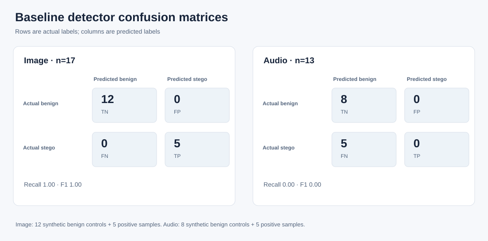
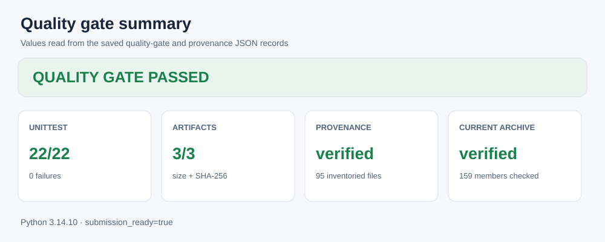
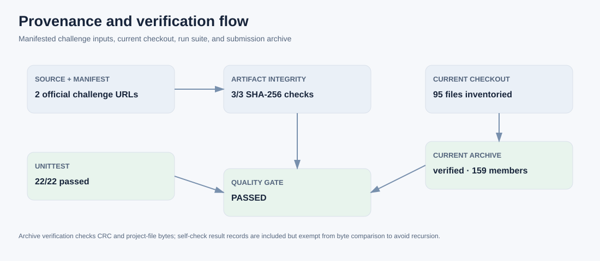
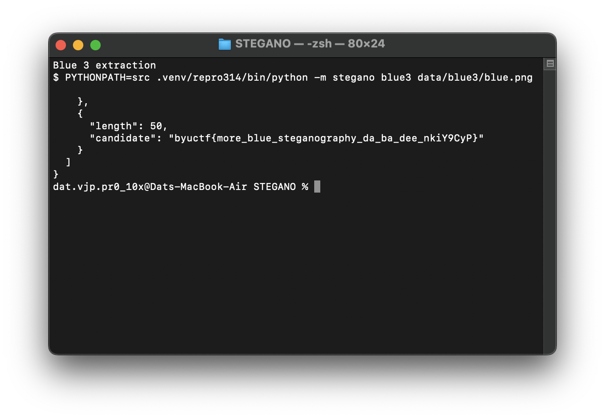
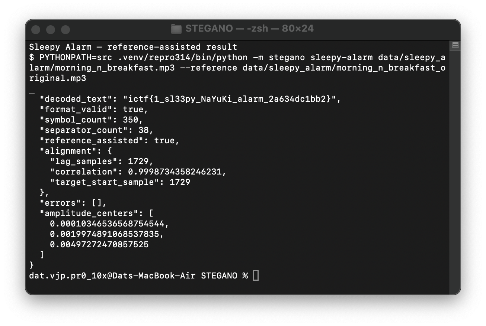
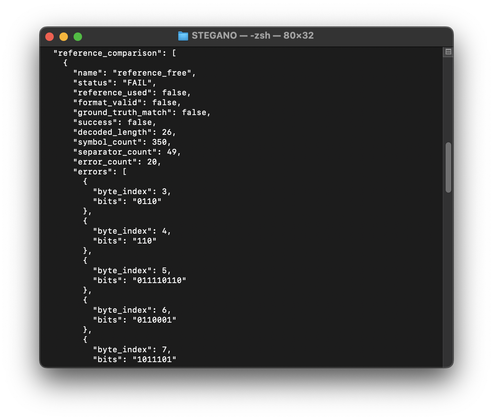
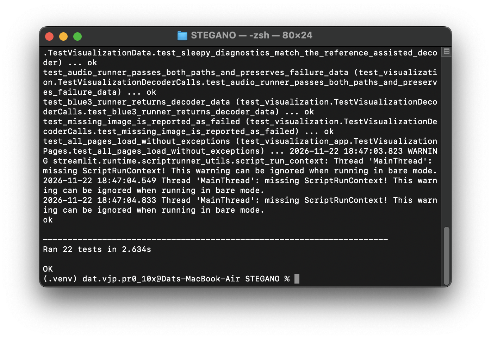

# STEGANO — Báo cáo đồ án thực hành CTF Jeopardy

**Học phần:** UET.CN3124 — An toàn và an ninh mạng (ĐH Công nghệ, ĐHQGHN)  
**Chủ đề:** Steganography (Blue 3 — Ảnh; Sleepy Alarm — Âm thanh)  
**Sinh viên:** Nguyễn Khả Đạt — **MSSV:** 24021404 — **Lớp:** INT3307E_3  
**Giảng viên hướng dẫn:** Nguyễn Đại Thọ

---

## Tóm tắt

Đồ án nghiên cứu và triển khai quy trình giải mã độc lập cho hai thử thách CTF Jeopardy thuộc chủ đề Steganography trên hai loại phương tiện khác nhau: **Blue 3** (ảnh PNG, BYU-CSA) và **Sleepy Alarm** (âm thanh MP3, ImaginaryCTF 2024). Trên bộ artifact đã kiểm tra toàn vẹn (3/3 khớp kích thước và SHA-256 trong `results/artifact_manifest.json`), bộ giải mã khôi phục chính xác flag của Blue 3 (`byuctf{more_blue_steganography_da_ba_dee_nkiY9CyP}`, 50 ký tự) bằng sai khác RGB trên các khối chéo, và khôi phục chính xác flag của Sleepy Alarm (`ictf{1_sl33py_NaYuKi_alarm_2a634dc1bb2}`, 39 ký tự, 350 symbol, 38 separator, 0 lỗi byte) ở chế độ có tệp tham chiếu (*reference-assisted*) với độ lệch căn chỉnh 1.729 mẫu (tương quan chuẩn hóa 0,9999). Ngược lại, chế độ không có tệp tham chiếu (*reference-free*) thất bại (26 ký tự, 49 separator, 20 nhóm byte lỗi, mã thoát 2) và được giữ nguyên như một giới hạn thực nghiệm.

Ngoài phần giải mã cốt lõi, đồ án bổ sung script kiểm chứng dấu hiệu khám phá tín hiệu (`scripts/inspect_discovery_signals.py`), ma trận đánh giá độ bền (robustness) 9 biến thể ảnh (Blue 3 đạt 1/9 PASS) và 23 lượt âm thanh một phía (Sleepy Alarm đạt 7/23 PASS), thí nghiệm bất đối xứng 6 biến thể âm thanh (2/6 PASS), benchmark bộ phát hiện heuristic cơ sở (ảnh đạt TP=5, TN=12, FP=0, FN=0; âm thanh đạt TP=0, TN=8, FP=0, FN=5 — bỏ sót 5/5 mẫu dương), ứng dụng trực quan hóa Streamlit và quy trình kiểm chứng quality gate/provenance tự động với 22/22 `unittest` đạt. Báo cáo cũng phân tích cơ chế bị khai thác từ góc nhìn tấn công–phòng thủ, chỉ rõ điều kiện thành công, giới hạn suy luận và các hướng cải tiến.

---

## 1. Giới thiệu và mục tiêu

Trong học phần **UET.CN3124 — An toàn và an ninh mạng**, hình thức thực hành theo mô hình **CTF Jeopardy** (giải các thử thách phân theo chủ đề để tìm chuỗi flag xác nhận [3]) giúp rèn luyện năng lực phân tích kỹ thuật, trích xuất chứng cứ số (CLO4) và tư duy đánh giá rủi ro – phòng thủ hệ thống (CLO5) theo chuẩn đầu ra môn học. Nhóm chủ đề **Steganography** (giấu tin mật) được lựa chọn vì đặt ra bài toán kép: vừa che giấu thông điệp ngay trong dữ liệu đa phương tiện hợp lệ mà không làm biến dạng rõ rệt về mặt cảm nhận, vừa đòi hỏi người phân tích kết hợp xử lý tín hiệu/ảnh với suy luận an ninh.

Đồ án chọn đồng thời một thử thách ảnh (**Blue 3**) và một thử thách âm thanh (**Sleepy Alarm**) nhằm tránh phụ thuộc vào một dạng dữ liệu hay một kỹ thuật nhúng duy nhất (như LSB thuần túy):

- **Blue 3** nhúng dữ liệu trong miền không gian ảnh PNG bằng tổng sai khác giá trị RGB so với màu nền trên các khối nằm dọc đường chéo chính.
- **Sleepy Alarm** nhúng dữ liệu trong miền thời gian–tần số của tệp MP3 bằng điều chế biên độ ASK (sóng mang 8.000 Hz, tốc độ 50 baud, 3 mức biên độ), đòi hỏi căn chỉnh thời gian và trừ tín hiệu tham chiếu.

**Lý do chọn phương án và so sánh lựa chọn:** Các công cụ phổ biến như Aperi'Solve [4] (chủ yếu trích xuất bit-plane LSB và chuỗi văn bản ảnh) hay Audacity/Sonic Visualiser (quan sát phổ và dạng sóng thủ công) phù hợp cho bước thăm dò trực quan ban đầu, nhưng không mô hình hóa trực tiếp phép cộng sai khác RGB trên lưới $n \times n$ biến thiên của Blue 3, cũng không tự động hóa được bước căn chỉnh cross-correlation chính xác từng mẫu, giữ tiền tố trước vùng chồng lấp và chiếu I/Q theo pha toàn cục cho 350 symbol ASK. Việc cài đặt bằng Python với NumPy [7], SciPy [8], Pillow [9] và soundfile [10] bảo đảm tính tái lập, kiểm thử tự động và đo lường định lượng độ bền.

| Phương án cân nhắc | Tính sẵn có của artifact | Khả năng tái lập tự động | Độ phức tạp kỹ thuật | Liên kết học phần UET.CN3124 |
|---|---|---|---|---|
| **Cặp Blue 3 + Sleepy Alarm & pipeline Python (được chọn)** | Đủ 3 artifact chính thức, kiểm chứng SHA-256 [1], [2] | Cao: CLI, 22 `unittest`, benchmark & quality gate | Phối hợp không gian ảnh RGB-delta + tín hiệu số ASK/I-Q | Bao phủ phân tích chứng cứ số (CLO4) và đánh giá kênh ẩn/DLP (CLO5) |
| Chỉ giải thử thách LSB ảnh đơn lẻ | Sẵn nhiều bài công khai | Trung bình (thường thiếu đối chứng âm) | Thấp, chỉ kiểm tra bit ít trọng số | Chỉ phản ánh một kỹ thuật nhúng cổ điển |
| Dùng thuần công cụ GUI/web (Aperi'Solve, Audacity) | Phụ thuộc giao diện ngoài | Thấp, thao tác thủ công khó kiểm thử hồi quy | Hạn chế khi cần chiếu I/Q và đo độ bền hàng loạt | Khó chuẩn hóa kiểm chứng kỹ thuật phòng thủ |
| Thử thách âm thanh ASK không có bản gốc tham chiếu | Không có tệp gốc đối chứng | Không thể kiểm chứng phép trừ tham chiếu | Dễ rơi vào suy đoán không định lượng được phần dư | Thiếu cơ sở đối chiếu reference-assisted vs reference-free |

**Phạm vi và khung phân bổ công việc:** Trong khung đồ án cá nhân dự kiến khoảng 30 giờ của học phần, khối lượng công việc được phân bổ qua các giai đoạn chính gồm: khảo sát và cài đặt bộ giải mã cho hai challenge; bổ sung kiểm thử đơn vị và hồi quy; triển khai thực nghiệm bất đối xứng, ma trận độ bền và benchmark bộ phát hiện; xây dựng giao diện trực quan hóa Streamlit; tự động hóa quality gate/provenance và hoàn thiện báo cáo (không gán số giờ riêng cho từng công đoạn vì thời lượng thực hiện trong nhật ký là ước lượng tự báo cáo).

---

## 2. Bối cảnh và kiến thức nền

**Steganography so với mật mã học (Cryptography):** Mật mã học biến đổi bản rõ thành bản mã không thể đọc được nhằm bảo vệ tính bí mật, nhưng bản thân sự tồn tại của thông điệp mã hóa là hiển nhiên đối với bên quan sát. Ngược lại, steganography giấu sự *tồn tại* của thông điệp bên trong một vật mang (*cover media*) tưởng chừng vô hại như ảnh hoặc âm thanh [11]; hai kỹ thuật thường bổ trợ nhau trong thực tế.

**Nhúng miền không gian trong ảnh (Spatial-domain RGB delta):** Thay vì chỉ sửa trực tiếp bit ít trọng số nhất (LSB) của từng điểm ảnh [11], một biến thể miền không gian mã hóa từng ký tự bằng độ lệch màu cộng dồn $\Delta = \sum_{(x,y)\in B_i} (I(x,y) - B_0)$ trên một vùng/khối $B_i$ so với màu nền chuẩn $B_0$. Khi $B_0$ chiếm đa số tuyệt đối điểm ảnh, sai khác cộng dồn vừa đủ nhỏ để mắt thường khó nhận ra trên từng điểm ảnh, vừa khôi phục được giá trị mã ký tự khi cộng trên toàn khối.

**Điều chế ASK trong âm thanh và vai trò tín hiệu tham chiếu:** *Amplitude-Shift Keying* (ASK) biểu diễn ký hiệu số bằng cách thay đổi biên độ của một sóng mang hình sin $s(t) = A_k \cos(2\pi f_c t + \phi)$. Khi tín hiệu dữ liệu có biên độ rất nhỏ (khoảng $10^{-4}$–$5\times 10^{-3}$, tương ứng tâm cụm đo được tới $\approx 0,005$) được cộng lên một bản nhạc nền có băng thông rộng và biên độ lớn hơn nhiều, năng lượng nhạc nền lấn át tín hiệu mang tin trong từng cửa sổ symbol. Nếu có bản ghi gốc (*reference*), việc căn chỉnh pha/thời gian chính xác và lấy hiệu `target - reference` sẽ triệt tiêu phần lớn nền nhạc, làm lộ rõ các mức biên độ ASK.

**Ảnh hưởng của nén MP3 tới phép trừ tín hiệu:** MP3 (MPEG-1/2 Layer-3) là định dạng nén mất dữ liệu (*lossy*) sử dụng băng lọc kết hợp biến đổi MDCT theo khung và mô hình tâm lý thính học (*psychoacoustic masking*) [12]. Quá trình mã hóa/giải mã MP3 thường chèn thêm độ trễ đầu khung (*encoder delay*), suy giảm hoặc làm tròn phổ tần số cao (bao gồm vùng 8 kHz) và tạo sai số lượng tử hóa giữa hai lần nén. Do đó, không thể trừ trực tiếp từ mẫu 0 mà phải ước lượng độ trễ (lag) bằng tương quan chéo (*cross-correlation*) trước khi trừ; đồng thời, ngay cả sau khi trừ, phần dư vẫn còn nhiễu nén MP3 khiến biên độ symbol dao động nhẹ.

---

## 3. Môi trường và công cụ

<a id="report-environment"></a>
<a id="report-artifacts"></a>

**Môi trường thực thi và tính minh bạch tham số:** Mã nguồn yêu cầu **Python $\ge 3.10$**. Các lần chạy tái lập và quality gate được ghi nhận trong hồ sơ sử dụng **Python 3.14.10** (CPython) trên macOS arm64 (`results/final/provenance.json`). Phiên bản các thư viện chính được chốt trong `requirements-lock.txt` (sinh từ `pip freeze` trên môi trường kiểm thử) bên cạnh khoảng phiên bản tại `requirements.txt`: NumPy `2.5.5`, Pillow `13.0.0`, SciPy `1.18.1`, SoundFile `0.14.0`, Plotly `6.9.0` và Streamlit `1.67.0`.

[Manifest chạy ngày 19/11](../results/reproduction-2026-11-19/sleepy-alarm-reference-assisted-manifest.json) ghi nhận cấu hình giải mã cố định cho Sleepy Alarm gồm sóng mang 8.000 Hz, tốc độ 50 baud và cửa sổ 7,0 giây. Hồ sơ lịch sử xác nhận các thông số đã dùng trong thực nghiệm nhưng không lưu dấu vết quá trình dò tìm ban đầu trước khi biết flag; do đó báo cáo xem đây là cấu hình decoder cố định, không tuyên bố lựa chọn mù, và xem phép đối chiếu *exact match* là bước kiểm tra hợp lệ sau giải mã. Để phục vụ đối chiếu kỹ thuật tái lập khi vấn đáp, Mục 4 bổ sung kết quả kiểm tra tín hiệu **sau khi đã giải** (*post-hoc inspection*) bằng `scripts/inspect_discovery_signals.py`. Tác giả xác nhận không tham khảo writeup công khai cho hai challenge.

**Tính toàn vẹn artifact đầu vào:** Ba tệp gốc trong `data/` được kiểm tra kích thước và mã băm SHA-256 bằng `python scripts/verify_artifacts.py` đối chiếu với [manifest](../results/artifact_manifest.json):

| Artifact | Kích thước (bytes) | SHA-256 | Nguồn gốc |
|---|---:|---|---|
| `data/blue3/blue.png` | 9.406 | `009dab85bf6ccc5b42b8efa5f959ab6efa0c556b37eb6b4a77a21ec3356b721e` | BYU-CSA [1] |
| `data/sleepy_alarm/morning_n_breakfast.mp3` | 179.283 | `bd181876c2d28152b9c3982fd88945d4e681fd93d49477622ea5841a3ff25ae2` | ImaginaryCTF 2024 [2] |
| `data/sleepy_alarm/morning_n_breakfast_original.mp3` | 160.495 | `d0c283834955e54d68b0bba723ccd194142a428d2de74722e5f1dff3ccbd94ad` | ImaginaryCTF 2024 [2] |

---

## 4. Quy trình từng bước

<a id="report-methods"></a>

Toàn bộ các bước triển khai, giả thuyết, kết quả trung gian và xử lý lỗi đều được ghi chép theo thời gian thực trong [LOGBOOK.md](../LOGBOOK.md) và chi tiết hóa tại [APPENDIX.md](APPENDIX.md). Phần *kiểm tra dấu hiệu tín hiệu* trong mỗi mục dưới đây là phép **kiểm tra tái lập sau khi đã giải (post-hoc)** thực thi qua `python scripts/inspect_discovery_signals.py` (`results/final/discovery-signals.json`, `results/final/discovery-signals.log`), không phải nhật ký lịch sử trước khi giải mã. Các lệnh đều là lệnh Python thuần chạy từ thư mục gốc repo.

### 4.1. Challenge 1 — Blue 3 (Ảnh PNG)

1. **Dấu hiệu nhận diện cấu trúc (kiểm tra post-hoc từ ảnh gốc):** Khi thống kê kênh RGB của `data/blue3/blue.png` ($512 \times 512$ px = 262.144 điểm ảnh), ảnh chỉ có 49 màu phân biệt và màu nền `(64, 77, 205)` chiếm 258.916 điểm ảnh (98,77%). Khi lọc mặt nạ các điểm ảnh khác màu nền (`pixels != base`), toàn bộ **3.228 điểm ảnh** (1,23%) đều tập trung dọc đường chéo chính với khoảng cách $|x - y| \le 9\text{ px}$ (`results/final/discovery-signals.json`), minh họa trực quan ở Hình 1. Quan sát này lý giải việc thử mô hình chia ảnh thành $n \times n$ khối vuông và cộng sai khác RGB trên $n$ khối đường chéo.
2. **Giả thuyết và lệnh thực thi:** Tổng sai khác RGB so với màu nền trong $n$ khối chéo cho chuỗi ký tự khớp khuôn dạng flag:
   ```bash
   PYTHONPATH=src python -m stegano blue3 data/blue3/blue.png
   ```
3. **Kết quả trung gian và đầu ra:** Trong `src/stegano/image.py`, bộ giải mã duyệt $n$ từ $2$ đến $\min(w,h)$. Tệp log `results/recheck/blue3.log` ghi nhận 49 lần thử (`length=2..50`); ở $n=2..49$, các chuỗi sinh ra là ký tự nhiễu hoặc thiếu dấu đóng `}` (ví dụ tại $n=49$ thu được `byuctf{more_blue_steganography_da_ba_dee_nkiY9CyP`), đến $n=50$ thu được chuỗi hợp lệ `byuctf{more_blue_steganography_da_ba_dee_nkiY9CyP}` (`format_valid: true`, exit code 0).
4. **Lỗi và hiệu chỉnh:** Ở lần dựng kiểm thử trực quan ban đầu ([Logbook Entry 00](../LOGBOOK.md#entry-00), [Entry 12](../LOGBOOK.md#entry-12)), môi trường `.venv` cũ dùng Python 3.9.6 (< 3.10) và Python hệ thống thiếu `streamlit`; sinh viên đã tạo môi trường ảo riêng dùng Python 3.14.10 và kiểm tra `pip check`.
5. **Bằng chứng:** Xem [Logbook Entry 01](../LOGBOOK.md#entry-01), [Appendix A.3](APPENDIX.md#app-a3-blue-3-extraction) và Hình 1.


*Hình 1. Trang chẩn đoán Blue 3 trên Streamlit: histogram kênh RGB tập trung tại màu nền `(64, 77, 205)` và toàn bộ điểm ảnh sai khác phân bố dọc 50 khối trên đường chéo chính (`evidence/visualization/2026-11-22-blue3-rgb-histogram-diagonal-trace.png`).*

### 4.2. Challenge 2 — Sleepy Alarm (Âm thanh MP3)

1. **Dấu hiệu phổ và tham số symbol (kiểm tra post-hoc từ cặp âm thanh):** Trước khi trừ bản gốc, phổ `periodogram` trong 7,0 giây đầu của `morning_n_breakfast.mp3` có đỉnh chính tại 1.598,71 Hz của nhạc nền, còn dải 7,9–8,1 kHz chỉ chiếm **0,03%** (`0.000257`, `results/final/discovery-signals.json`) năng lượng; lưu ý con số **0,02%** (`0.000204`) trong `results/steganalysis/benchmark.json` ở Mục 6.2 là tỷ số đo trên **toàn tệp 10,02 giây**, còn **0,03%** đo riêng trên **cửa sổ 7,0 giây đầu** chứa payload. Sau khi căn chỉnh cross-correlation (`lag_samples = 1729`) và lấy hiệu `target - reference`, phần dư làm lộ một đỉnh hẹp dải nổi bật đúng tại **8.000,00 Hz**, với dải 7,9–8,1 kHz tăng lên chiếm **52,40%** (`0.524009`) tổng năng lượng phần dư (Hình 2). Khi vẽ phần dư với tham số cấu hình cố định của decoder là tốc độ **50 baud** (tương ứng chu kỳ **20 ms/symbol**, 350 symbol trong 7,0 giây), biểu đồ 32 symbol đầu (`evidence/visualization/2026-11-22-sleepy-first-32-symbols-byte-groups.png`) và Hình 3 xác nhận các ranh giới mức biên độ khớp nhất quán với khung 20 ms này (đây là tham số cố định của decoder được kiểm chứng nhất quán, không phải đại lượng đo độc lập từ đầu).
2. **Giả thuyết và lệnh thực thi:** Trừ bản gốc làm lộ 3 mức biên độ ASK (separator, bit `0`, bit `1`), còn chạy không tham chiếu dùng làm đối chứng âm:
   ```bash
   # Chế độ có tham chiếu (reference-assisted)
   PYTHONPATH=src python -m stegano sleepy-alarm \
     data/sleepy_alarm/morning_n_breakfast.mp3 \
     --reference data/sleepy_alarm/morning_n_breakfast_original.mp3

   # Chế độ không tham chiếu (reference-free — đối chứng âm)
   PYTHONPATH=src python -m stegano sleepy-alarm \
     data/sleepy_alarm/morning_n_breakfast.mp3
   ```
3. **Kết quả trung gian:** Ở chế độ *reference-assisted* (`results/reproduction-2026-11-19/sleepy-alarm-reference-assisted-output.json`), căn chỉnh đạt `lag_samples = 1729`, `target_start_sample = 1729`, tương quan `0.9998734358246231` ($\approx 0,9999$). Phân cụm 350 phép chiếu I/Q cho 3 tâm biên độ `[0.0001035, 0.0019975, 0.0049727]` (Hình 3), tách 38 separator, 0 lỗi nhóm byte, giải mã đúng 39 ký tự `ictf{1_sl33py_NaYuKi_alarm_2a634dc1bb2}` (exit code 0). Ở chế độ *reference-free* (`results/recheck/sleepy-alarm-reference-free.log`), vẫn đo 350 symbol nhưng phân cụm lỗi (49 separator, 20 nhóm byte sai độ dài), chỉ ra mảnh vỡ `ictsl33p_Nauk_arm_224dcb2}` (26 ký tự, `format_valid: false`, exit code 2).
4. **Lỗi phát hiện và cách sửa ([Logbook Entry 12](../LOGBOOK.md#entry-12)):** Phiên bản decoder trước ngày 19/11 chỉ giải mã trên đoạn chồng lấp `x - y`, làm mất phần đầu (`prefix`) của tệp target trước điểm `target_start_sample` khi vùng overlap bắt đầu bên trong symbol đầu tiên. Bản sửa trong `src/stegano/audio.py` ghép lại `prefix = target[:alignment['target_start_sample']]` và giữ chỉ số mẫu toàn cục khi chiếu I/Q từng symbol; bài kiểm thử hồi quy tổng hợp (`tests/test_audio.py`) đặt điểm overlap tại 1,5 chu kỳ symbol đã xác nhận 16 nhãn đầu và toàn bộ flag đều đúng. Khi chạy `unittest` với `AppTest` của Streamlit ở chế độ bare-mode xuất hiện 3 cảnh báo `missing ScriptRunContext` (không ảnh hưởng kết quả PASS) và biểu ngữ trạng thái dashboard tổng quan đã được sửa ở [Logbook Entry 16](../LOGBOOK.md#entry-16).
5. **Bằng chứng:** Xem [Logbook Entry 02](../LOGBOOK.md#entry-02), [Entry 03](../LOGBOOK.md#entry-03), [Entry 12](../LOGBOOK.md#entry-12), [Appendix A.4](APPENDIX.md#app-a4-sleepy-alarm-reference-assisted)–[A.5](APPENDIX.md#app-a5-sleepy-alarm-reference-free), [A.15](APPENDIX.md#app-a15-ask-prefix-preservation-and-output-regression), Hình 2 và Hình 3.


*Hình 2. So sánh phổ `periodogram` 0–16 kHz trong 7,0 giây đầu trước và sau khi căn chỉnh trừ bản gốc (`report/figures/sleepy-residual-spectrum.svg`, sinh bởi `scripts/inspect_discovery_signals.py`): đỉnh sóng mang 8.000 Hz lộ rõ từ 0,03% lên 52,40% năng lượng phần dư.*


*Hình 3. Phân bố biên độ 350 symbol ASK sau khi trừ tham chiếu: 3 cụm tách biệt rõ giữa separator, bit `0` và bit `1` (`evidence/visualization/2026-11-22-sleepy-ask-symbol-clusters.png`).*

---

## 5. Kết quả

<a id="report-results"></a>

Bảng dưới đây tổng hợp toàn bộ kết quả định lượng thu được từ các tệp JSON/log đã lưu trong repo:

| Hạng mục kiểm tra | Kết quả ghi nhận | Nguồn số liệu |
|---|---|---|
| Tính toàn vẹn artifact | **3/3 PASS** (size + SHA-256 khớp) | `results/artifact_manifest.json` |
| Dấu hiệu khám phá (post-hoc) | Blue 3: 3.228 px trong $\lvert x-y \rvert \le 9$; Audio residual: đỉnh 8.000 Hz (52,40%) | `results/final/discovery-signals.json` |
| Giải mã Blue 3 | **Exact match**, 50 ký tự: `byuctf{more_blue_steganography_da_ba_dee_nkiY9CyP}` | `results/recheck/blue3.log` |
| Sleepy Alarm (có reference) | **Exact match**, 39 ký tự: `ictf{1_sl33py_NaYuKi_alarm_2a634dc1bb2}`; 350 symbol, 38 separator, lag 1.729, corr 0,9999, 0 lỗi byte | `results/reproduction-2026-11-19/sleepy-alarm-reference-assisted-output.json` |
| Sleepy Alarm (không reference) | **FAIL** — 26 ký tự, 49 separator, 20 nhóm byte lỗi, `format_valid: false`, exit code 2 | `results/steganalysis/benchmark.json` |
| Sleepy Alarm bất đối xứng | Baseline **PASS**; biến đổi một phía **2/6 PASS** (2 resample PASS, 4 gain FAIL) | `results/asymmetric/asymmetric_robustness.json` |
| Robustness mở rộng Blue 3 | **1/9 PASS** (chỉ Gaussian blur r=0,3 đạt exact match) | `results/robustness/blue3_extended_robustness.json` |
| Robustness mở rộng Sleepy Alarm | **7/23 PASS** (baseline + gain ×0,75, AWGN SNR 30 dB, resample mỗi phía) | `results/robustness/sleepy_alarm_robustness_matrix.json` |
| Detector cơ sở — Ảnh | **TP=5, TN=12, FP=0, FN=0** (Precision/Recall/F1 = 1,00 trên 17 mẫu) | `results/steganalysis/benchmark.json` |
| Detector cơ sở — Âm thanh | **TP=0, TN=8, FP=0, FN=5** (Recall = 0,00 trên 13 mẫu — bỏ sót 5/5 mẫu dương) | `results/steganalysis/benchmark.json` |
| Kiểm thử & Quality gate cuối | **22/22 unittest PASS** (exit code 0); provenance (97 tệp) & archive (169 thành viên) `verified` | `results/final/quality-gate.json` |

Về kiểm tra chất lượng và nguồn gốc (*provenance*), lần chạy cuối trong `results/final/quality-gate.json` và `results/final/provenance.json` xác nhận 3/3 artifact gốc, 22/22 `unittest`, 97 tệp nguồn được băm và toàn bộ 169 thành viên trong gói nộp `submission_package_current.zip` đạt trạng thái `verified`; chi tiết đối chiếu các mốc lịch sử và luồng provenance nằm trong phần Phụ lục.

---

## 6. Phân tích kỹ thuật và phòng thủ

### 6.1. Cơ chế kỹ thuật, điều kiện thành công và giới hạn

**Blue 3 (`src/stegano/image.py`):** Tệp `blue.png` có kích thước $512 \times 512$ px, chỉ gồm 49 màu RGB phân biệt, trong đó màu nền chiếm tới **98,77%** tổng số điểm ảnh (`modal_rgb_fraction = 0.987686`) và độ lệch chuẩn trung bình các kênh chỉ là **0,094** (`results/steganalysis/benchmark.json`). Bộ giải mã xác định màu nền phổ biến nhất `base`, sau đó thử lần lượt số khối $n \in [2, \min(w,h)]$, cắt $n$ khối kích thước $\lfloor w/n \rfloor \times \lfloor h/n \rfloor$ trên đường chéo chính (`pixels[i*ch:(i+1)*ch, i*cw:(i+1)*cw]`). Với mỗi khối $i$, tổng sai khác 3 kênh RGB so với `base` là $\text{value} = \sum (\text{block} - \text{base})$ (cộng trên cả chiều không gian và 3 kênh màu), rồi chuyển thành ký tự qua `chr(value)`.

- *Điều kiện thành công & giới hạn:* Phương pháp đòi hỏi ảnh không bị thay đổi độ sáng/tương phản toàn cục (vốn làm lệch hiệu `block - base` nhân theo số pixel trong khối $10\times 10 = 100$ lần), không bị cắt xén (làm lệch tọa độ đường chéo) và không có nhiễu cộng làm tràn mã ký tự. Đặc biệt, vòng lặp chọn $n=50$ dựa trên điều kiện kiểm tra định dạng đã biết (`candidate.startswith('byuctf{')`, kết thúc bằng `}`, chỉ gồm ký tự chữ/số hoặc `_{}`); đây là **kiểm tra theo định dạng đã biết**, không phải giải mã mù hoàn toàn trên chuỗi bất kỳ. Bảng dưới đây trích 7 khối chéo đầu tiên từ `diagnose_blue3` cho thấy cách tổng sai khác RGB tạo nên tiền tố `byuctf{`:

| Khối | Tọa độ `(x0:x1, y0:y1)` | `rgb_delta` `(ΔR, ΔG, ΔB)` | Tổng mã ký tự | Ký tự |
|---:|---|---|---:|---|
| 0 | `(0:10, 0:10)` | `(30, 37, 31)` | 98 | `b` |
| 1 | `(10:20, 10:20)` | `(33, 50, 38)` | 121 | `y` |
| 2 | `(20:30, 20:30)` | `(39, 46, 32)` | 117 | `u` |
| 3 | `(30:40, 30:40)` | `(36, 30, 33)` | 99 | `c` |
| 4 | `(40:50, 40:50)` | `(41, 33, 42)` | 116 | `t` |
| 5 | `(50:60, 50:60)` | `(32, 35, 35)` | 102 | `f` |
| 6 | `(60:70, 60:70)` | `(49, 40, 34)` | 123 | `{` |

**Sleepy Alarm (`src/stegano/audio.py`):** Cặp MP3 có tần số lấy mẫu 44.100 Hz, 2 kênh stereo, thời lượng khoảng 10,02 giây. Bộ giải mã đọc tham số cố định: sóng mang $f_c = 8.000\text{ Hz}$, tốc độ $50\text{ baud}$ ($\approx 882\text{ mẫu/symbol}$), cửa sổ $7\text{ giây} \Rightarrow 350\text{ symbol}$. Trong chế độ có tham chiếu, hàm `_align` hạ mẫu theo hệ số `round(sr/4000) = 11` để tìm độ trễ thô bằng FFT cross-correlation, rồi tinh chỉnh từng mẫu trong lân cận $\pm 11$ mẫu để tối đa hóa tương quan chuẩn hóa (đạt `lag_samples = 1729`, `correlation = 0.999873`). Phần tiền tố `target[:1729]` được ghép trước hiệu `x - y` nhằm giữ nguyên mốc thời gian và pha sóng mang tại mẫu 0. Tiếp theo, `_project_symbol` chiếu trực tiếp từng cửa sổ symbol (không dùng bộ lọc thông dải toàn cục để tránh làm nhòe năng lượng biên) lên cặp trực giao I/Q:
$$I_i = \frac{2}{N_i}\sum_{k} (z_k - \bar{z})\cos\!\left(\frac{2\pi f_c k}{f_s}\right),\quad Q_i = \frac{2}{N_i}\sum_{k} (z_k - \bar{z})\sin\!\left(\frac{2\pi f_c k}{f_s}\right),\quad A_i = \sqrt{I_i^2 + Q_i^2}$$
Ba mức biên độ $A_i$ được phân cụm bằng k-means 1D khởi tạo tại phân vị 5%, 50%, 95% thành ký tự phân cách (`' '`), bit `'0'` và bit `'1'`, rồi ghép mỗi cụm 8 bit giữa các separator thành 1 ký tự ASCII.

- *Điều kiện thành công & giới hạn:* Thành công phụ thuộc vào việc có bản ghi gốc đồng dạng (cùng biên độ nền, không bị cắt xén hoặc lọc dải 7,5–8,5 kHz) và cố định đúng $(f_c, \text{baud}, \text{duration})$. Việc chấp nhận kết quả (`format_valid`) dựa trên kiểm tra 39 cụm đủ 8 bit, không lỗi byte và khớp khuôn dạng `ictf{...}`, tức là kiểm tra theo định dạng của challenge chứ không phải giải mù phổ quát. Năm nhóm byte đầu tiên trích từ `diagnose_sleepy_alarm` minh họa quá trình ghép 8 bit thành ký tự `ictf{`:

| Chỉ số byte | Chuỗi 8 bit (sau phân cụm ASK) | Mã ASCII | Ký tự |
|---:|---|---:|---|
| 0 | `01101001` | 105 | `i` |
| 1 | `01100011` | 99 | `c` |
| 2 | `01110100` | 116 | `t` |
| 3 | `01100110` | 102 | `f` |
| 4 | `01111011` | 123 | `{` |

### 6.2. Phân tích dưới góc nhìn tấn công và phòng thủ

- **Cơ chế bị khai thác & rủi ro thực tế:** Kẻ tấn công lợi dụng dung lượng dư thừa của tệp đa phương tiện thông thường (ảnh minh họa PNG hoặc tệp ghi âm/nhạc chuông MP3) để thiết lập **kênh rò rỉ dữ liệu bí mật (*data exfiltration*)** hoặc truyền lệnh điều khiển (C2) vượt qua tường lửa/DLP truyền thống vốn chỉ kiểm tra văn bản hoặc chữ ký mã độc. Với kỹ thuật sai khác khối màu hoặc ASK tần số cao (8 kHz, biên độ $\le 0,005$), nội dung tệp vẫn hiển thị và phát ra âm thanh bình thường đối với người dùng cuối.
- **Dấu hiệu phát hiện (*Indicators*):**
  1. *Với ảnh kiểu Blue 3:* Histogram tập trung cực đoan vào một giá trị RGB (>90% điểm ảnh giống hệt nhau), độ lệch chuẩn kênh rất thấp, xuất hiện các biến thiên màu cục bộ rời rạc dọc cấu trúc hình học (đường chéo) không tự nhiên.
  2. *Với âm thanh kiểu Sleepy Alarm:* Có năng lượng hẹp dải quanh tần số sóng mang (8 kHz) biến thiên theo chu kỳ khối cố định (20 ms ứng với 50 baud) và xuất hiện sai lệch nhỏ ở miền tần số cao nếu so được với bản gốc công khai.
- **Biện pháp phòng thủ, giảm thiểu (*Mitigations*) và giới hạn thực nghiệm:**
  - *Chuẩn hóa và tái tạo nội dung (Content Disarm and Reconstruction — CDR):* Áp dụng các phép biến đổi mạnh tại cổng mạng (ví dụ thay đổi độ sáng/tương phản, cắt viền, thêm nhiễu hoặc tái mã hóa mất dữ liệu ở mức phù hợp). Tuy nhiên, cần lưu ý giới hạn từ số liệu thực nghiệm (Mục 7): **xử lý nhẹ không đủ làm biện pháp phòng thủ** vì *Gaussian blur radius 0,3* (Blue 3) và *resample round-trip 44,1→48→44,1 kHz* cả hai phía (Sleepy Alarm) vẫn **PASS** toàn bộ flag. Ngoài ra, dù 8/9 phép biến đổi ảnh làm Blue 3 **FAIL** tiêu chí exact-match, biến đổi `brightness ×0,9` vẫn giữ đúng **47/50 vị trí ký tự** (`edit_distance = 3`, `results/robustness/blue3_extended_robustness.json`), tức là làm hỏng tính hợp lệ giải mã tự động nhưng chưa xóa sạch toàn bộ dữ liệu rò rỉ.
  - *Lọc dải tần và thay đổi biên độ (với âm thanh):* Trong tập thử nghiệm của đồ án, bộ lọc thông dải 7,5–8,5 kHz, nhiễu AWGN từ 20 dB trở xuống và lệch gain $\times 0,5/\times 1,5$ (hoặc $\times 0,25/\times 1,25/\times 1,75$) đều khiến decoder thất bại (FAIL). Các kỹ thuật tái nén MP3 ở bitrate thấp hơn hoặc lọc thông thấp cũng là hướng giảm thiểu hợp lý về mặt lý thuyết, song chưa được thực nghiệm đo đạc trực tiếp trong đồ án này.
  - *Giám sát tệp media:* Quét bất thường thống kê (entropy không gian, phân bố màu, phổ tần số hẹp dải) tại proxy/DLP đối với tệp đa phương tiện gửi ra ngoài bất thường.
- **Liên hệ trung thực với kết quả detector của đồ án:** Bộ phát hiện heuristic cố định trong `src/steganalysis.py` yêu cầu thỏa mãn đồng thời 2 ngưỡng cho mỗi loại media (`results/steganalysis/benchmark.json`):
  - *Ảnh:* Đạt **TP=5, TN=12, FP=0, FN=0** (F1 = 1,00) vì `blue.png` và 4 biến thể độ sáng đều có `modal_rgb_fraction = 0.9877 >= 0.90` và `mean_channel_std ≈ 0.094 <= 8.0`. Tuy nhiên ngưỡng này dễ bỏ sót nếu đối tượng là ảnh tự nhiên phức tạp (không đơn sắc) và chỉ được đánh giá trên 12 ảnh đối chứng tổng hợp.
  - *Âm thanh:* Đạt **TP=0, TN=8, FP=0, FN=5** (Recall = 0,00 — bỏ sót toàn bộ 5 mẫu dương). Nguyên nhân trực tiếp từ số liệu `benchmark.json`: điều kiện biến thiên RMS theo khối 50 baud đạt (`symbol_block_rms_cv ≈ 0.987 >= 0.15`), nhưng điều kiện tỷ số năng lượng dải 8 kHz thất bại hoàn toàn (`carrier_band_energy_ratio ≈ 0.000204 < 0.02`, tức chỉ ~0,02% tổng năng lượng trên toàn tệp, thậm chí thấp hơn mẫu tổng hợp `~0.009`). Điều này chứng minh sóng mang biên độ nhỏ bị nhạc nền lấn át hoàn toàn trên phổ toàn cục, nên detector ngưỡng năng lượng cố định không thể dùng làm cổng chặn đơn lẻ.
  - *Hướng cải tiến detector:* Thay tỷ số năng lượng toàn cục bằng tỷ số đỉnh phổ hẹp dải so với nền cục bộ (*narrowband peak-to-local-floor ratio*), phân tích sai khác phổ/cepstral theo cửa sổ trượt 20 ms, và hiệu chỉnh bộ phân loại học máy trên tập dữ liệu âm thanh/ảnh thực tế đa dạng thay vì ngưỡng cứng.

**Bảng đối chiếu hai kỹ thuật dưới góc nhìn an toàn thông tin (UET.CN3124):**

| Tiêu chí | Blue 3 (Ảnh PNG) | Sleepy Alarm (Âm thanh MP3) |
|---|---|---|
| **Miền nhúng** | Miền không gian: tổng sai khác RGB theo $n$ khối chéo | Miền thời gian–tần số: điều chế ASK sóng mang 8 kHz, 50 baud |
| **Kích thước payload của challenge** | 50 ký tự trên ảnh $512 \times 512$ px *(kích thước thực tế của bài, chưa phải dung lượng tối đa)* | 39 byte trong cửa sổ 7 giây *(kích thước thực tế của bài, chưa phải dung lượng tối đa)* |
| **Độ bền quan sát được** | 1/9 biến thể ảnh PASS (`Gaussian blur r=0,3`); `brightness ×0,9` còn 47/50 vị trí khớp *(không so sánh trực tiếp với tỷ lệ của audio do khác loại và số lượng phép biến đổi)* | 7/23 lượt một phía PASS (baseline + gain ×0,75, AWGN 30 dB, resample mỗi phía) *(không so sánh trực tiếp với tỷ lệ của ảnh)* |
| **Dấu hiệu phát hiện (IDS/DLP)** | Tỷ lệ màu đơn sắc cực cao (98,77%), `mean_channel_std` thấp (0,094) | Đỉnh năng lượng hẹp dải quanh 8 kHz (0,02% toàn tệp / 0,03% trong 7 s đầu trước khi trừ; lộ 52,40% sau khi trừ) |
| **Biện pháp phòng thủ (CDR/giám sát)** | Biến đổi mạnh độ sáng/tương phản, cắt viền, nhiễu (xử lý nhẹ như blur 0,3 không đủ) | Lọc dải 7,5–8,5 kHz, lệch gain hoặc nhiễu mạnh (resample nhẹ không đủ) |
| **Liên hệ học phần UET.CN3124** | Kênh ẩn rò rỉ dữ liệu qua tệp ảnh; kiểm soát nội dung đa phương tiện tại cổng DLP | Kênh ẩn thời gian–tần số vượt qua bộ lọc chữ ký thông thường; bài toán phát hiện kênh ẩn trên IDS/DLP |

---

## 7. Phần tùy biến và mở rộng

<a id="report-asymmetric-robustness"></a>
<a id="report-benchmark"></a>
<a id="report-extended-robustness"></a>
<a id="report-visualization"></a>

Ngoài việc giải mã hai challenge, sinh viên đã phát triển các công cụ đo lường và kiểm chứng mở rộng sau:

1. **Thí nghiệm độ bền bất đối xứng Sleepy Alarm (`scripts/run_audio_asymmetric.py`):** Biến đổi độc lập chỉ `target` hoặc chỉ `reference` với gain ($\times 0,5$; $\times 1,5$) và resample round-trip ($44,1 \to 48 \to 44,1\text{ kHz}$). Kết quả trong `results/asymmetric/asymmetric_robustness.json` cho thấy baseline PASS (tính riêng), còn biến đổi một phía đạt **2/6 PASS**:

   | Tệp bị biến đổi | Gain ×0,5 | Gain ×1,5 | Resample 44,1→48→44,1 kHz |
   |---|---|---|---|
   | **Target** | **FAIL** (28 ký tự, 14 lỗi byte) | **FAIL** (34 ký tự, 4 lỗi byte) | **PASS** (39 ký tự, 0 lỗi byte) |
   | **Reference** | **FAIL** (36 ký tự, 5 lỗi byte) | **FAIL** (33 ký tự, 4 lỗi byte) | **PASS** (39 ký tự, 0 lỗi byte) |

2. **Ma trận độ bền mở rộng (`scripts/run_extended_robustness.py`):** Đánh giá bằng tiêu chí nghiêm ngặt (`format_valid`, khớp chính xác ground truth và 0 lỗi byte), kết quả lưu tại `results/robustness/` và minh họa tại Hình 4:
   - *Blue 3 (`blue3_extended_robustness.json`):* Đạt **1/9 PASS** — chỉ phép làm mờ nhẹ *Gaussian blur radius 0,3* giữ được toàn bộ 50 ký tự; 8 phép còn lại (brightness $\times 0,9/\times 1,1$, contrast $\times 0,9/\times 1,1$, crop 16 px và nhiễu Gaussian $\sigma = 0,5/1,0/2,0$) đều FAIL (dù brightness $\times 0,9$ giữ đúng 47/50 vị trí ký tự ở độ dài 50).
   - *Sleepy Alarm (`sleepy_alarm_robustness_matrix.json`):* Đạt **7/23 PASS** gồm baseline và 6 lượt biến đổi một phía (gain $\times 0,75$, AWGN SNR 30 dB, resample round-trip trên từng phía `target` và `reference`); 16 lượt còn lại (gain $\times 0,25/\times 0,5/\times 1,25/\times 1,5/\times 1,75$, AWGN SNR 20/10 dB, bandpass 7,5–8,5 kHz trên mỗi phía) đều FAIL.


*Hình 4. Tổng hợp kết quả PASS/FAIL trên 9 biến thể ảnh Blue 3 và 23 lượt thử nghiệm Sleepy Alarm (`report/figures/robustness-heatmaps.svg`, nguồn `results/recheck/robustness/`).*

3. **Benchmark bộ phát hiện steganalysis & đối chiếu công cụ mã nguồn mở (`scripts/run_steganalysis_benchmark.py`):** Ma trận nhầm lẫn trên 17 mẫu ảnh và 13 mẫu âm thanh được minh họa ở Hình 5 (`results/steganalysis/benchmark.json`). Đồng thời, báo cáo đối chiếu ở mức phạm vi kỹ thuật với [Aperi'Solve](https://github.com/Zeecka/AperiSolve) [4] (phân tích ảnh/bit-plane), [The-A-Files](https://github.com/pawel-kaczmarek/The-A-Files) [5] (framework đánh giá độ bền steganography âm thanh) và [WavSteg](https://github.com/ragibson/Steganography) [6] (LSB trên WAV) — không cài đặt hoặc chạy thực nghiệm các công cụ ngoài này.
4. **Dashboard trực quan hóa Streamlit & Quality gate tự động:** Xây dựng ứng dụng 3 trang (`visualization/app.py`) hiển thị trạng thái toàn vẹn, phân tích chẩn đoán từng bước và tự động hóa kiểm thử/đóng gói qua `scripts/verify_reproducibility.py`.



*Hình 5. Ma trận nhầm lẫn của bộ phát hiện heuristic cơ sở trên tập mẫu xác định: ảnh 17 mẫu (F1 = 1,00) và âm thanh 13 mẫu (FN = 5/5, Recall = 0,00) (`report/figures/benchmark-confusion-matrices.svg`).*

---

## 8. Đánh giá, hạn chế và bài học

<a id="report-reflection"></a>
<a id="report-limitations"></a>

**Khó khăn đã gặp:** (1) Sai lệch môi trường ban đầu giữa Python 3.9.6 trong `.venv` cũ và yêu cầu $\ge 3.10$ / 3.14.10; (2) Lỗi cắt bỏ phần prefix trước điểm chồng lấp trong giải mã ASK khi offset rơi vào giữa symbol; (3) Hiện tượng bộ phát hiện âm thanh dựa trên ngưỡng tỷ lệ năng lượng dải 8 kHz bỏ sót 5/5 mẫu do nhạc nền lấn át năng lượng sóng mang.

**Giới hạn suy luận (Critique):**

- Kiểm tra *exact match* mới xác nhận bộ giải mã hoạt động trên 3 artifact cố định với định dạng flag đã biết (`byuctf{...}` và `ictf{...}`), chưa chứng minh khả năng phát hiện hoặc giải mã mù trên challenge có cấu trúc khác.
- Chế độ *reference-assisted* của Sleepy Alarm phụ thuộc hoàn toàn vào bản ghi gốc; thử nghiệm *reference-free* thất bại và được giữ nguyên.
- Tập mẫu benchmark (17 ảnh, 13 âm thanh) sử dụng các mẫu đối chứng tổng hợp xác định (*deterministic synthetic controls*) nên không đại diện cho phân phối media thực tế ngoài môi trường sản xuất. Tương tự, các ma trận robustness 1/9 và 7/23 chỉ đặc tả đúng từng cấu hình biến đổi đã thử trên một artifact mỗi loại.
- Thời lượng làm việc ghi trong Logbook Entries 06–10 là ước lượng tự báo cáo, không dùng làm bằng chứng định lượng; mã băm SHA-256 chỉ xác nhận tính nhất quán byte với manifest đã ghim.
- File `requirements.txt` dùng khoảng phiên bản nên đã bổ sung `requirements-lock.txt` để khóa chặt phiên bản thư viện của môi trường chạy thành công.

**Quá trình phát triển tư duy và đối chiếu tài liệu học thuật:**

- *Điều chỉnh giả định từ thực nghiệm:* Ban đầu, khi xử lý Sleepy Alarm, thiết kế chỉ trừ và giải mã trực tiếp trên đoạn chồng lấp `x - y`; sau đó nhận ra nếu điểm bắt đầu overlap rơi vào giữa symbol đầu tiên thì phần tiền tố bị cắt bỏ và pha sóng mang bị lệch, nên đã sửa giữ nguyên `prefix = target[:target_start_sample]` và viết thêm kiểm thử hồi quy tổng hợp đặt overlap tại 1,5 chu kỳ symbol (`tests/test_audio.py`). Tương tự, ban đầu kết quả exact-match dễ được nhìn nhận như giải mã thành công tổng quát, nhưng khi rà soát lại mã nguồn đã nhận rõ cả hai decoder đều kiểm tra theo định dạng flag đã biết (`byuctf{...}`, `ictf{...}`, 39 ký tự) chứ chưa giải mù, từ đó điều chỉnh cách diễn đạt và giữ nguyên các kết quả âm làm ranh giới trung thực.
- *Đối chiếu với tài liệu [11] và [12]:* Kết quả thực nghiệm phù hợp với nhận định trong [11] (Petitcolas et al.) về sự đánh đổi giữa tính vô hình, kích thước thông điệp và độ bền trước nhiễu/biến đổi nhẹ (Blue 3 giữ nền xanh 98,77% đồng nhất nhưng dễ mất exact-match khi thay đổi điểm ảnh). Ở âm thanh, [12] (Brandenburg) giải thích ở mức nguyên lý rằng nén mất dữ liệu MP3/MDCT tạo độ trễ khung và nhiễu lượng tử hóa phổ nói chung, lý giải vì sao cần bước căn chỉnh cross-correlation và vẫn còn nhiễu dư sau phép trừ (riêng giá trị đo được `lag_samples = 1729` là độ lệch tương quan thực nghiệm giữa hai tệp, không gán toàn bộ cho bộ mã hóa MP3).

**Bài học rút ra và hướng phát triển tiếp theo:** Thứ nhất, trong phân tích tín hiệu đa phương tiện, việc giữ nguyên gốc tọa độ thời gian/pha và kiểm thử hồi quy với các trường hợp biên tổng hợp (như overlap giữa symbol) giúp phát hiện lỗi âm thầm mà dữ liệu chuẩn có thể che khuất. Thứ hai, các bộ phát hiện dựa trên ngưỡng tĩnh toàn cục rất dễ thất bại khi tín hiệu nhúng có công suất nhỏ hơn nhiều lần so với tín hiệu phủ. Các bước thực hiện cụ thể cho hướng nghiên cứu tiếp theo gồm: (i) thử nghiệm **tái nén MP3** ở các mức bitrate (128/96/64 kbps bằng `ffmpeg`/`lame` trên bản sao tạm) để kiểm chứng giả thuyết CDR âm thanh vốn chưa được thực nghiệm tại §6.2; (ii) thay ngưỡng năng lượng toàn cục trong `src/steganalysis.py` bằng tỷ số đỉnh phổ hẹp dải so với nền cục bộ; và (iii) nghiên cứu bộ giải điều chế ASK không cần tệp tham chiếu dựa trên ước lượng đường bao cục bộ kết hợp đồng bộ pha mù (Costas loop / PLL).

---

## 9. Kết luận

Đồ án đã hoàn thành đầy đủ mục tiêu giải mã, kiểm chứng và đánh giá hai challenge Steganography (Blue 3 và Sleepy Alarm) theo chuẩn mực tái lập thực nghiệm. Hai flag chuẩn được khôi phục chính xác, toàn bộ 3/3 artifact gốc và 22/22 `unittest` đều vượt qua quy trình quality gate, đồng thời các kết quả âm (*reference-free* FAIL, audio detector FN=5/5, mức độ dễ tổn thương 1/9 và 7/23 trước biến đổi) được giữ nguyên trung thực để làm rõ ranh giới kỹ thuật và bài toán phòng thủ trong an toàn thông tin.

---

## Tài liệu tham khảo

[1] BYU-CSA, "blue-3 (Forensics/Steganography CTF Challenge)," *old-ctf-challenges*, GitHub. [Online]. Available: https://github.com/BYU-CSA/old-ctf-challenges/tree/master/forensics-steganography/blue-3

[2] ImaginaryCTF, "Sleepy Alarm (Forensics CTF Challenge)," *ImaginaryCTF-2024-Challenges*, GitHub, 2024. [Online]. Available: https://github.com/ImaginaryCTF/ImaginaryCTF-2024-Challenges/tree/main/Forensics/Sleepy%20Alarm

[3] CTFtime, "All about CTF (Capture The Flag)," *CTFtime.org*. [Online]. Available: https://ctftime.org/ctf-wtf/

[4] Zeecka, "Aperi'Solve — Online platform which performs layer analysis on image," GitHub. [Online]. Available: https://github.com/Zeecka/AperiSolve

[5] P. Kaczmarek, "The-A-Files — Audio steganography evaluation framework," GitHub. [Online]. Available: https://github.com/pawel-kaczmarek/The-A-Files

[6] R. Gibson, "Steganography (WavSteg) — LSB steganography for WAV files," GitHub. [Online]. Available: https://github.com/ragibson/Steganography

[7] NumPy Developers, "NumPy Documentation," *numpy.org*. [Online]. Available: https://numpy.org/doc/stable/

[8] SciPy Developers, "SciPy Documentation," *scipy.org*. [Online]. Available: https://docs.scipy.org/doc/scipy/

[9] A. Clark et al., "Pillow (PIL Fork) Documentation," *Read the Docs*. [Online]. Available: https://pillow.readthedocs.io/en/stable/

[10] B. Bechtold, "python-soundfile Documentation," *Read the Docs*. [Online]. Available: https://python-soundfile.readthedocs.io/en/latest/

[11] F. A. P. Petitcolas, R. J. Anderson, and M. G. Kuhn, "Information hiding—a survey," *Proceedings of the IEEE*, vol. 87, no. 7, pp. 1062–1078, Jul. 1999, doi: 10.1109/5.771065.

[12] K. Brandenburg, "MP3 and AAC Explained," *Proc. AES 17th Int. Conf.: High-Quality Audio Coding*, Florence, Italy, Sep. 1999. [Online]. Available: https://www.iis.fraunhofer.de/content/dam/iis/de/doc/ame/conference/AES-17-Conference_mp3-and-AAC-explained_AES17.pdf

---

## Phụ lục

<a id="report-quality-gate-provenance"></a>

> *Các lệnh có tiền tố `rtk proxy` trong phụ lục là bản ghi lịch sử; bỏ tiền tố này khi chạy lại.*

### A. Tóm tắt Quality gate và Provenance

Quy trình kiểm chứng tự động (`scripts/verify_reproducibility.py`) chạy tuần tự `scripts/verify_artifacts.py`, `unittest discover -s tests -v` và `scripts/check_provenance.py`. Với gói nộp `submission_package_current.zip`, trình kiểm tra đối chiếu mã CRC (`testzip()`), danh sách tệp bắt buộc, tập thành viên đầy đủ và khớp từng byte với bản checkout hiện tại (ngoại trừ các tệp kết quả tự kiểm chứng chỉ kiểm tra tồn tại và CRC để tránh vòng lặp hash).

| Hạng mục | Snapshot 22/11 (`results/verification/`) | Recheck (`results/recheck/`) | Lần chạy cuối (`results/final/`) |
|---|---|---|---|
| Unittest | **22/22 PASS** (exit 0) | **22/22 PASS** (exit 0) | **22/22 PASS** (exit 0) |
| Artifact integrity | **3/3 verified** | **3/3 verified** | **3/3 verified** |
| Provenance | `verified` (30 tệp băm) | `verified` (95 tệp băm) | `verified` (97 tệp băm) |
| `submission_package` | `not_verified` | `verified` (159 thành viên) | `verified` (169 thành viên) |



*Hình A.1. Tóm tắt quality gate dựng từ bộ `results/recheck/quality-gate.json` và `results/recheck/provenance.json` (`report/figures/quality-gate-summary.svg`). Lần chạy cuối tại `results/final/` giữ cùng trạng thái PASS với 97 tệp provenance và 169 thành viên archive.*



*Hình A.2. Luồng đối chiếu nguồn gốc artifact và kiểm tra toàn vẹn gói nộp hội tụ tại quality gate (`report/figures/provenance-flow.svg`).*

### B. Liên kết hồ sơ chi tiết

- Nhật ký thực nghiệm đầy đủ (Entries 00–16): [LOGBOOK.md](../LOGBOOK.md)
- Phụ lục kỹ thuật chi tiết từng lần chạy (A.1–A.19): [APPENDIX.md](APPENDIX.md)
- Tái tạo số liệu khám phá tín hiệu và hình phổ phần dư (`results/final/discovery-signals.json`, `figures/sleepy-residual-spectrum.svg`):
  ```bash
  python scripts/inspect_discovery_signals.py
  ```
- Tái tạo bốn hình SVG tĩnh từ dữ liệu `results/recheck/`:
  ```bash
  python scripts/render_report_figures.py
  ```
- Chạy lại quality gate vào thư mục mới (ví dụ `results/final/`):
  ```bash
  python scripts/create_submission_zip.py
  python scripts/verify_reproducibility.py \
    --output results/final/quality-gate.json \
    --provenance-output results/final/provenance.json \
    --log-output results/final/reproducibility.log
  ```

### C. Bằng chứng chạy lệnh trên terminal

Sáu ảnh chụp màn hình gốc dưới đây từ `evidence/terminal/` ghi lại đầy đủ đầu ra cài đặt môi trường, giải mã hai challenge (bao gồm đối chứng âm không tham chiếu), kiểm thử tự động và xác minh toàn vẹn artifact/provenance:


*Hình A.3. Kiểm tra môi trường Python 3.14.10, cài đặt phụ thuộc từ `requirements.txt` và xác nhận `pip check` không có lỗi (`evidence/terminal/2026-11-18-setup-terminal.png`).*



*Hình A.4. Đầu ra lệnh giải mã Blue 3 khôi phục flag 50 ký tự `byuctf{more_blue_steganography_da_ba_dee_nkiY9CyP}` (`evidence/terminal/2026-11-18-blue3-terminal.png`).*



*Hình A.5. Đầu ra lệnh giải mã Sleepy Alarm chế độ có tham chiếu: `format_valid: true`, 350 symbol, 38 separator, lag 1.729 mẫu, 0 lỗi byte (`evidence/terminal/2026-11-18-audio-assisted-terminal.png`).*



*Hình A.6. Đối chứng âm chế độ không tham chiếu (`reference_free`): `status: FAIL`, `format_valid: false`, 26 ký tự, 49 separator và 20 nhóm byte lỗi (`evidence/terminal/2026-11-20-reference-free-audio-failure-terminal.png`).*



*Hình A.7. Toàn bộ 22 `unittest` vượt qua (`Ran 22 tests in 2.634s — OK`) kèm các cảnh báo bare-mode không gây lỗi của Streamlit `AppTest` (`evidence/terminal/2026-11-22-unittest-22-tests-passed-terminal.png`).*


*Hình A.8. Kiểm tra toàn vẹn 3/3 artifact bằng SHA-256 và chạy `scripts/check_provenance.py` (`evidence/terminal/2026-11-22-artifact-and-provenance-terminal.png`).*
