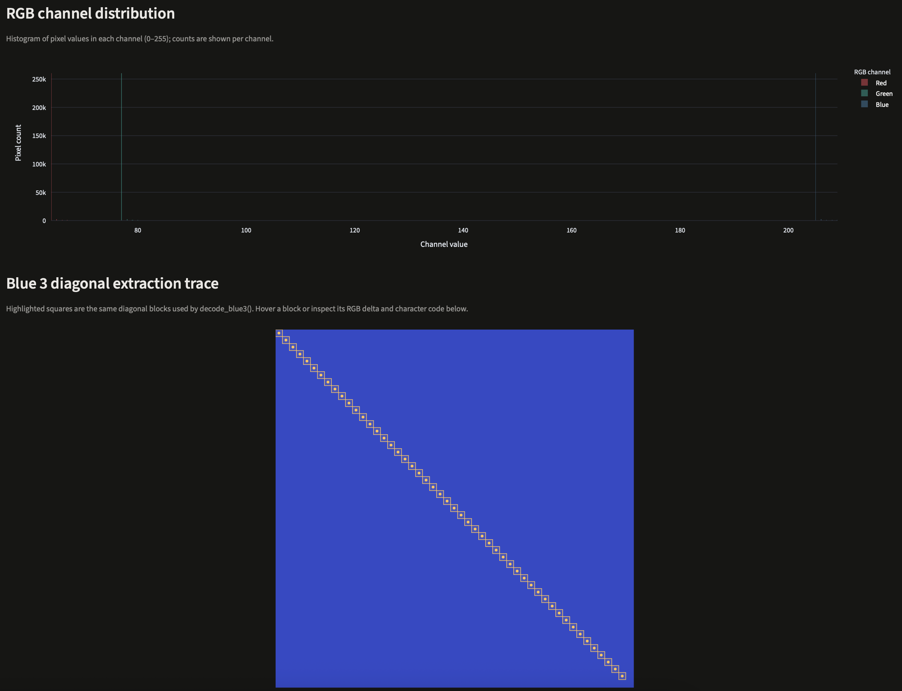
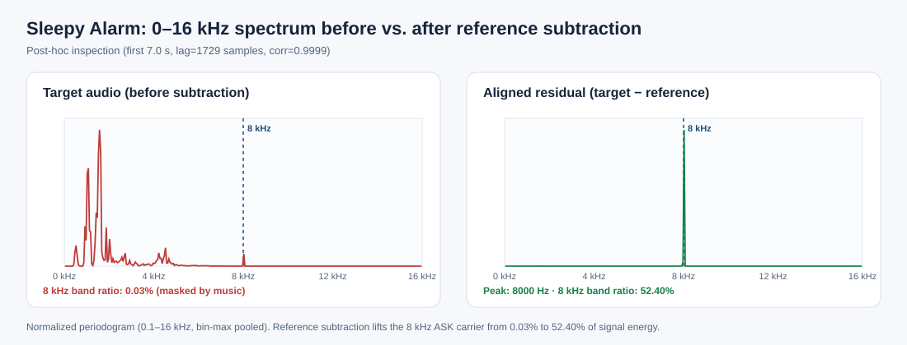
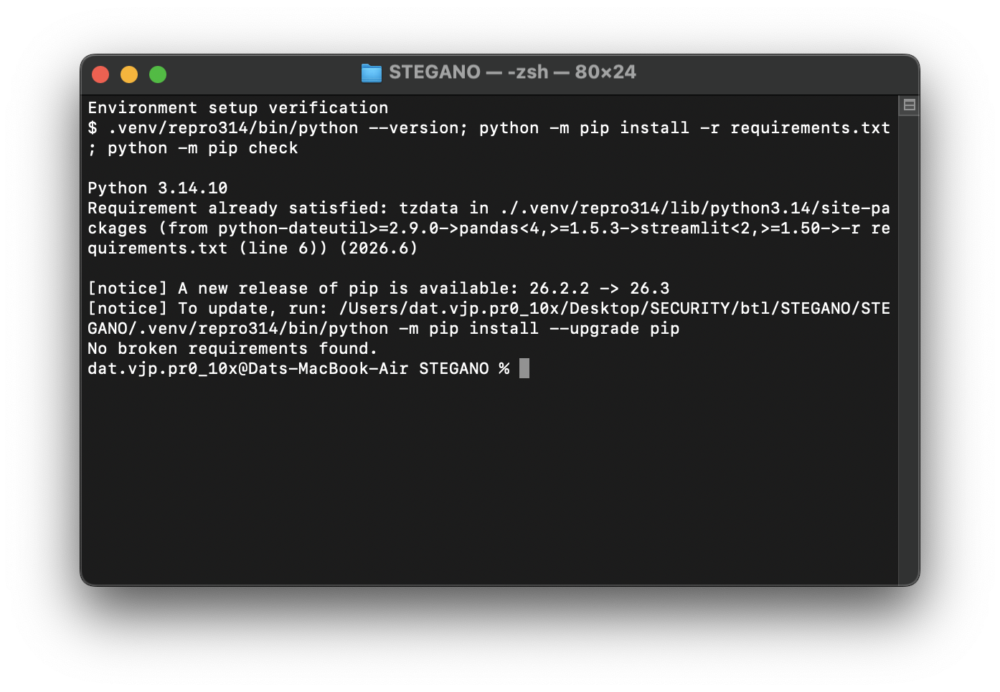
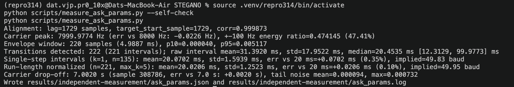

# STEGANO — CTF Jeopardy Practical Project Report

**Course:** UET.CN3124 — Information Security (VNU University of Engineering and Technology)  
**Topic:** Steganography (Blue 3 — Image; Sleepy Alarm — Audio)  
**Student:** Nguyễn Khả Đạt — **Student ID:** 24021404 — **Class:** INT3307E_3  
**Instructor:** Nguyễn Đại Thọ  
**Submission Date:** 27/11/2026  
**Due Date:** 13/12/2026

---

## Abstract

This report documents two standalone decoding pipelines built for Jeopardy-style Steganography CTF challenges across different media formats: **Blue 3** (PNG image, BYU-CSA) and **Sleepy Alarm** (MP3 audio, ImaginaryCTF 2024). All three official input files pass byte-size and SHA-256 verification against `results/artifact_manifest.json`. For Blue 3, summing RGB differences inside diagonal blocks recovers the exact 50-character flag (`byuctf{more_blue_steganography_da_ba_dee_nkiY9CyP}`). For Sleepy Alarm, *reference-assisted* decoding aligns the recordings at a cross-correlation lag of 1,729 samples (normalized correlation 0.9999) and recovers the full 39-character flag (`ictf{1_sl33py_NaYuKi_alarm_2a634dc1bb2}`) across 350 symbols, 38 separators, and 0 byte errors. Running the same audio decoder without the reference track (*reference-free* mode) breaks down: it outputs 26 characters, 49 separators, and 20 malformed byte groups with exit code 2. This failed mode is retained in the repository as an explicit limitation.

On top of the decoders, the project includes a post-hoc signal inspection script (`scripts/inspect_discovery_signals.py`), an independent ASK parameter measurement script (`scripts/measure_ask_params.py`), a 9-variant image robustness test (Blue 3: 1/9 PASS), a 23-trial one-sided audio robustness matrix (Sleepy Alarm: 7/23 PASS), and a 6-variant asymmetric audio sweep (2/6 PASS). It also evaluates a fixed-threshold steganalysis benchmark (image: TP=5, TN=12, FP=0, FN=0; audio: TP=0, TN=8, FP=0, FN=5 — missing every positive sample), a multi-page Streamlit diagnostic app, and an automated quality-gate workflow where all 22/22 `unittest` cases pass. The rest of the report breaks down how both hiding schemes work, how the audio modulation parameters are measured independently, how the pipeline compares with public writeups, what defenders can and cannot catch, and where the current implementation still falls short.

---

## 1. Introduction and Objectives

In **UET.CN3124 — Information Security**, Jeopardy-style Capture The Flag (CTF) tasks require solving focused technical problems to recover a verified flag string [3]. Doing this work builds hands-on evidence extraction skills (CLO4) alongside security risk and defense analysis (CLO5). **Steganography** was selected because it sits directly between signal processing and security: an attacker hides data inside ordinary media files without making them look or sound broken, while a defender has to find statistical or structural anomalies that normal inspection misses.

The project pairs one image task (**Blue 3**) with one audio task (**Sleepy Alarm**) so the evaluation does not lean on a single file format or a textbook least-significant-bit (LSB) trick:

- **Blue 3** hides text in the spatial domain of a PNG file by spreading cumulative RGB shifts relative to the background color across blocks on the main diagonal.
- **Sleepy Alarm** hides data in the time–frequency domain of an MP3 recording using Amplitude-Shift Keying (ASK) at an 8,000 Hz carrier, 50 baud (20 ms/symbol), and three amplitude levels. Extracting it reliably requires sample-level alignment and reference subtraction.

**Why Python (NumPy, SciPy, Pillow, soundfile) Over GUI Tools:** Web and desktop utilities like Aperi'Solve [4] (good for LSB bit-plane views and quick string dumps) or Audacity and Sonic Visualiser (helpful for eyeballing waveforms and spectrograms) work well for first-pass triage. They fall short once the problem leaves standard presets. Neither tool models Blue 3's variable $n \times n$ diagonal RGB-delta grid, nor can they automate sample-accurate cross-correlation alignment, pre-overlap prefix preservation, and globally phased I/Q projection over 350 ASK symbols. Writing the pipeline in Python with NumPy [7], SciPy [8], Pillow [9], and soundfile [10] keeps every run repeatable, testable via `unittest`, and ready for batch robustness sweeps.

| Evaluated Option | Artifact Availability | Automated Reproducibility | Technical Depth | Alignment with UET.CN3124 |
|---|---|---|---|---|
| **Blue 3 + Sleepy Alarm & custom Python pipeline (Selected)** | All 3 official artifacts pinned and SHA-256 verified [1], [2] | High: CLI, 22 `unittest`, benchmark & quality gate | Combines spatial RGB-delta and ASK I/Q signal processing | Covers digital evidence extraction (CLO4) and covert-channel/DLP defense (CLO5) |
| Single basic image LSB challenge | Widely available | Moderate (often lacks negative controls) | Low; inspects only least-significant bits | Reflects only one classical hiding scheme |
| GUI/web tools only (Aperi'Solve, Audacity) | Depends on external UI | Low; manual clicks resist regression testing | Limited for batch I/Q projection and robustness sweeps | Difficult to standardize defensive verification |
| ASK audio challenge without original reference | Lacks clean cover recording | Cannot verify reference subtraction | Risks unquantified guesses on residual noise | Misses reference-assisted vs. reference-free contrast |

**Scope and Work Breakdown:** Within the course's ~30-hour individual workload, the work spans six stages: challenge analysis and decoder coding; unit and regression tests; asymmetric robustness, extended robustness, and steganalysis benchmarks; the Streamlit diagnostic app; automated quality-gate and provenance scripts; and independent parameter measurement, writeup comparison, and report writing. Exact per-task hour totals are omitted here because the durations noted in the logbook are rough self-reported estimates.

---

## 2. Background and Theoretical Foundations

**Steganography vs. Cryptography:** Cryptography scrambles plaintext into ciphertext so nobody can read it, though anyone watching the channel still sees that encrypted traffic is moving. Steganography hides the fact that a message exists at all by tucking it inside an ordinary carrier like a PNG or MP3 [11]. In real deployments, the two are often stacked together.

**Spatial-Domain Image Embedding (RGB Delta):** Instead of flipping only the least-significant bits of single pixels [11], Blue 3 encodes each character as the total color difference $\Delta = \sum_{(x,y)\in B_i} (I(x,y) - B_0)$ over a block $B_i$ compared against the dominant background color $B_0$. When $B_0$ makes up almost the whole image, tiny per-pixel nudges stay invisible to the naked eye, yet their sum across a block lands on an exact ASCII codepoint.

**Audio ASK Modulation and Reference Subtraction:** Amplitude-Shift Keying (ASK) encodes symbols by stepping the amplitude of a sine wave carrier $s(t) = A_k \cos(2\pi f_c t + \phi)$. Here the carrier is very quiet—roughly $10^{-4}$ to $5\times 10^{-3}$, matching the top measured cluster center of $\approx 0.005$—and sits underneath much louder broadband music. Because the music swamps the carrier in every symbol window, raw demodulation fails. Having the clean original track (*reference*) changes the picture: aligning the two recordings in time and taking `target - reference` cancels most of the music, leaving the three ASK amplitude levels exposed.

**How MP3 Compression Affects Subtraction:** MP3 (MPEG-1/2 Layer-3) is a lossy perceptual codec built around filter banks, frame-based Modified Discrete Cosine Transform (MDCT), and psychoacoustic masking [12]. Passing audio through MP3 encoding and decoding typically adds frame-level encoder delay, trims or rounds high frequencies (including near 8 kHz), and leaves slightly different quantization noise each time a file is re-encoded. Because of this, subtracting two MP3s starting at sample 0 rarely works. The decoder must estimate the exact sample lag via cross-correlation first, and even after alignment some residual quantization noise always remains.

---

## 3. Environment and Tools

<a id="report-environment"></a>
<a id="report-artifacts"></a>

**Runtime Environment and Parameter Provenance:** The codebase targets **Python $\ge 3.10$**. All verified reproduction and quality-gate runs from 18 November onward executed on **Python 3.14.10** (CPython) under macOS arm64 (`.venv/repro314`, recorded in `results/final-2026-11-27/provenance.json`). By contrast, the earlier 16 November run's `.venv` interpreter could not be independently verified from historical logs—a supplemental check on 18 November found the pre-existing `.venv` running Python 3.9.6 (below the 3.10 minimum) and the system Python lacking `streamlit`, prompting creation of the isolated Python 3.14.10 environment. Exact package versions are locked in `requirements-lock.txt` (`pip freeze`), while `requirements.txt` keeps looser compatible ranges: NumPy `2.5.5`, Pillow `13.0.0`, SciPy `1.18.1`, SoundFile `0.14.0`, Plotly `6.9.0`, and Streamlit `1.67.0`.

The November 19 run manifest (`results/reproduction-2026-11-19/sleepy-alarm-reference-assisted-manifest.json`) fixes the Sleepy Alarm modulation parameters at an **8,000 Hz** carrier and **50 baud** symbol rate over a **7.0-second** extraction window matched to the 350-symbol framed message. Those settings match the official challenge README [2] and are independently re-measured from the audio in Section 4.3 (`scripts/measure_ask_params.py`) alongside the reproducible post-hoc signal inspection in `scripts/inspect_discovery_signals.py`.

**Input Artifact Integrity:** Running `python scripts/verify_artifacts.py` checks the byte size and SHA-256 hash of all three official inputs in `data/` against `results/artifact_manifest.json`:

| Artifact | Size (bytes) | SHA-256 | Official Source |
|---|---:|---|---|
| `data/blue3/blue.png` | 9,406 | `009dab85bf6ccc5b42b8efa5f959ab6efa0c556b37eb6b4a77a21ec3356b721e` | BYU-CSA [1] |
| `data/sleepy_alarm/morning_n_breakfast.mp3` | 179,283 | `bd181876c2d28152b9c3982fd88945d4e681fd93d49477622ea5841a3ff25ae2` | ImaginaryCTF 2024 [2] |
| `data/sleepy_alarm/morning_n_breakfast_original.mp3` | 160,495 | `d0c283834955e54d68b0bba723ccd194142a428d2de74722e5f1dff3ccbd94ad` | ImaginaryCTF 2024 [2] |

---

## 4. Step-by-Step Methodology

<a id="report-methods"></a>

Every step, hypothesis, intermediate output, and bug fix is logged chronologically in `LOGBOOK.md` and expanded in `report/APPENDIX.md`. The *signal discovery checks* below are **reproducible post-hoc inspections** run via `python scripts/inspect_discovery_signals.py` (`results/final/discovery-signals.json`), followed by independent parameter verification in Section 4.3. Run all commands below from the repository root.

### 4.1. Challenge 1 — Blue 3 (PNG Image)

1. **Structural Discovery Check (post-hoc on raw image):** `data/blue3/blue.png` is $512 \times 512$ px (262,144 pixels) and contains only 49 distinct RGB colors. A single background color `(64, 77, 205)` fills 258,916 pixels (98.77%). Filtering for non-background pixels (`pixels != base`) shows all **3,228 modified pixels** (1.23%) clustered within $|x - y| \le 9\text{ px}$ along the main diagonal (`results/final/discovery-signals.json`), as seen in Figure 1. That tight diagonal band points directly to slicing the image into an $n \times n$ grid and summing RGB deltas in each diagonal cell.
2. **Hypothesis and Command:** Summing RGB offsets from the background color across $n$ diagonal blocks recovers the flag string:
   ```bash
   PYTHONPATH=src python -m stegano blue3 data/blue3/blue.png
   ```
3. **Intermediate and Final Output:** `_decode_blue3` in `src/stegano/image.py` loops `n` from `2` up to `min(w, h)` (`512` for a $512 \times 512$ image), skips any grid size whose block sum falls outside Unicode scalar range `0..0x10ffff`, and **returns immediately on the first candidate matching the `byuctf{...}` flag format**. On `data/blue3/blue.png`, this early exit occurs at $n = 50$, which is why `results/recheck/blue3.log` records 49 candidates (`length=2..50`). Sizes $n=2..49$ return garbled text or clip the closing brace (for instance, $n=49$ outputs `byuctf{more_blue_steganography_da_ba_dee_nkiY9CyP`). At $n=50$, the decoder hits the exact string `byuctf{more_blue_steganography_da_ba_dee_nkiY9CyP}` (`format_valid: true`, exit code 0).
4. **Errors and Fixes:** Initial environment checks (`LOGBOOK.md` Entries 00 and 12) flagged the pre-existing `.venv` running Python 3.9.6 (below 3.10) and a system Python missing `streamlit`. An isolated Python 3.14.10 virtual environment (`.venv/repro314`) was built and verified with `pip check`.
5. **Evidence:** See `LOGBOOK.md` Entry 01, Appendix A.3 (`report/APPENDIX.md`), and Figure 1.



*Figure 1. Streamlit Blue 3 diagnostic view showing the RGB channel histogram concentrated at `(64, 77, 205)` and the 50 decoded blocks along the main diagonal (`evidence/visualization/2026-11-22-blue3-rgb-histogram-diagonal-trace.png`).*

### 4.2. Challenge 2 — Sleepy Alarm (MP3 Audio)

1. **Spectral and Symbol-Timing Check (post-hoc on audio pair):** Before subtraction, the 7.0-second `periodogram` of `morning_n_breakfast.mp3` peaks at 1,598.71 Hz from the background music, and the 7.9–8.1 kHz band holds just **0.03%** (`0.000257`, `results/final/discovery-signals.json`) of total power. (The **0.02%** / `0.000204` figure in `results/steganalysis/benchmark.json` covers the **full 10.02-second file**, whereas **0.03%** covers the **first 7.0-second payload window**.) Once aligned (`lag_samples = 1729`) and subtracted (`target - reference`), the residual spectrum jumps to a sharp peak at **8,000.00 Hz**, pushing the 7.9–8.1 kHz band up to **52.40%** (`0.524009`) of residual energy (Figure 2). Under the **50 baud** (**20 ms/symbol**) modulation rate, both the 32-symbol zoom (`evidence/visualization/2026-11-22-sleepy-first-32-symbols-byte-groups.png`) and Figure 3 align cleanly across the 350-symbol (7.0 s) payload window.
2. **Hypothesis and Commands:** Subtracting the aligned reference exposes three ASK amplitude levels (separator, bit `0`, bit `1`). Running without `--reference` acts as the negative control:
   ```bash
   # Reference-assisted mode
   PYTHONPATH=src python -m stegano sleepy-alarm \
     data/sleepy_alarm/morning_n_breakfast.mp3 \
     --reference data/sleepy_alarm/morning_n_breakfast_original.mp3

   # Reference-free mode (negative control)
   PYTHONPATH=src python -m stegano sleepy-alarm \
     data/sleepy_alarm/morning_n_breakfast.mp3
   ```
3. **Intermediate and Final Output:** In *reference-assisted* mode (`results/reproduction-2026-11-19/sleepy-alarm-reference-assisted-output.json`), alignment locks onto `lag_samples = 1729`, `target_start_sample = 1729`, and correlation `0.9998734358246231` ($\approx 0.9999$). Clustering the 350 I/Q projections produces three clean centers `[0.0001035, 0.0019975, 0.0049727]` (Figure 3), 38 separators, 0 malformed byte groups, and the exact 39-character flag `ictf{1_sl33py_NaYuKi_alarm_2a634dc1bb2}` (exit code 0). Without the reference (`results/recheck/sleepy-alarm-reference-free.log`), the decoder still measures 350 symbols, yet clustering collapses (49 separators, 20 malformed byte groups) into the broken string `ictsl33p_Nauk_arm_224dcb2}` (26 characters, `format_valid: false`, exit code 2).
4. **Bugs Found and Fixes (`LOGBOOK.md` Entry 12):** Before November 19, the decoder ran only on the aligned overlap `x - y`. Whenever alignment started inside an early symbol, that dropped the leading samples of `target` before `target_start_sample`. This was fixed in `src/stegano/audio.py` by prepending `prefix = target[:alignment['target_start_sample']]` and projecting each symbol with global sample indices to keep carrier phase anchored to sample 0. A synthetic regression test in `tests/test_audio.py` shifts the overlap 1.5 symbol periods into the target and verifies the first 16 labels plus the full flag. Separately, running Streamlit `AppTest` in bare mode logs three harmless `missing ScriptRunContext` warnings (all tests still pass), and a misleading green status banner on the Overview page was fixed in `LOGBOOK.md` Entry 16.
5. **Evidence:** See `LOGBOOK.md` Entries 02, 03, and 12, Appendix A.4–A.5 and A.15 (`report/APPENDIX.md`), Figure 2, and Figure 3.



*Figure 2. Comparison of 0–16 kHz `periodogram` power spectra over the first 7.0 s before and after reference alignment subtraction (`report/figures/sleepy-residual-spectrum.svg`, generated by `scripts/inspect_discovery_signals.py`): the 8,000 Hz carrier rises from 0.03% to 52.40% of residual energy.*


*Figure 3. Amplitude distribution across 350 ASK symbols after reference subtraction, showing three well-separated clusters for separator, bit `0`, and bit `1` (`evidence/visualization/2026-11-22-sleepy-ask-symbol-clusters.png`).*

### 4.3. Independent Parameter Determination (Sleepy Alarm)

The Sleepy Alarm modulation and framing values match the official challenge README [2] and are re-measured independently from the audio here using `scripts/measure_ask_params.py` (`results/independent-measurement/ask_params.json`, `results/independent-measurement/ask_params.log`). Because the estimator's thresholds (`height >= 0.25 * p95`, `p10 + 0.20 * (p95 - p10)`, ~5 ms window, 10 ms minimum peak spacing) were chosen after observing the residual signal, this measurement serves as independent verification rather than blind discovery:

1. **Carrier Frequency (8,000 Hz):** Computing the `periodogram` over the entire aligned overlap (`438,912` samples = `9.9527 s` after `lag = 1,729` samples, without truncating to 7 s) finds a dominant spectral peak at **7,999.98 Hz** (`7999.9774 Hz`, error `-0.0226 Hz` relative to 8,000 Hz), with **47.41%** (`0.474145`) of total residual power ($\ge 100\text{ Hz}$) concentrated inside $\pm 100\text{ Hz}$ of the peak. This agrees with the 0–7.0 s residual spectrum in Figure 2 (`8,000.00 Hz` peak, `52.40%` in 7.9–8.1 kHz, `results/final/discovery-signals.json`).
2. **Symbol Rate (50 baud / 20 ms):** Demodulating the residual around the detected spectral peak into a complex baseband envelope smoothed with a **~5 ms** sliding boxcar window (`220` samples = `4.9887 ms` at 44,100 Hz) and locating envelope derivative peaks (`height >= 0.25 * p95`) detects **222 amplitude transitions** (**221 inter-transition intervals**; raw mean `31.3920 ms`, std `17.9522 ms`, median `20.4535 ms`, range `12.3129–99.9773 ms`). Because consecutive identical symbols hold a constant level without an edge, raw intervals span integer multiples $k \cdot T_{\text{sym}}$ ($k \in [1, 5]$). Isolating the shortest cluster `dts_ms <= 1.5 * Q25` gives single-symbol transitions ($k = 1$, $n = 135$) with mean **20.0702 ms** (std `1.5939 ms`, error `+0.0702 ms` / `0.35%` vs. 20 ms, `49.83 baud`); dividing each interval by `k = max(1, round(dt / median(single)))` (without referencing nominal 20 ms) normalizes all 221 intervals to **20.0206 ms** (std `1.2523 ms`, error `+0.0206 ms` / `0.10%` vs. 20 ms, `49.95 baud`).
3. **Active Payload Window (7.0 s):** Rather than acting as an independent modulation parameter, **7.0 s** is the message-framing duration matching the 39-character ASCII payload with 1-symbol byte separators: $(39 \times 8) + 38 = 350\text{ symbols} \times 20\text{ ms/symbol} = 7.00\text{ s}$. Independently, tracking where the ~5 ms carrier envelope falls below `p10 + 0.20 * (p95 - p10)` (`0.001055`) locates the final active carrier drop-off at **7.0020 s** (`sample 308,786`, error `+0.0020 s` vs. 7.0 s), after which the envelope settles to the post-payload noise floor (`tail_mean = 0.000094`, `tail_max = 0.000732` from `7.2020 s` onward).

| Parameter | Nominal Value | Measured Value (independent) | Determination Method | Evidence (Log / Figure) |
|---|---:|---:|---|---|
| Carrier frequency ($f_c$) | 8,000 Hz | 7,999.98 Hz (-0.0226 Hz) | Aligned residual `periodogram` peak & $\pm 100$ Hz power ratio (47.41% full overlap; 52.40% in 0–7 s) | `results/independent-measurement/ask_params.json`, Figure 2 |
| Symbol rate / period | 50 baud (20 ms) | 20.07 ms $\pm$ 1.59 ms ($k=1$); 20.02 ms $\pm$ 1.25 ms ($k$-norm, 49.95 baud) | ~5 ms sliding-window baseband envelope derivative transition spacing | `results/independent-measurement/ask_params.log`, Figure 3 |
| Payload window | 7.0 s | 7.0020 s (+0.0020 s) | Matches 39-char framing ($350 \times 20\text{ ms}$); verified by independent carrier drop-off to noise floor | `results/independent-measurement/ask_params.json` |

---

## 5. Results

<a id="report-results"></a>

The table below compiles every quantitative outcome directly from the saved JSON files and logs in the repository:

| Verification Item | Recorded Outcome | Data Source |
|---|---|---|
| Artifact integrity | **3/3 PASS** (byte size + SHA-256 verified) | `results/artifact_manifest.json` |
| Signal discovery check (post-hoc) | Blue 3: 3,228 px within $\lvert x-y \rvert \le 9$; Audio residual: 8,000 Hz peak (52.40%) | `results/final/discovery-signals.json` |
| Independent ASK parameter measurement | Peak `7,999.98 Hz`; $k$-norm period `20.02 ms` (`49.95 baud`); drop-off `7.0020 s` | `results/independent-measurement/ask_params.json` |
| Blue 3 extraction | **Exact match**, 50 chars: `byuctf{more_blue_steganography_da_ba_dee_nkiY9CyP}` | `results/recheck/blue3.log` |
| Sleepy Alarm (reference-assisted) | **Exact match**, 39 chars: `ictf{1_sl33py_NaYuKi_alarm_2a634dc1bb2}`; 350 symbols, 38 separators, lag 1,729, corr 0.9999, 0 byte errors | `results/reproduction-2026-11-19/sleepy-alarm-reference-assisted-output.json` |
| Sleepy Alarm (reference-free) | **FAIL** — 26 chars, 49 separators, 20 malformed byte groups, `format_valid: false`, exit code 2 | `results/steganalysis/benchmark.json` |
| Sleepy Alarm asymmetric robustness | Baseline **PASS**; one-sided transforms **2/6 PASS** (2 resample PASS, 4 gain FAIL) | `results/asymmetric/asymmetric_robustness.json` |
| Blue 3 extended robustness | **1/9 PASS** (only Gaussian blur r=0.3 achieves exact match) | `results/robustness/blue3_extended_robustness.json` |
| Sleepy Alarm extended robustness | **7/23 PASS** (baseline + gain ×0.75, AWGN SNR 30 dB, resample on each side) | `results/robustness/sleepy_alarm_robustness_matrix.json` |
| Baseline detector — Image | **TP=5, TN=12, FP=0, FN=0** (Precision/Recall/F1 = 1.00 across 17 samples) | `results/steganalysis/benchmark.json` |
| Baseline detector — Audio | **TP=0, TN=8, FP=0, FN=5** (Recall = 0.00 across 13 samples — misses all 5 positives) | `results/steganalysis/benchmark.json` |
| Automated tests & final quality gate | **22/22 unittest PASS** (exit code 0); provenance & archive `verified` | `results/final-2026-11-27/quality-gate.json` |

---

## 6. Technical, Offensive, and Defensive Analysis

### 6.1. Technical Mechanisms, Success Conditions, and Limits

**Blue 3 (`src/stegano/image.py`):** `blue.png` is $512 \times 512$ px with just 49 unique RGB values. The modal background covers **98.77%** of the canvas (`modal_rgb_fraction = 0.987686`), and mean channel standard deviation sits at **0.094** (`results/steganalysis/benchmark.json`). The decoder finds the modal RGB triplet `base`, loops $n \in [2, \min(w,h)]$, skips invalid Unicode sums, and slices $n$ diagonal blocks of size $\lfloor w/n \rfloor \times \lfloor h/n \rfloor$ (`pixels[i*ch:(i+1)*ch, i*cw:(i+1)*cw]`), returning on the first `byuctf{...}` match ($n = 50$). For each block $i$, it adds up every RGB channel difference from `base` ($\text{value} = \sum (\text{block} - \text{base})$ over height, width, and all 3 channels) and converts the sum with `chr(value)`.

- *Success Conditions & Limits:* Any global brightness or contrast change shifts `block - base` across all 100 pixels of a $10 \times 10$ block, edge cropping knocks the grid off the diagonal, and additive noise pushes sums outside printable ASCII. Picking $n = 50$ also depends on knowing the flag format (`candidate.startswith('byuctf{')`, closing `}`, alphanumeric/`_{}`), making selection **format-guided** rather than format-agnostic extraction. First seven blocks from `diagnose_blue3`:

| Block | Coordinates `(x0:x1, y0:y1)` | `rgb_delta` `(ΔR, ΔG, ΔB)` | Sum / Codepoint | Character |
|---:|---|---|---:|---|
| 0 | `(0:10, 0:10)` | `(30, 37, 31)` | 98 | `b` |
| 1 | `(10:20, 10:20)` | `(33, 50, 38)` | 121 | `y` |
| 2 | `(20:30, 20:30)` | `(39, 46, 32)` | 117 | `u` |
| 3 | `(30:40, 30:40)` | `(36, 30, 33)` | 99 | `c` |
| 4 | `(40:50, 40:50)` | `(41, 33, 42)` | 116 | `t` |
| 5 | `(50:60, 50:60)` | `(32, 35, 35)` | 102 | `f` |
| 6 | `(60:70, 60:70)` | `(49, 40, 34)` | 123 | `{` |

**Sleepy Alarm (`src/stegano/audio.py`):** Both MP3 tracks are 44,100 Hz stereo (~10.02 s). The decoder modulates at $f_c = 8{,}000\text{ Hz}$ and $50\text{ baud}$ ($\approx 882\text{ samples/symbol}$), reading the 7.0 s payload window (350 symbols for 39 framed bytes). In reference-assisted mode, `_align` downsamples by `round(sr/4000) = 11` for a fast FFT cross-correlation search, then refines within $\pm 11$ samples at full rate (`lag_samples = 1729`, `correlation = 0.999873`). Prepending `target[:1729]` ahead of `x - y` keeps sample-0 symbol timing and carrier phase intact. `_project_symbol` then runs an unfiltered per-symbol I/Q projection so a whole-file band-pass filter will not smear energy across symbol edges:
$$I_i = \frac{2}{N_i}\sum_{k} (z_k - \bar{z})\cos\!\left(\frac{2\pi f_c k}{f_s}\right),\quad Q_i = \frac{2}{N_i}\sum_{k} (z_k - \bar{z})\sin\!\left(\frac{2\pi f_c k}{f_s}\right),\quad A_i = \sqrt{I_i^2 + Q_i^2}$$
Next, 1D k-means initialized at the 5th, 50th, and 95th percentiles sorts the amplitudes $A_i$ into separator (`' '`), bit `'0'`, and bit `'1'`, and each 8-bit group maps to ASCII.

- *Success Conditions & Limits:* Extraction needs a matching reference file (similar volume, uncropped, untouched in 7.5–8.5 kHz) plus accurate $(f_c, \text{baud}, \text{duration})$ values. Acceptance (`format_valid`) checks for 39 clean 8-bit groups matching `ictf{...}`, verifying challenge format rather than unassisted demodulation. First five bytes (`ictf{`) from `diagnose_sleepy_alarm`: `01101001` (`105`, `i`), `01100011` (`99`, `c`), `01110100` (`116`, `t`), `01100110` (`102`, `f`), `01111011` (`123`, `{`).

### 6.2. Offensive and Defensive Perspective

- **How Attackers Use This & Real-World Risk:** Attackers can abuse spare capacity in routine PNGs or MP3s to run **covert data exfiltration** or low-rate command-and-control (C2) channels past signature-based DLP and firewall rules. Since Blue 3 changes only a thin diagonal band and Sleepy Alarm hides an 8 kHz tone at amplitude $\le 0.005$, normal users will not spot anything wrong by looking or listening.
- **Detection Indicators:** (1) *Blue 3-style images:* lopsided color histograms (>90% identical RGB pixels), near-zero channel standard deviation, and small color shifts along a geometric path. (2) *Sleepy Alarm-style audio:* narrowband energy switching around 8 kHz on 20 ms boundaries (50 baud), or a sharp high-frequency residual when diffed against a clean copy.
- **Defensive Mitigations and Where Light Sanitization Fails:**
  - *Content Disarm and Reconstruction (CDR):* Egress gateways can strip hidden payloads via brightness/contrast scaling, cropping, additive noise, or lossy re-encoding. Yet Section 7.1 proves **light sanitization is insufficient**: *Gaussian blur radius 0.3* on Blue 3 and a *44.1→48→44.1 kHz resampling round-trip* on either Sleepy Alarm file still **PASS** with 100% flag recovery. Even when an image transform breaks exact-match validation (8/9 cases), `brightness ×0.9` still leaves **47/50 character positions intact** (`edit_distance = 3`, `results/robustness/blue3_extended_robustness.json`).
  - *Band Filtering & Gain Shifts (Audio):* A 7.5–8.5 kHz band-pass filter, AWGN at $\le 20\text{ dB}$ SNR, and one-sided gain shifts ($\times 0.25/\times 0.5/\times 1.25/\times 1.5/\times 1.75$) all break decoding (FAIL). Lower-bitrate MP3 re-compression or low-pass filtering should also destroy the carrier in theory, though those transforms were not benchmarked directly here.
- **What the Project's Own Detector Benchmark Actually Shows (`src/steganalysis.py`, `results/steganalysis/benchmark.json`):**
  - *Image:* Hits **TP=5, TN=12, FP=0, FN=0** (F1 = 1.00) because `blue.png` and its four brightness copies have `modal_rgb_fraction = 0.9877 >= 0.90` and `mean_channel_std ≈ 0.094 <= 8.0`. However, this rule would miss payloads in busy natural photos and was tested only against 12 synthetic controls.
  - *Audio:* Scores **TP=0, TN=8, FP=0, FN=5** (Recall = 0.00 — missing all 5 positives). The 50-baud RMS variation check trips (`symbol_block_rms_cv ≈ 0.987 >= 0.15`), yet the global 8 kHz energy ratio misses (`carrier_band_energy_ratio ≈ 0.000204 < 0.02`, 0.02% of whole-file energy—below the synthetic controls at `~0.009`). Broadband music drowns out the weak carrier across the whole track, making a fixed global energy threshold ineffective as a standalone gate.
  - *Remediation:* Replace whole-file energy ratios with narrowband peak-to-local-floor ratios, inspect short-window (20 ms) spectral/cepstral residuals, and calibrate detectors on real media corpora.

| Dimension | Blue 3 (PNG Image) | Sleepy Alarm (MP3 Audio) |
|---|---|---|
| **Embedding Domain** | Spatial domain: cumulative RGB delta across $n$ diagonal blocks | Time–frequency domain: 8 kHz ASK modulation at 50 baud |
| **Challenge Payload Size** | 50 chars in a $512 \times 512$ image *(challenge payload, not max capacity)* | 39 bytes in a 7 s window *(challenge payload, not max capacity)* |
| **Observed Robustness** | 1/9 image variants PASS (`Gaussian blur r=0.3`); `brightness ×0.9` keeps 47/50 positions | 7/23 one-sided trials PASS (baseline + gain ×0.75, AWGN 30 dB, resample on each side) |
| **Detection Indicators (IDS/DLP)** | Extreme modal color dominance (98.77%), low `mean_channel_std` (0.094) | Narrowband 8 kHz peak (0.02% full file / 0.03% 7 s window pre-subtraction; 52.40% 0–7 s & 47.41% full-overlap post-subtraction) |
| **Defensive Mitigations (CDR/Monitoring)** | Strong brightness/contrast scaling, cropping, noise (light blur 0.3 insufficient) | 7.5–8.5 kHz filtering, gain mismatch, strong noise (light resampling insufficient) |
| **Course Alignment (UET.CN3124)** | Image covert exfiltration channel; multimedia inspection at DLP egress | Time–frequency covert channel evading signature filters; covert-channel detection on IDS/DLP |

---

## 7. Custom Extensions and Writeup Comparison

<a id="report-asymmetric-robustness"></a>
<a id="report-benchmark"></a>
<a id="report-extended-robustness"></a>

### 7.1. Reference-Assisted vs. Reference-Free & Core Evaluation Takeaways

Beyond solving both base challenges, the project implements extended robustness matrices (`scripts/run_extended_robustness.py`, Figure 4) and a fixed-threshold steganalysis benchmark (`scripts/run_steganalysis_benchmark.py`, Figure 5). Secondary extensions—the 6-variant asymmetric audio sweep (`scripts/run_audio_asymmetric.py`), the 3-page Streamlit diagnostic app (`visualization/app.py`), open-source tool scope comparison, and the automated quality gate (`scripts/verify_reproducibility.py`)—are documented in Appendices A and B.

- **Blue 3 Extended Robustness (`results/robustness/blue3_extended_robustness.json`):** **1/9 PASS** under strict criteria (`format_valid`, exact ground-truth match, 0 errors). Only *Gaussian blur radius 0.3* keeps all 50 characters intact; brightness ($\times 0.9/\times 1.1$), contrast ($\times 0.9/\times 1.1$), 16 px crop, and Gaussian noise ($\sigma = 0.5/1.0/2.0$) all FAIL, although `brightness ×0.9` retains 47/50 character positions.
- **Sleepy Alarm Extended Robustness (`results/robustness/sleepy_alarm_robustness_matrix.json`):** **7/23 PASS** — baseline plus six one-sided trials (gain $\times 0.75$, AWGN SNR 30 dB, and 44.1→48→44.1 kHz resampling round-trip on `target` and `reference` individually). All 16 remaining trials (gain $\times 0.25/\times 0.5/\times 1.25/\times 1.5/\times 1.75$, AWGN SNR 20/10 dB, and 7.5–8.5 kHz band-pass on each side) FAIL.
- **Reference-Assisted vs. Reference-Free Contrast (`results/steganalysis/benchmark.json`):** Reference-assisted mode achieves exact 39-character recovery (`350` symbols, `38` separators, `0` errors), whereas reference-free mode breaks down (`26` chars, `49` separators, `20` malformed byte groups, exit code 2).


*Figure 4. PASS/FAIL breakdown across 9 Blue 3 image variants and 23 Sleepy Alarm audio trials (`report/figures/robustness-heatmaps.svg`, source `results/recheck/robustness/`).*


*Figure 5. Confusion matrices for the fixed-threshold baseline detectors: 17 image samples (F1 = 1.00) and 13 audio samples (FN = 5/5, Recall = 0.00) (`report/figures/benchmark-confusion-matrices.svg`).*

### 7.2. Comparison with Public Writeups and Official Sources

To situate this project's methodology against public CTF solutions, the project verified the official ImaginaryCTF 2024 Sleepy Alarm challenge record (author `Minerva`, Forensics, Medium; description noting *"an extra jingle"* in the alarm audio and official hint fixing the flag length at 39 characters) [2], Cook1e's public ImaginaryCTF 2024 writeup [13], and the official BYU-CSA Blue 3 challenge specification (`Blue 3?`, Hard, flag format `byuctf{[0-9a-zA-Z_]*}`, diagonal RGB-difference mechanism) [1]. No external third-party blog writeup was used or cited for Blue 3. All quantitative figures reported in Sections 4–7 come from the project's own measurements rather than external writeups.

| Aspect / Parameter | Cook1e Public Writeup [13] | This Project's Pipeline | Verification Status |
|---|---|---|---|
| **Anomalous ~8 kHz component** | Observed in Audacity spectrogram around 8 kHz | Measured peak at `8,000.00 Hz` (0–7 s) and `7,999.98 Hz` (full overlap) | **Confirmed** in writeup |
| **ASK modulation scheme** | Identified post-CTF as Amplitude-Shift Keying | Modeled explicitly via per-symbol I/Q projection + 3-cluster k-means | **Confirmed** in writeup |
| **Recovered flag** | `ictf{1_sl33py_NaYuKi_alarm_2a634dc1bb2}` (manual read) | Exact match (`format_valid: true`, 39 chars, 0 byte errors) | **Confirmed** in writeup |
| **Signal isolation method** | Manual Audacity `Graphic EQ` (2–3 passes) + `Vocal Reduction and Isolation` (`remove center`) | Automated FFT cross-correlation alignment (`lag = 1,729`, corr `0.9999`) + `target - reference` subtraction | Different method (**Not** in writeup) |
| **50 baud / 20 ms symbol rate** | Not reported | Measured independently via ~5 ms envelope transitions (`20.02 ms` $k$-norm, `49.95 baud`); matches official README [2] | **Not confirmed** in Cook1e writeup |
| **Three amplitude levels (`sep`, `0`, `1`)** | Not quantified (decoded manually from waveform) | Measured cluster centers `[0.0001035, 0.0019975, 0.0049727]`; official README states `0`, `2e-3`, `5e-3` [2] | **Not confirmed** in Cook1e writeup |
| **7.0 s / 350-symbol framing** | Not reported | 350 symbols = $(39\times 8)+38$; independent carrier drop-off at `7.0020 s` | **Not confirmed** in Cook1e writeup |
| **Automated decoder & negative control** | Manual decoding only (first noisy pass gave garbled chars) | CLI + `unittest` + prefix preservation + reference-free FAIL + robustness/detector suites | **Project-only contribution** |

**Manual Writeup Approach vs. Reference-Assisted Pipeline:** Cook1e's GUI workflow in Audacity [13] shows that aggressive manual EQ and `remove center` stereo vocal isolation can solve Sleepy Alarm without locating the original reference track, but it is labor-intensive, sensitive to manual threshold tuning (producing an initial garbled read before teammate refinement), and non-repeatable across files. Conversely, the project's reference-assisted pipeline is fast, deterministic, sample-accurate, and directly testable under controlled perturbations (`2/6` asymmetric and `7/23` extended robustness), while keeping the failed reference-free path in the codebase to show precisely why reference-free extraction breaks without equalization or stereo cancellation.

---

## 8. Evaluation, Limitations, and Lessons Learned

<a id="report-reflection"></a>
<a id="report-limitations"></a>

**Main Hurdles:** Three snags stood out during development: (1) an initial mismatch between Python 3.9.6 in the pre-existing `.venv` and the project's $\ge 3.10$ / 3.14.10 environment; (2) an early ASK decoder bug that silently clipped the target prefix before the overlap window; and (3) total failure (5/5 false negatives) of the whole-file 8 kHz energy-ratio audio detector due to broadband music masking.

**Scope Limitations:**

- Exact-match tests prove recovery on three fixed challenge files with known flag formats (`byuctf{...}` and `ictf{...}`). They do not prove unassisted payload discovery or generalization to unseen challenges.
- Sleepy Alarm exact-match recovery depends on having the clean reference track. *Reference-free* mode fails and stays in the repository as a negative result.
- The steganalysis benchmark (17 image, 13 audio samples) relies on deterministic synthetic clean controls rather than real-world media corpora, and the 1/9 and 7/23 robustness numbers reflect one artifact per challenge under the chosen transforms.
- Time estimates in Logbook Entries 06–10 are self-reported, not stopwatch logs. SHA-256 checks prove byte-for-byte identity against the pinned manifest, not publisher authenticity.
- Because `requirements.txt` uses open version ranges, `requirements-lock.txt` pins the verified Python 3.14.10 environment.

**How Assumptions Changed & Links to Literature:** Early on, the Sleepy Alarm decoder subtracted and demodulated only the aligned overlap `x - y`. Boundary testing showed that an overlap starting mid-symbol drops leading samples and shifts carrier phase, motivating the `prefix = target[:target_start_sample]` fix and the 1.5-symbol regression test in `tests/test_audio.py`. The measured data also aligns with Petitcolas et al. [11] on the trade-off between imperceptibility, capacity, and fragility (Blue 3 leaves 98.77% of pixels untouched yet fails exact-match under mild pixel tweaks), and with Brandenburg [12] on how MDCT/MP3 coding introduces frame delay and spectral quantization noise—though the measured `lag_samples = 1729` is treated strictly as an observed cross-correlation offset rather than attributed to encoder delay alone.

**Lessons Learned and Next Steps:** Anchoring phase and timing to sample 0—and backing it up with synthetic edge-case unit tests—catches signal bugs that happy-path challenge files hide. On the defense side, global-energy heuristics fail whenever a weak narrowband carrier sits inside loud broadband audio. Three concrete next steps follow: (i) benchmark real **MP3 re-compression** at 128/96/64 kbps (`ffmpeg`/`lame` on temporary copies); (ii) replace global energy ratios in `src/steganalysis.py` with narrowband peak-to-local-floor ratios; and (iii) explore reference-free ASK demodulation using local envelope tracking, stereo center subtraction, and carrier synchronization (Costas loop / PLL).

---

## 9. Conclusion

This project built, tested, and documented independent decoders, independent parameter verification, and defensive evaluation suites for two Steganography CTF challenges (Blue 3 and Sleepy Alarm). Both official flags are recovered cleanly, all 3/3 artifacts and 22/22 `unittest` cases clear the quality gate, independent signal measurements confirm the 8 kHz / 50 baud / 7.0 s payload structure, and every negative result (*reference-free* FAIL, audio detector FN=5/5, and the 1/9 and 7/23 robustness limits) is reported openly to show where real-world defensive checks hold up and where they break.

---

## References

[1] BYU-CSA, "blue-3 (Forensics/Steganography CTF Challenge)," *old-ctf-challenges*, GitHub. [Online]. Available: https://github.com/BYU-CSA/old-ctf-challenges/tree/master/forensics-steganography/blue-3 [Accessed: Nov. 27, 2026].

[2] ImaginaryCTF, "Sleepy Alarm (Forensics CTF Challenge)," *ImaginaryCTF-2024-Challenges*, GitHub, 2024. [Online]. Available: https://github.com/ImaginaryCTF/ImaginaryCTF-2024-Challenges/tree/main/Forensics/Sleepy%20Alarm [Accessed: Nov. 27, 2026].

[3] CTFtime, "All about CTF (Capture The Flag)," *CTFtime.org*. [Online]. Available: https://ctftime.org/ctf-wtf/

[4] Zeecka, "Aperi'Solve — Online platform which performs layer analysis on image," GitHub. [Online]. Available: https://github.com/Zeecka/AperiSolve

[5] P. Kaczmarek, "The-A-Files — Audio steganography evaluation framework," GitHub. [Online]. Available: https://github.com/pawel-kaczmarek/The-A-Files

[6] R. Gibson, "Steganography (WavSteg) — LSB steganography for WAV files," GitHub. [Online]. Available: https://github.com/ragibson/Steganography

[7] NumPy Developers, "NumPy Documentation," *numpy.org*. [Online]. Available: https://numpy.org/doc/stable/

[8] SciPy Developers, "SciPy Documentation," *scipy.org*. [Online]. Available: https://docs.scipy.org/doc/scipy/

[9] A. Clark et al., "Pillow (PIL Fork) Documentation," *Read the Docs*. [Online]. Available: https://pillow.readthedocs.io/en/stable/

[10] B. Bechtold, "python-soundfile Documentation," *Read the Docs*. [Online]. Available: https://python-soundfile.readthedocs.io/en/latest/

[11] F. A. P. Petitcolas, R. J. Anderson, and M. G. Kuhn, "Information hiding—a survey," *Proceedings of the IEEE*, vol. 87, no. 7, pp. 1062–1078, Jul. 1999, doi: 10.1109/5.771065.

[12] K. Brandenburg, "MP3 and AAC Explained," *Proc. AES 17th Int. Conf.: High-Quality Audio Coding*, Florence, Italy, Sep. 1999. [Online]. Available: https://www.iis.fraunhofer.de/content/dam/iis/de/doc/ame/conference/AES-17-Conference_mp3-and-AAC-explained_AES17.pdf

[13] Cook1e, "Imaginary CTF 2024," Jul. 21, 2024. [Online]. Available: https://0xcook1e.github.io/posts/imaginaryctf24/ (canonical: https://cookie.is-a.dev/posts/imaginaryctf24/) [Accessed: Nov. 27, 2026].

---

## Appendix

<a id="report-quality-gate-provenance"></a>

### A. Quality Gate and Provenance Summary

The verification runner (`scripts/verify_reproducibility.py`) runs `scripts/verify_artifacts.py`, `unittest discover -s tests -v`, and `scripts/check_provenance.py` in sequence. For `submission_package_current.zip`, provenance checks CRC integrity (`testzip()`), required files, full member lists, and byte-for-byte parity against the working tree (skipping self-referential quality-gate outputs during byte comparison to avoid hash loops, while still verifying their presence and CRC).

| Check | Snapshot 22/11 (`results/verification/`) | Recheck (`results/recheck/`) | Final Run (`results/final-2026-11-27/`) |
|---|---|---|---|
| Unittest | **22/22 PASS** (exit 0) | **22/22 PASS** (exit 0) | **22/22 PASS** (exit 0) |
| Artifact integrity | **3/3 verified** | **3/3 verified** | **3/3 verified** |
| Provenance | `verified` (30 hashed files) | `verified` (95 hashed files) | `verified` (99 hashed files) |
| `submission_package` | `not_verified` | `verified` (159 members) | `verified` (176 members) |


*Figure A.1. Quality-gate summary rendered from `results/recheck/quality-gate.json` and `results/recheck/provenance.json` (`report/figures/quality-gate-summary.svg`, generated by `scripts/render_report_figures.py` which targets `results/recheck/`); the final run in `results/final-2026-11-27/` preserves the PASS state with 99 inventoried files and 176 archive members.*


*Figure A.2. End-to-end provenance and archive verification flow converging at the quality gate (`report/figures/provenance-flow.svg`).*

<a id="report-visualization"></a>

### B. Streamlit Dashboard and Secondary Benchmarks

1. **Asymmetric Audio Robustness Experiment (`scripts/run_audio_asymmetric.py`):** Applies gain ($\times 0.5$, $\times 1.5$) or a resampling round-trip ($44.1 \to 48 \to 44.1\text{ kHz}$) to only one side (`target` or `reference`) at a time. In `results/asymmetric/asymmetric_robustness.json`, the unmodified baseline PASSES, while one-sided runs hit **2/6 PASS**:

   | Modified File | Gain ×0.5 | Gain ×1.5 | Resample 44.1→48→44.1 kHz |
   |---|---|---|---|
   | **Target** | **FAIL** (28 chars, 14 byte errors) | **FAIL** (34 chars, 4 byte errors) | **PASS** (39 chars, 0 byte errors) |
   | **Reference** | **FAIL** (36 chars, 5 byte errors) | **FAIL** (33 chars, 4 byte errors) | **PASS** (39 chars, 0 byte errors) |

2. **Streamlit Diagnostic Dashboard (`visualization/app.py`):** A 3-page Streamlit interface (`visualization/app.py`, `visualization/pages/1_Blue_3.py`, `visualization/pages/2_Sleepy_Alarm.py`) displays artifact integrity, Blue 3 RGB histograms and diagonal blocks, and Sleepy Alarm resampling, cross-correlation alignment, residuals, ASK symbol clustering, first-32-symbol zoom, and asymmetric robustness.
3. **Open-Source Tool Scope Comparison (`results/steganalysis/benchmark.json`):** Project scope was compared (without executing third-party binaries) against Aperi'Solve [4] (image/bit-plane triage), The-A-Files [5] (audio steganography robustness framework), and WavSteg [6] (WAV LSB).

### C. Detailed Record Cross-References

- Full chronological experiment log (Entries 00–17): `LOGBOOK.md` (independent ASK measurement and final verification records are stored in `results/independent-measurement/` and `results/final-2026-11-27/`)
- Detailed per-run appendix records (A.1–A.19): `report/APPENDIX.md`
- Reproduce post-hoc signal discovery metrics and residual spectrum SVG (`results/final/discovery-signals.json`, `report/figures/sleepy-residual-spectrum.svg`):
  ```bash
  python scripts/inspect_discovery_signals.py
  ```
- Reproduce independent ASK parameter measurements (`results/independent-measurement/ask_params.json`, `results/independent-measurement/ask_params.log`):
  ```bash
  python scripts/measure_ask_params.py --self-check
  python scripts/measure_ask_params.py
  ```
- Re-render the four static report SVG figures from `results/recheck/`:
  ```bash
  python scripts/render_report_figures.py
  ```
- Re-run the quality gate into a new results directory (e.g., `results/final-2026-11-27/`):
  ```bash
  python scripts/create_submission_zip.py
  python scripts/verify_reproducibility.py \
    --output results/final-2026-11-27/quality-gate.json \
    --provenance-output results/final-2026-11-27/provenance.json \
    --log-output results/final-2026-11-27/reproducibility.log
  ```

### D. Terminal Execution Evidence

The seven unaltered terminal screenshots below from `evidence/terminal/` show environment setup, decoding for both challenges (including the reference-free negative control), unit tests, artifact/provenance checks, and independent ASK parameter measurement:



*Figure D.1. Python 3.14.10 environment verification, dependency check against `requirements.txt`, and clean `pip check` (`evidence/terminal/2026-11-18-setup-terminal.png`).*


*Figure D.2. Blue 3 decoder terminal output recovering the 50-character flag `byuctf{more_blue_steganography_da_ba_dee_nkiY9CyP}` (`evidence/terminal/2026-11-18-blue3-terminal.png`).*


*Figure D.3. Sleepy Alarm reference-assisted decoder output: `format_valid: true`, 350 symbols, 38 separators, 1,729-sample lag, 0 byte errors (`evidence/terminal/2026-11-18-audio-assisted-terminal.png`).*


*Figure D.4. Negative control in reference-free mode (`reference_free`): `status: FAIL`, `format_valid: false`, 26 characters, 49 separators, and 20 malformed byte groups (`evidence/terminal/2026-11-20-reference-free-audio-failure-terminal.png`).*


*Figure D.5. Full 22-test `unittest` run passing (`Ran 22 tests in 2.634s — OK`) with non-fatal Streamlit bare-mode `AppTest` warnings (`evidence/terminal/2026-11-22-unittest-22-tests-passed-terminal.png`).*


*Figure D.6. SHA-256 verification of all 3/3 official artifacts and `scripts/check_provenance.py` execution (`evidence/terminal/2026-11-22-artifact-and-provenance-terminal.png`).*



*Figure D.7. Independent Sleepy Alarm ASK parameter verification (`scripts/measure_ask_params.py --self-check` and `scripts/measure_ask_params.py`) executed locally on the student's machine (`evidence/terminal/2026-11-27-independent-ask-measurement-terminal.png`).*
